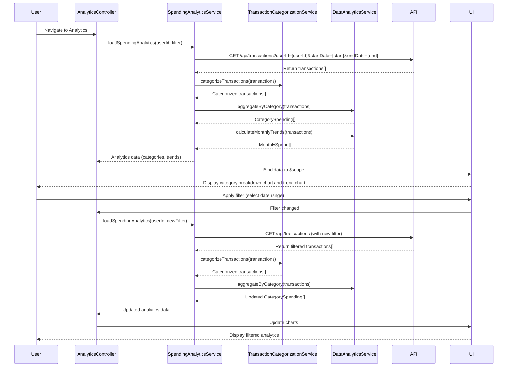

# Low-Level Design: QE-9680 - Category-wise Spending Analytics and Visualizations

## a. Architecture Mapping

**AngularJS Artifacts:**
- **analyticsModule** (Module) - Root module for analytics and visualization feature
- **AnalyticsController** (Controller) - Manages analytics view state and user interactions
- **SpendingAnalyticsService** (Service) - Orchestrates data retrieval and aggregation for spending analytics
- **TransactionCategorizationService** (Service) - Classifies transactions into 9 predefined categories
- **DataAnalyticsService** (Service) - Performs trend calculations and pattern analysis
- **categoryBreakdownDirective** (Directive) - Renders category-wise spending breakdown chart (pie/donut)
- **trendChartDirective** (Directive) - Displays monthly spend trend line chart
- **categoryFilterDirective** (Directive) - Provides interactive filtering controls for drill-down

**Recommended Folder Structure:**
```
app/
├── modules/
│   └── analytics/
│       ├── controllers/
│       │   └── analytics.controller.js
│       ├── services/
│       │   ├── spending-analytics.service.js
│       │   ├── transaction-categorization.service.js
│       │   └── data-analytics.service.js
│       ├── directives/
│       │   ├── category-breakdown.directive.js
│       │   ├── trend-chart.directive.js
│       │   └── category-filter.directive.js
│       ├── views/
│       │   └── analytics.html
│       └── analytics.module.js
```

## b. Component Specifications

| Component Name | Artifact Type | Responsibility | Key Dependencies |
|---|---|---|---|
| analyticsModule | Module | Root module declaration and routing setup | ngRoute, Chart.js, analyticsService |
| AnalyticsController | Controller | Manages analytics view lifecycle, handles filter changes, coordinates data loading | SpendingAnalyticsService, $scope, $filter |
| SpendingAnalyticsService | Service | Fetches transaction data, orchestrates categorization and trend analysis | TransactionCategorizationService, DataAnalyticsService, $http, $q |
| TransactionCategorizationService | Service | Classifies transactions into 9 categories (Food & Dining, Fuel, Shopping, Travel, Entertainment, Utilities, Healthcare, Education, Miscellaneous) | None (business logic) |
| DataAnalyticsService | Service | Aggregates spending by category and month, calculates trends and patterns | $q |
| categoryBreakdownDirective | Directive | Renders interactive pie/donut chart showing category-wise spending distribution | Chart.js |
| trendChartDirective | Directive | Renders line chart displaying monthly spend trends with drill-down capability | Chart.js |
| categoryFilterDirective | Directive | Provides date range and category filter controls for interactive analysis | $filter |

## c. Data Model

**Transaction Model:**
```javascript
class Transaction {
  transactionId: String
  userId: String
  cardId: String
  amount: Number
  transactionDate: Date
  merchant: String
  category: String (one of 9 predefined categories)
  description: String
}
```

**CategorySpending Model:**
```javascript
class CategorySpending {
  category: String
  totalAmount: Number
  transactionCount: Number
  percentage: Number
  monthlyBreakdown: Array<MonthlySpend>
}
```

**MonthlySpend Model:**
```javascript
class MonthlySpend {
  month: String (YYYY-MM format)
  amount: Number
  transactionCount: Number
}
```

**AnalyticsFilter Model:**
```javascript
class AnalyticsFilter {
  startDate: Date
  endDate: Date
  selectedCategories: Array<String>
  cardId: String (optional)
}
```

## d. Data Flow

User navigates to analytics view → AnalyticsController initializes with default filter (current month) → SpendingAnalyticsService fetches user transactions via REST API (`GET /api/transactions?userId={userId}&startDate={start}&endDate={end}`) → TransactionCategorizationService validates/assigns category to each transaction → DataAnalyticsService aggregates spending by category and calculates monthly trends → SpendingAnalyticsService returns CategorySpending array and MonthlySpend data → AnalyticsController binds data to $scope → categoryBreakdownDirective renders pie chart showing category distribution → trendChartDirective renders line chart with monthly trends → User applies filter (date range or category selection) via categoryFilterDirective → AnalyticsController updates filter and triggers data refresh → Charts re-render with filtered data → User clicks on chart segment for drill-down → Controller displays detailed transaction list for selected category/month.

## e. Primary Sequence Diagram



## f. Implementation Notes

- Use AngularJS 1.x with ES6 classes; integrate Chart.js library for rendering interactive charts (pie, donut, line charts).
- Implement dependency injection using `$inject` annotation; define analyticsModule with `angular.module('analyticsModule', ['ngRoute'])`.
- Use `$http` service for REST API calls with promise-based error handling; implement response caching for repeated queries within session.
- Wrap Chart.js in AngularJS directives (categoryBreakdownDirective, trendChartDirective) with isolated scope; use `$watch` to update charts on data changes.
- Implement client-side filtering using AngularJS `$filter` service for date range and category selection; ensure charts re-render within 3-second NFR using efficient data binding and chart update methods.

## g. Error Handling

HTTP interceptor-based error handling for API failures with user-friendly toast notifications; try/catch in aggregation logic with fallback to empty state display.

## h. Security Notes

Requires token-based auth via existing SSO; transaction data filtered by authenticated userId; standard input validation for filter parameters.