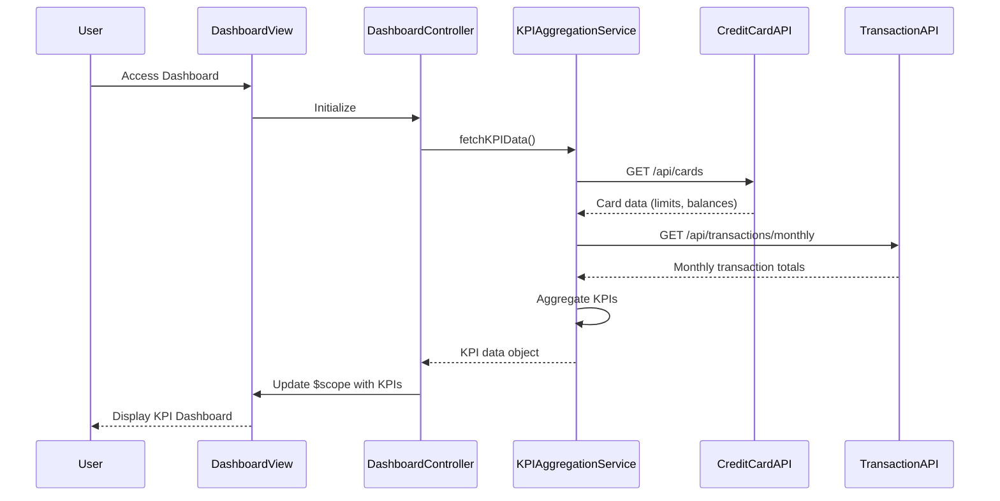

# Low-Level Design: Dashboard and KPI Management
**Epic ID:** QE-9681  
**Epic Title:** CreditCardNew20261110203452-Dashboard and KPI Management

---

## a. Architecture Mapping

**AngularJS Artifacts:**
- **Module**: `dashboardModule` - Main module for dashboard functionality
- **Controller**: `DashboardController` - Manages KPI display and user interactions
- **Service**: `KPIAggregationService` - Fetches and aggregates KPI data from backend APIs
- **Directive**: `kpiCardDirective` - Reusable component for displaying individual KPI metrics
- **Factory**: `CreditCardDataFactory` - Handles credit card data retrieval and caching

**Folder Structure:**
```
/app
  /modules
    /dashboard
      dashboard.module.js
      dashboard.controller.js
      dashboard.html
      /services
        kpi-aggregation.service.js
        creditcard-data.factory.js
      /directives
        kpi-card.directive.js
      /styles
        dashboard.css
```

---

## b. Component Specifications

| Name | Artifact Type | Responsibility | Key Dependencies |
|------|---------------|----------------|------------------|
| dashboardModule | Module | Registers all dashboard components and configures routing | angular, ui-router |
| DashboardController | Controller | Orchestrates KPI data retrieval, manages view state, handles refresh actions | KPIAggregationService, $scope, $interval |
| KPIAggregationService | Service | Fetches KPI data from REST APIs, performs client-side aggregation, implements caching | $http, $q, CreditCardDataFactory |
| CreditCardDataFactory | Factory | Retrieves credit card balance and limit data, manages data cache | $http, $q |
| kpiCardDirective | Directive | Renders individual KPI metric with responsive layout and real-time updates | None |

---

## c. Data Model

**KPIDashboard Model:**
```javascript
{
  monthlySpend: Number,           // Total spending for current month
  totalCreditLimit: Number,       // Sum of all card credit limits
  availableCredit: Number,        // Total limit - outstanding amount
  outstandingAmount: Number,      // Total balance across all cards
  lastUpdated: Date,              // Timestamp of last data refresh
  cards: Array<CreditCard>        // Array of individual card objects
}
```

**CreditCard Model:**
```javascript
{
  cardId: String,                 // Unique card identifier
  cardNumber: String,             // Masked card number (last 4 digits)
  creditLimit: Number,            // Card credit limit
  currentBalance: Number,         // Outstanding balance
  availableCredit: Number         // Limit - balance
}
```

---

## d. Data Flow

User accesses the dashboard view → DashboardController initializes and calls KPIAggregationService → Service invokes CreditCardDataFactory to fetch card data via REST API (`GET /api/cards`) → Service calls Transaction API (`GET /api/transactions/monthly`) to retrieve monthly spend → Service aggregates data client-side (calculates totals, available credit) → Aggregated KPI data is bound to $scope → View renders KPI metrics using kpiCardDirective with responsive Bootstrap grid → User sees real-time KPIs; auto-refresh via $interval updates data every 30 seconds.

---

## e. Primary Sequence Diagram



---

## f. Implementation Notes

- Use AngularJS 1.x dependency injection for all services and controllers; register components via `angular.module()` pattern
- Implement ES6 classes for services and factories; use arrow functions for callbacks and promises
- Leverage Bootstrap responsive grid (col-xs/sm/md/lg) in dashboard.html for cross-device layout; CSS3 media queries for fine-tuning
- Use $http service with promise chaining ($q) for REST API calls; implement response interceptor for error handling
- Apply $interval service for 30-second auto-refresh; cancel interval on $scope.$destroy to prevent memory leaks

---

## g. Error Handling

HTTP interceptor captures API errors and displays user-friendly notifications via toaster service; try/catch blocks in service methods with fallback to cached data.

---

## h. Security Notes

Requires token-based auth via existing SSO; JWT token passed in Authorization header for all API calls.