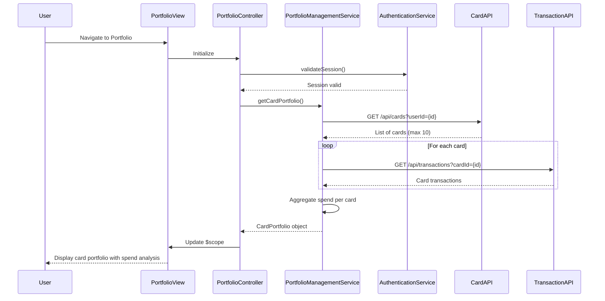

# Low-Level Design: Credit Card Portfolio Management
**Epic ID:** QE-9682  
**Epic Title:** CreditCardNew20261110203452-Credit Card Portfolio Management

---

## a. Architecture Mapping

**AngularJS Artifacts:**
- **Module**: `portfolioModule` - Main module for portfolio management
- **Controller**: `PortfolioController` - Manages card list display and spend analysis
- **Service**: `PortfolioManagementService` - Orchestrates card data and transaction retrieval
- **Service**: `AuthenticationService` - Handles user authentication and session management
- **Directive**: `cardDetailDirective` - Displays individual card information with masked number
- **Factory**: `TransactionHistoryFactory` - Fetches card-specific transaction data

**Folder Structure:**
```
/app
  /modules
    /portfolio
      portfolio.module.js
      portfolio.controller.js
      portfolio.html
      /services
        portfolio-management.service.js
        authentication.service.js
        transaction-history.factory.js
      /directives
        card-detail.directive.js
      /styles
        portfolio.css
```

---

## b. Component Specifications

| Name | Artifact Type | Responsibility | Key Dependencies |
|------|---------------|----------------|------------------|
| portfolioModule | Module | Registers portfolio components, configures routes with authentication guard | angular, ui-router, AuthenticationService |
| PortfolioController | Controller | Manages card list, handles card selection, triggers spend analysis | PortfolioManagementService, $scope, $filter |
| PortfolioManagementService | Service | Coordinates card data retrieval and transaction aggregation, enforces 10-card limit | $http, $q, TransactionHistoryFactory, AuthenticationService |
| AuthenticationService | Service | Validates user session, manages auth tokens, enforces secure card access | $http, $window |
| cardDetailDirective | Directive | Renders card details with masked number, displays spend metrics, handles card selection | $filter |
| TransactionHistoryFactory | Factory | Retrieves card-specific transactions via REST API, caches transaction data | $http, $q |

---

## c. Data Model

**CardPortfolio Model:**
```javascript
{
  userId: String,                 // Authenticated user ID
  cards: Array<CreditCard>,       // Array of up to 10 cards
  totalSpend: Number,             // Aggregated spend across all cards
  lastUpdated: Date               // Last data refresh timestamp
}
```

**CreditCard Model:**
```javascript
{
  cardId: String,                 // Unique card identifier
  cardNumber: String,             // Masked (e.g., "****1234")
  cardType: String,               // Visa, Mastercard, etc.
  creditLimit: Number,
  currentBalance: Number,
  monthlySpend: Number,           // Current month spend for this card
  transactions: Array<Transaction> // Recent transactions
}
```

**Transaction Model:**
```javascript
{
  transactionId: String,
  cardId: String,
  amount: Number,
  date: Date,
  merchant: String,
  category: String
}
```

---

## d. Data Flow

User logs in → AuthenticationService validates credentials and stores JWT token → User navigates to portfolio view → PortfolioController calls PortfolioManagementService.getCardPortfolio() → Service retrieves card list via REST API (`GET /api/cards?userId={id}`) → For each card, TransactionHistoryFactory fetches transactions (`GET /api/transactions?cardId={id}&month=current`) → Service aggregates monthly spend per card client-side → Card data with spend analysis is bound to $scope → View renders card list using cardDetailDirective with masked numbers → User clicks a card to view detailed spend analysis.

---

## e. Primary Sequence Diagram



---

## f. Implementation Notes

- Use ui-router resolve to enforce authentication before portfolio route activation; redirect to login if session invalid
- Implement ES6 Promise.all() in PortfolioManagementService to fetch transactions for multiple cards in parallel
- Apply AngularJS $filter service to mask card numbers in cardDetailDirective (display last 4 digits only)
- Use Bootstrap card components for responsive card layout; CSS3 flexbox for adaptive grid
- Implement local storage caching in TransactionHistoryFactory to reduce API calls; cache expiry set to 5 minutes

---

## g. Error Handling

HTTP interceptor handles 401/403 errors by redirecting to login; service-level try/catch with user notification for API failures.

---

## h. Security Notes

Requires token-based auth via existing SSO; card numbers masked at API level and further masked in UI layer.