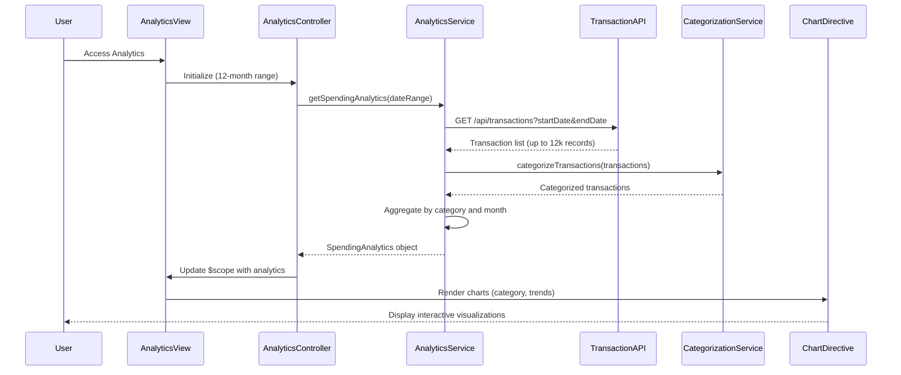

# Low-Level Design: Spending Analytics and Insights
**Epic ID:** QE-9683  
**Epic Title:** CreditCardNew20261110203452-Spending Analytics and Insights

---

## a. Architecture Mapping

**AngularJS Artifacts:**
- **Module**: `analyticsModule` - Main module for spending analytics
- **Controller**: `AnalyticsController` - Manages analytics view and user interactions
- **Service**: `AnalyticsService` - Fetches and processes transaction data for analytics
- **Service**: `CategorizationService` - Handles transaction category mapping and validation
- **Directive**: `spendingChartDirective` - Renders interactive charts using Chart.js or D3.js
- **Factory**: `TransactionDataFactory` - Retrieves historical transaction data from API

**Folder Structure:**
```
/app
  /modules
    /analytics
      analytics.module.js
      analytics.controller.js
      analytics.html
      /services
        analytics.service.js
        categorization.service.js
        transaction-data.factory.js
      /directives
        spending-chart.directive.js
      /styles
        analytics.css
```

---

## b. Component Specifications

| Name | Artifact Type | Responsibility | Key Dependencies |
|------|---------------|----------------|------------------|
| analyticsModule | Module | Registers analytics components, configures routes, imports Chart.js library | angular, ui-router, chart.js |
| AnalyticsController | Controller | Manages analytics view state, handles date range selection, triggers chart updates | AnalyticsService, $scope, $filter |
| AnalyticsService | Service | Aggregates transactions by category and time period, calculates spending trends | $http, $q, CategorizationService, TransactionDataFactory |
| CategorizationService | Service | Maps transactions to 9 predefined categories, validates category assignments | None |
| spendingChartDirective | Directive | Renders interactive bar/pie/line charts, handles chart interactions and tooltips | chart.js |
| TransactionDataFactory | Factory | Fetches historical transactions (12 months) via REST API, implements pagination | $http, $q |

---

## c. Data Model

**SpendingAnalytics Model:**
```javascript
{
  userId: String,
  dateRange: { startDate: Date, endDate: Date },
  categorySpending: Array<CategorySpend>, // Spending by category
  monthlyTrends: Array<MonthlyTrend>,     // Month-over-month trends
  totalTransactions: Number,
  lastUpdated: Date
}
```

**CategorySpend Model:**
```javascript
{
  category: String,               // Food & Dining, Fuel, Shopping, etc.
  totalAmount: Number,
  transactionCount: Number,
  percentageOfTotal: Number
}
```

**MonthlyTrend Model:**
```javascript
{
  month: String,                  // YYYY-MM format
  totalSpend: Number,
  categoryBreakdown: Array<CategorySpend>
}
```

---

## d. Data Flow

User navigates to analytics view → AnalyticsController initializes with default 12-month date range → Controller calls AnalyticsService.getSpendingAnalytics() → Service invokes TransactionDataFactory to fetch transactions via REST API (`GET /api/transactions?userId={id}&startDate={date}&endDate={date}`) → CategorizationService validates and maps each transaction to one of 9 categories → AnalyticsService aggregates data by category and month client-side → Aggregated analytics data is bound to $scope → View renders charts using spendingChartDirective with Chart.js → User interacts with charts (hover for details, filter by category) → Updates trigger re-aggregation and chart re-render.

---

## e. Primary Sequence Diagram



---

## f. Implementation Notes

- Use Chart.js library integrated via angular-chart.js wrapper for declarative chart rendering in AngularJS
- Implement ES6 Map and reduce functions in AnalyticsService for efficient client-side aggregation of large transaction datasets
- Apply AngularJS $filter for date formatting and currency display in charts and tooltips
- Use Bootstrap tabs for switching between category view and trend view; CSS3 transitions for smooth chart animations
- Implement lazy loading in TransactionDataFactory with pagination (fetch 1000 transactions per API call) to handle 12-month history efficiently

---

## g. Error Handling

HTTP interceptor handles API errors; service-level try/catch with fallback to cached data and user notification via toaster.

---

## h. Security Notes

Standard input validation and secure API calls assumed; JWT token authentication for transaction data access.