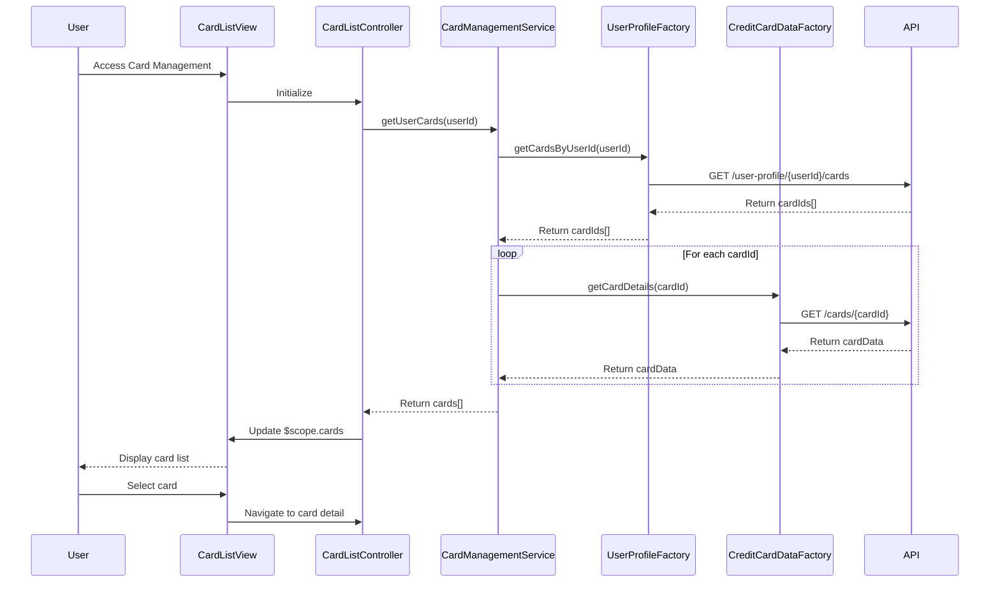

# Low-Level Design: Multiple Credit Card Management
**Epic ID:** QE-9690  
**Technology Stack:** AngularJS 1.x, JavaScript ES6, HTML5, CSS3, Bootstrap, REST APIs, MVC Architecture

---

## a. Architecture Mapping

- **User Interface - Card Management** → AngularJS Module (`cardManagement`) + Controller (`CardListController`, `CardDetailController`) + Views (HTML templates with Bootstrap)
- **Card Management Service** → AngularJS Service (`CardManagementService`) using `$http` for REST API calls
- **Credit Card Data Service Integration** → AngularJS Factory (`CreditCardDataFactory`) for API endpoint abstraction
- **User Profile Service Integration** → AngularJS Factory (`UserProfileFactory`) for user-card association APIs

**Recommended Folder Structure:**
```
/app
  /modules
    /card-management
      /controllers
      /services
      /factories
      /views
      /directives
```

---

## b. Component Specifications

| Component Name | Artifact Type | Responsibility | Key Dependencies |
|----------------|---------------|----------------|------------------|
| `cardManagement` | Module | Root module for card management feature | `ngRoute`, `cardManagement.controllers`, `cardManagement.services` |
| `CardListController` | Controller | Manages list of user's cards, handles card selection | `CardManagementService`, `$scope`, `$location` |
| `CardDetailController` | Controller | Displays detailed view of selected card with spend analysis | `CardManagementService`, `CreditCardDataFactory`, `$routeParams` |
| `CardManagementService` | Service | Orchestrates card data retrieval and user profile integration | `CreditCardDataFactory`, `UserProfileFactory`, `$q` |
| `CreditCardDataFactory` | Factory | Encapsulates REST API calls to Credit Card Data Service | `$http`, `API_ENDPOINTS` |
| `UserProfileFactory` | Factory | Encapsulates REST API calls to User Profile Service | `$http`, `API_ENDPOINTS` |
| `cardListDirective` | Directive | Renders responsive card list with Bootstrap grid | `CardManagementService` |
| `cardSwitcher` | Directive | Provides quick card switching UI component | `$location` |

---

## c. Data Model

**CardModel (JavaScript Object):**
```javascript
{
  cardId: String,
  userId: String,
  cardType: String,
  issuer: String,
  lastFourDigits: String,
  expiryDate: Date,
  creditLimit: Number,
  availableCredit: Number,
  outstandingBalance: Number,
  monthlySpend: Number,
  metadata: Object
}
```

**UserCardAssociation (JavaScript Object):**
```javascript
{
  userId: String,
  cardIds: Array<String>
}
```

---

## d. Data Flow

User authenticates and accesses the card management view → `CardListController` invokes `CardManagementService.getUserCards()` → Service calls `UserProfileFactory.getCardsByUserId()` to retrieve card IDs → For each card ID, `CreditCardDataFactory.getCardDetails()` fetches card information via REST API → Aggregated card data is returned to controller → Controller binds data to `$scope.cards` → View renders card list using `cardListDirective` with Bootstrap responsive grid → User clicks a card → `CardDetailController` is activated via `ngRoute` with `cardId` parameter → Controller fetches detailed card data and spend analysis → Detailed view is rendered → All API calls use HTTPS ensuring encryption in transit.

---

## e. Primary Sequence Diagram



---

## f. Implementation Notes

- Use AngularJS Dependency Injection for all services, factories, and controllers to ensure testability and modularity.
- Implement `$q` promises for asynchronous API calls with proper chaining and error propagation.
- Use `ngRoute` for client-side routing between card list and card detail views with card ID as route parameter.
- Apply Bootstrap responsive classes (col-xs, col-sm, col-md) in views to ensure cross-device compatibility.
- Cache card list data in service using a simple object store to achieve sub-500ms card switching; invalidate cache on data refresh.

---

## g. Error Handling

HTTP interceptor-based error handling with user-friendly notifications via Bootstrap alerts for API failures and network errors.

---

## h. Security Notes

Data encrypted in transit via HTTPS; token-based authentication via existing SSO integrated through HTTP interceptor for all API calls.