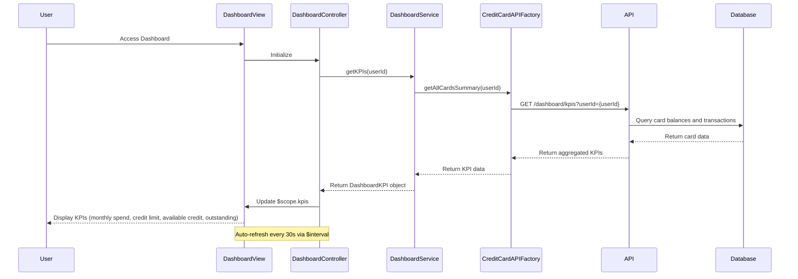

# Low-Level Design: Credit Card Dashboard and KPI Management
**Epic ID:** QE-9691  
**Technology Stack:** AngularJS 1.x, JavaScript ES6, HTML5, CSS3, Bootstrap, REST APIs, MVC Architecture

---

## a. Architecture Mapping

- **Dashboard UI Layer** → AngularJS Module (`dashboard`) + Controller (`DashboardController`) + View (HTML template with Bootstrap responsive grid)
- **API Gateway Integration** → AngularJS HTTP Interceptor (`AuthInterceptor`) for authentication and routing
- **Dashboard Service** → AngularJS Service (`DashboardService`) for KPI data aggregation and business logic
- **Credit Card Data Service Integration** → AngularJS Factory (`CreditCardAPIFactory`) for REST API calls
- **User Authentication Service Integration** → AngularJS Service (`AuthService`) for secure access management

**Recommended Folder Structure:**
```
/app
  /modules
    /dashboard
      /controllers
      /services
      /factories
      /views
      /directives
      /interceptors
```

---

## b. Component Specifications

| Component Name | Artifact Type | Responsibility | Key Dependencies |
|----------------|---------------|----------------|------------------|
| `dashboard` | Module | Root module for dashboard feature | `ngRoute`, `dashboard.controllers`, `dashboard.services` |
| `DashboardController` | Controller | Manages dashboard state, KPI display, and real-time refresh | `DashboardService`, `$scope`, `$interval` |
| `DashboardService` | Service | Aggregates KPI data from multiple cards and handles refresh logic | `CreditCardAPIFactory`, `$q` |
| `CreditCardAPIFactory` | Factory | Encapsulates REST API calls to Credit Card Data Service for balances and transactions | `$http`, `API_ENDPOINTS` |
| `AuthService` | Service | Manages user authentication state and token management | `$http`, `$window` |
| `AuthInterceptor` | HTTP Interceptor | Injects auth tokens into API requests and handles 401 responses | `AuthService`, `$q` |
| `kpiCardDirective` | Directive | Renders individual KPI card (e.g., monthly spend, credit limit) with Bootstrap styling | None |
| `autoRefreshDirective` | Directive | Implements periodic data refresh for real-time KPI updates | `$interval`, `DashboardService` |

---

## c. Data Model

**DashboardKPI (JavaScript Object):**
```javascript
{
  userId: String,
  monthlySpend: Number,
  totalCreditLimit: Number,
  availableCredit: Number,
  outstandingAmount: Number,
  lastUpdated: Date
}
```

**CardSummary (JavaScript Object):**
```javascript
{
  cardId: String,
  monthlySpend: Number,
  creditLimit: Number,
  availableCredit: Number,
  outstandingBalance: Number
}
```

---

## d. Data Flow

User authenticates via `AuthService` → User navigates to dashboard view → `DashboardController` initializes and calls `DashboardService.getKPIs(userId)` → Service invokes `CreditCardAPIFactory.getAllCardsSummary(userId)` via REST API → API Gateway routes request to Dashboard Service backend → Backend queries Credit Card Data Service for all user cards → Credit Card Database returns card balances, transactions, and limits → Backend aggregates data (sums monthly spend, credit limits, calculates available credit and outstanding amounts) → Aggregated KPI data is returned to `DashboardService` → Service updates `$scope.kpis` in controller → View renders KPIs using `kpiCardDirective` with Bootstrap responsive layout → `autoRefreshDirective` triggers periodic refresh every 30 seconds using `$interval` → Updated KPIs are displayed without full page reload.

---

## e. Primary Sequence Diagram



---

## f. Implementation Notes

- Use AngularJS `$interval` service for periodic KPI refresh (30-second interval) with proper cleanup on scope destruction.
- Implement HTTP interceptor pattern for injecting authentication tokens and handling API errors centrally.
- Apply Bootstrap grid system (container-fluid, row, col-*) for responsive KPI card layout across devices.
- Use AngularJS `$q.all()` for parallel API calls if fetching data from multiple endpoints to meet 3-second load time NFR.
- Leverage AngularJS two-way data binding for seamless KPI updates without manual DOM manipulation.

---

## g. Error Handling

Centralized HTTP interceptor captures API errors; user notified via Bootstrap alert component with retry option on failure.

---

## h. Security Notes

Token-based authentication via existing SSO; AuthInterceptor injects bearer token in Authorization header for all API calls.