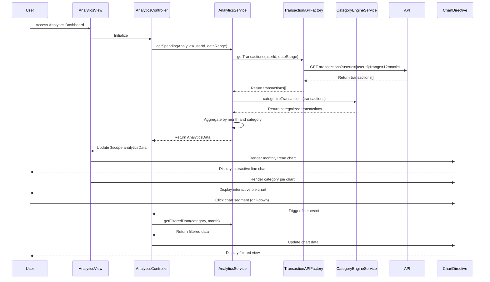

# Low-Level Design: Spending Analytics and Trend Visualization
**Epic ID:** QE-9692  
**Technology Stack:** AngularJS 1.x, JavaScript ES6, HTML5, CSS3, Bootstrap, REST APIs, MVC Architecture

---

## a. Architecture Mapping

- **User Interface - Analytics Dashboard** → AngularJS Module (`analytics`) + Controller (`AnalyticsController`) + View (HTML with chart containers)
- **Analytics Service Layer** → AngularJS Service (`AnalyticsService`) for data processing and aggregation
- **Transaction Data Service Integration** → AngularJS Factory (`TransactionAPIFactory`) for fetching transaction data via REST
- **Analytics Engine Integration** → AngularJS Service (`CategoryEngineService`) for transaction categorization logic
- **Visualization Library** → Chart.js integrated via AngularJS Directive (`chartDirective`) for rendering interactive charts

**Recommended Folder Structure:**
```
/app
  /modules
    /analytics
      /controllers
      /services
      /factories
      /directives
      /views
```

---

## b. Component Specifications

| Component Name | Artifact Type | Responsibility | Key Dependencies |
|----------------|---------------|----------------|------------------|
| `analytics` | Module | Root module for analytics feature | `ngRoute`, `chart.js`, `analytics.controllers`, `analytics.services` |
| `AnalyticsController` | Controller | Manages analytics view state, user interactions, and filter selections | `AnalyticsService`, `$scope`, `$filter` |
| `AnalyticsService` | Service | Orchestrates data fetching, processing, and chart data preparation | `TransactionAPIFactory`, `CategoryEngineService`, `$q` |
| `TransactionAPIFactory` | Factory | Encapsulates REST API calls to Transaction Data Service | `$http`, `API_ENDPOINTS` |
| `CategoryEngineService` | Service | Categorizes transactions into 9 predefined categories using rule-based logic | None |
| `chartDirective` | Directive | Wraps Chart.js library for rendering line, bar, and pie charts | `Chart.js` |
| `trendChartDirective` | Directive | Specialized directive for monthly spend trend line chart | `chartDirective` |
| `categoryPieDirective` | Directive | Specialized directive for category-wise spending pie chart | `chartDirective` |
| `drillDownService` | Service | Handles drill-down filtering and sub-category data fetching | `AnalyticsService` |

---

## c. Data Model

**Transaction (JavaScript Object):**
```javascript
{
  transactionId: String,
  cardId: String,
  amount: Number,
  category: String,
  date: Date,
  merchant: String,
  description: String
}
```

**MonthlySpendTrend (JavaScript Object):**
```javascript
{
  month: String,
  totalSpend: Number,
  transactionCount: Number
}
```

**CategorySpend (JavaScript Object):**
```javascript
{
  category: String,
  totalSpend: Number,
  percentage: Number
}
```

**AnalyticsData (JavaScript Object):**
```javascript
{
  userId: String,
  monthlyTrends: Array<MonthlySpendTrend>,
  categoryBreakdown: Array<CategorySpend>,
  dateRange: { start: Date, end: Date }
}
```

---

## d. Data Flow

User navigates to analytics dashboard → `AnalyticsController` initializes and calls `AnalyticsService.getSpendingAnalytics(userId, dateRange)` → Service invokes `TransactionAPIFactory.getTransactions(userId, dateRange)` via REST API → Transaction Data Service queries Transaction Database for 12 months of transaction data → Raw transactions are returned to service → `CategoryEngineService.categorizeTransactions(transactions)` applies rule-based logic to assign each transaction to one of 9 categories → `AnalyticsService` aggregates data by month and category → Processed data (monthly trends and category breakdown) is returned to controller → Controller binds data to `$scope.analyticsData` → View renders monthly trend chart using `trendChartDirective` and category pie chart using `categoryPieDirective` → User clicks on a chart segment for drill-down → Controller calls `drillDownService.getFilteredData(category, month)` → Filtered data is fetched and chart is updated → All chart rendering completes within 2 seconds per NFR.

---

## e. Primary Sequence Diagram



---

## f. Implementation Notes

- Integrate Chart.js via AngularJS directive pattern to encapsulate chart lifecycle (creation, update, destroy) and ensure proper cleanup.
- Use AngularJS `$filter` service for client-side date range filtering to achieve sub-second drill-down response times.
- Implement lazy loading for transaction data: fetch only visible date range initially, load more on user request.
- Apply Bootstrap responsive utilities to ensure charts scale properly on mobile, tablet, and desktop (use canvas responsive properties).
- Use ES6 array methods (map, reduce, filter) in `CategoryEngineService` for efficient transaction categorization and aggregation.

---

## g. Error Handling

Try/catch blocks in service methods with fallback to empty datasets; HTTP interceptor handles API errors with user notification via Bootstrap modal.

---

## h. Security Notes

Standard input validation and secure API calls assumed; authentication token passed via HTTP interceptor for all transaction data requests.