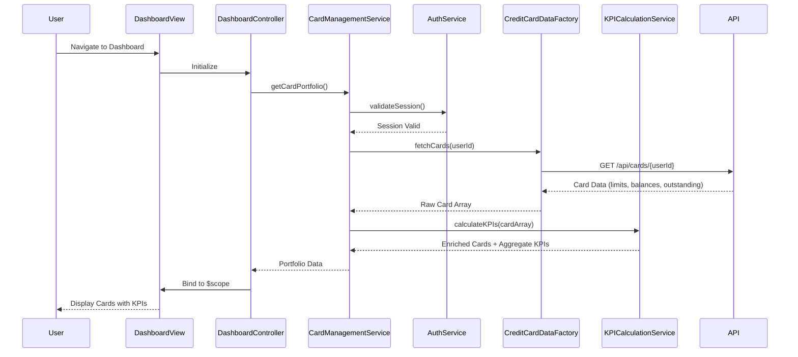

# Low-Level Design: QE-9699 - Credit Card Management and Dashboard KPIs

## a. Architecture Mapping

- **Dashboard UI Module** → AngularJS Module (`creditCardDashboard`)
- **Dashboard Controller** → AngularJS Controller (`DashboardController`)
- **Card Management Service** → AngularJS Service (`CardManagementService`)
- **Authentication Service** → AngularJS Service (`AuthService`)
- **Credit Card Data Service** → AngularJS Factory (`CreditCardDataFactory`)
- **KPI Calculation Engine** → AngularJS Service (`KPICalculationService`)
- **Card Display Component** → AngularJS Directive (`creditCardWidget`)

**Recommended Folder Structure:**
```
app/
├── modules/
│   └── dashboard/
│       ├── controllers/
│       │   └── dashboard.controller.js
│       ├── services/
│       │   ├── card-management.service.js
│       │   ├── kpi-calculation.service.js
│       │   └── auth.service.js
│       ├── factories/
│       │   └── credit-card-data.factory.js
│       ├── directives/
│       │   └── credit-card-widget.directive.js
│       └── views/
│           └── dashboard.html
├── assets/
│   ├── css/
│   └── images/
└── app.js
```

## b. Component Specifications

| Component Name | Artifact Type | Responsibility | Key Dependencies |
|----------------|---------------|----------------|------------------|
| creditCardDashboard | Module | Root module for dashboard functionality | ngRoute, ngResource |
| DashboardController | Controller | Orchestrates dashboard view, manages card data display and refresh | CardManagementService, KPICalculationService, $scope |
| CardManagementService | Service | Coordinates card data retrieval and KPI computation | CreditCardDataFactory, KPICalculationService, AuthService |
| AuthService | Service | Validates user authentication and manages session state | $http, $window |
| CreditCardDataFactory | Factory | Handles REST API calls to retrieve card details, balances, and limits | $resource, API_ENDPOINT |
| KPICalculationService | Service | Computes derived metrics (available credit, utilization %, monthly spend) | None |
| creditCardWidget | Directive | Renders individual card with KPIs in responsive layout | None |

## c. Data Model

**CreditCard Object:**
```javascript
{
  cardId: String,
  cardNumber: String,
  cardType: String,
  totalCreditLimit: Number,
  outstandingAmount: Number,
  availableCredit: Number,  // Computed
  monthlySpend: Number,
  utilizationPercent: Number  // Computed
}
```

**DashboardKPI Object:**
```javascript
{
  totalCards: Number,
  totalCreditLimit: Number,
  totalOutstanding: Number,
  totalAvailableCredit: Number,
  totalMonthlySpend: Number,
  averageUtilization: Number
}
```

## d. Data Flow

User logs in and navigates to dashboard → Dashboard view loads and DashboardController initializes → Controller calls CardManagementService.getCardPortfolio() → Service validates session via AuthService, then invokes CreditCardDataFactory.fetchCards() → Factory executes REST API call to backend endpoint → Response containing card details (limits, balances, outstanding) is returned → KPICalculationService computes derived metrics (available credit = limit - outstanding, utilization %) → CardManagementService returns enriched card array and aggregate KPIs to Controller → Controller binds data to $scope → View renders cards using creditCardWidget directive with Bootstrap responsive grid → Real-time refresh timer triggers periodic data refresh without page reload.

## e. Primary Sequence Diagram



## f. Implementation Notes

- Use AngularJS Dependency Injection to inject services into controllers; follow strict DI annotation (`$inject` array) for minification safety.
- Implement real-time refresh using `$interval` service with configurable polling interval (default 30 seconds) to meet NFR for live data updates.
- Leverage `$resource` for RESTful API integration with Credit Card Data Service; define resource methods for GET operations with caching.
- Apply Bootstrap grid system (col-md-4, col-sm-6, col-xs-12) in creditCardWidget directive template for responsive card layout across devices.
- Use ES6 arrow functions and template literals in service logic; transpile with Babel if targeting older browsers.

## g. Error Handling

HTTP interceptor-based error handling with user-friendly notifications via toast/alert service for API failures and session timeouts.

## h. Security Notes

Requires token-based authentication via existing SSO; session token passed in Authorization header for all API calls.