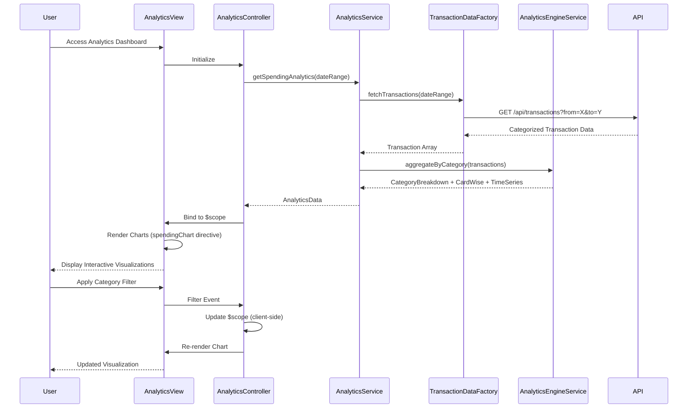

# Low-Level Design: QE-9700 - Spending Analytics and Visualization

## a. Architecture Mapping

- **Analytics Dashboard Module** → AngularJS Module (`spendingAnalytics`)
- **Analytics Controller** → AngularJS Controller (`AnalyticsController`)
- **Analytics Service** → AngularJS Service (`AnalyticsService`)
- **Transaction Data Service** → AngularJS Factory (`TransactionDataFactory`)
- **Analytics Engine** → AngularJS Service (`AnalyticsEngineService`)
- **Visualization Component** → AngularJS Directive (`spendingChart`)
- **Category Filter Component** → AngularJS Directive (`categoryFilter`)

**Recommended Folder Structure:**
```
app/
├── modules/
│   └── analytics/
│       ├── controllers/
│       │   └── analytics.controller.js
│       ├── services/
│       │   ├── analytics.service.js
│       │   └── analytics-engine.service.js
│       ├── factories/
│       │   └── transaction-data.factory.js
│       ├── directives/
│       │   ├── spending-chart.directive.js
│       │   └── category-filter.directive.js
│       └── views/
│           └── analytics.html
├── assets/
│   ├── css/
│   └── libs/
│       └── chart.js
└── app.js
```

## b. Component Specifications

| Component Name | Artifact Type | Responsibility | Key Dependencies |
|----------------|---------------|----------------|------------------|
| spendingAnalytics | Module | Root module for analytics and visualization features | ngRoute, chart.js |
| AnalyticsController | Controller | Manages analytics view state, handles user interactions (filter, drill-down) | AnalyticsService, $scope, $filter |
| AnalyticsService | Service | Orchestrates data retrieval and analytics computation | TransactionDataFactory, AnalyticsEngineService |
| TransactionDataFactory | Factory | Executes REST API calls to retrieve categorized transaction data | $resource, API_ENDPOINT |
| AnalyticsEngineService | Service | Aggregates spending by category, card, and time period; formats data for charts | None |
| spendingChart | Directive | Renders interactive charts (pie, bar, line) using Chart.js library | chart.js |
| categoryFilter | Directive | Provides UI controls for filtering by category, card, and date range | None |

## c. Data Model

**Transaction Object:**
```javascript
{
  transactionId: String,
  cardId: String,
  amount: Number,
  category: String,  // One of: Food & Dining, Fuel, Shopping, Travel, Entertainment, Utilities, Healthcare, Education, Miscellaneous
  date: Date,
  merchant: String
}
```

**CategorySpending Object:**
```javascript
{
  category: String,
  totalAmount: Number,
  transactionCount: Number,
  percentageOfTotal: Number
}
```

**AnalyticsData Object:**
```javascript
{
  categoryBreakdown: Array<CategorySpending>,
  cardWiseSpending: Array<{cardId: String, amount: Number}>,
  timeSeriesData: Array<{month: String, amount: Number}>
}
```

## d. Data Flow

User navigates to analytics dashboard → AnalyticsController initializes and calls AnalyticsService.getSpendingAnalytics() → Service invokes TransactionDataFactory.fetchTransactions() with date range and filters → Factory executes REST API call to retrieve categorized transaction data → Response containing transaction array is returned → AnalyticsEngineService.aggregateByCategory() processes transactions to compute spending totals, percentages, and breakdowns for all nine categories → AnalyticsEngineService also computes card-wise and time-series aggregations → Aggregated AnalyticsData object is returned to Controller → Controller binds data to $scope → spendingChart directive renders interactive visualizations (pie chart for category breakdown, bar chart for card-wise, line chart for trends) → User applies filters via categoryFilter directive → Controller updates data model client-side and chart re-renders within 1 second.

## e. Primary Sequence Diagram



## f. Implementation Notes

- Integrate Chart.js library via directive; use isolated scope to pass chart data and configuration for reusability across chart types.
- Pre-aggregate data on initial load and cache in AnalyticsEngineService; client-side filtering using AngularJS `$filter` to meet 1-second rendering NFR.
- Use ES6 `Array.reduce()` and `Array.map()` in AnalyticsEngineService for efficient category and card-wise aggregation.
- Implement responsive chart sizing using Chart.js responsive options and Bootstrap container classes for mobile optimization.
- Apply AngularJS two-way data binding for filter controls; use `ng-change` to trigger chart updates on filter selection.

## g. Error Handling

Try/catch blocks in aggregation logic with fallback to empty datasets; HTTP interceptor displays user notification on API failures.

## h. Security Notes

Standard input validation and secure API calls assumed; transaction data filtered by authenticated user context on backend.