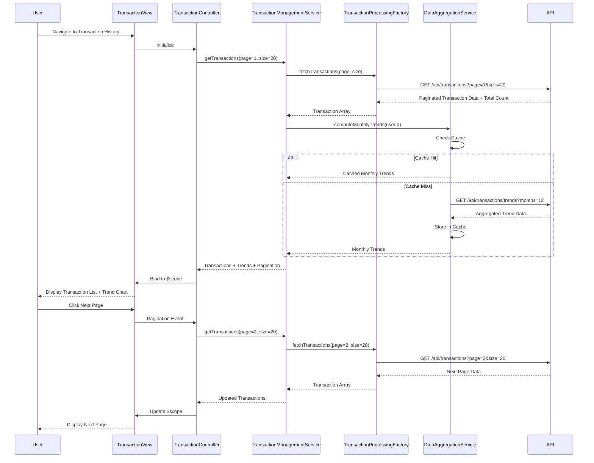

# Low-Level Design: QE-9701 - Transaction Management and Monthly Trends

## a. Architecture Mapping

- **Transaction Module** → AngularJS Module (`transactionManagement`)
- **Transaction Controller** → AngularJS Controller (`TransactionController`)
- **Transaction Management Service** → AngularJS Service (`TransactionManagementService`)
- **Transaction Processing Service** → AngularJS Factory (`TransactionProcessingFactory`)
- **Data Aggregation Service** → AngularJS Service (`DataAggregationService`)
- **Transaction List Component** → AngularJS Directive (`transactionList`)
- **Monthly Trend Chart Component** → AngularJS Directive (`monthlyTrendChart`)

**Recommended Folder Structure:**
```
app/
├── modules/
│   └── transactions/
│       ├── controllers/
│       │   └── transaction.controller.js
│       ├── services/
│       │   ├── transaction-management.service.js
│       │   └── data-aggregation.service.js
│       ├── factories/
│       │   └── transaction-processing.factory.js
│       ├── directives/
│       │   ├── transaction-list.directive.js
│       │   └── monthly-trend-chart.directive.js
│       └── views/
│           └── transactions.html
├── assets/
│   ├── css/
│   └── libs/
└── app.js
```

## b. Component Specifications

| Component Name | Artifact Type | Responsibility | Key Dependencies |
|----------------|---------------|----------------|------------------|
| transactionManagement | Module | Root module for transaction tracking and trend analysis | ngRoute, ngResource |
| TransactionController | Controller | Manages transaction view, handles pagination and trend display | TransactionManagementService, $scope |
| TransactionManagementService | Service | Orchestrates transaction retrieval and monthly trend computation | TransactionProcessingFactory, DataAggregationService |
| TransactionProcessingFactory | Factory | Executes REST API calls to retrieve raw transaction records | $resource, API_ENDPOINT |
| DataAggregationService | Service | Computes monthly trends by grouping transactions; implements caching for performance | None |
| transactionList | Directive | Renders paginated transaction history table with sorting | None |
| monthlyTrendChart | Directive | Displays line/bar chart showing spending trends over 12 months | chart.js |

## c. Data Model

**Transaction Object:**
```javascript
{
  transactionId: String,
  cardId: String,
  date: Date,
  amount: Number,
  merchant: String,
  category: String,
  description: String
}
```

**MonthlyTrend Object:**
```javascript
{
  month: String,  // Format: YYYY-MM
  totalSpend: Number,
  transactionCount: Number,
  cardBreakdown: Array<{cardId: String, amount: Number}>
}
```

**PaginationConfig Object:**
```javascript
{
  currentPage: Number,
  pageSize: Number,
  totalRecords: Number,
  totalPages: Number
}
```

## d. Data Flow

User navigates to transaction history page → TransactionController initializes and calls TransactionManagementService.getTransactions(page, pageSize) → Service invokes TransactionProcessingFactory.fetchTransactions() with pagination parameters → Factory executes REST API call to backend with query params → Response containing paginated transaction records and total count is returned within 500ms → DataAggregationService.computeMonthlyTrends() retrieves cached or computes aggregated monthly spending for last 12 months by grouping transactions by month and card → Service returns both transaction list and monthly trend data to Controller → Controller binds data to $scope → transactionList directive renders paginated table with transaction details → monthlyTrendChart directive displays line chart showing monthly spending patterns → User clicks pagination controls or sort headers → Controller updates query parameters and re-fetches data.

## e. Primary Sequence Diagram



## f. Implementation Notes

- Implement pagination using `$resource` with query parameters; use AngularJS `limitTo` and custom pagination directive for UI controls.
- Cache monthly trend data in DataAggregationService using in-memory object with TTL (5 minutes) to optimize performance and meet 500ms query NFR.
- Use ES6 `Map` and `groupBy` logic for efficient monthly aggregation; leverage `Array.reduce()` for summing amounts by month.
- Apply lazy loading for transaction list; fetch only current page data to minimize payload size and improve response time.
- Implement table sorting using AngularJS `orderBy` filter; add sort indicators in transactionList directive template.

## g. Error Handling

HTTP interceptor-based error handling with retry logic for transient failures; user notification via toast service on persistent errors.

## h. Security Notes

Requires token-based auth via existing SSO; backend enforces user-specific data filtering to prevent unauthorized transaction access.