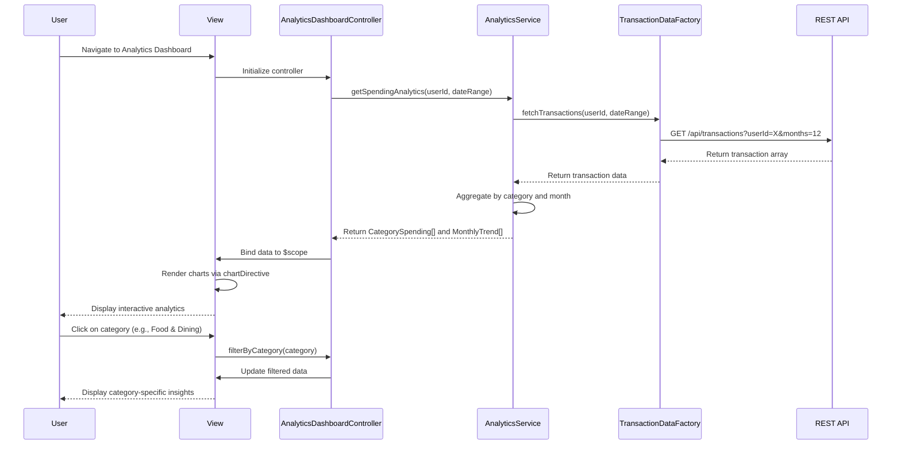

# Low-Level Design: QE-9702 - Spending Analytics and Transaction Insights

## a. Architecture Mapping

- **Analytics Dashboard Component** → AngularJS Module (`app.analytics`) + Controller (`AnalyticsDashboardController`)
- **Analytics Engine** → AngularJS Service (`AnalyticsService`) for data aggregation and calculation logic
- **Transaction Data Service** → AngularJS Factory (`TransactionDataFactory`) for REST API calls to retrieve transaction records
- **Charting Library Integration** → AngularJS Directive (`chartDirective`) wrapping Chart.js or D3.js for interactive visualizations
- **Transaction Data Store** → Backend REST API endpoints (consumed by TransactionDataFactory)

**Recommended Folder Structure:**
```
app/
├── modules/
│   └── analytics/
│       ├── analytics.module.js
│       ├── controllers/
│       │   └── analytics-dashboard.controller.js
│       ├── services/
│       │   └── analytics.service.js
│       ├── factories/
│       │   └── transaction-data.factory.js
│       ├── directives/
│       │   └── chart.directive.js
│       └── views/
│           └── analytics-dashboard.html
```

## b. Component Specifications

| Component Name | Artifact Type | Responsibility | Key Dependencies |
|---|---|---|---|
| AnalyticsDashboardController | Controller | Manages analytics view state, handles user interactions, coordinates data fetching and chart rendering | AnalyticsService, TransactionDataFactory, $scope |
| AnalyticsService | Service | Aggregates transaction data by category and time period, calculates spending trends and patterns | TransactionDataFactory |
| TransactionDataFactory | Factory | Fetches transaction history from REST API, caches responses, handles API errors | $http, $q |
| chartDirective | Directive | Renders interactive charts (category breakdown, monthly trends) using Chart.js/D3.js, handles chart interactions | Chart.js or D3.js library |
| analytics.module.js | Module | Defines the analytics feature module and its dependencies | ngRoute, chart library module |

## c. Data Model

**Transaction Model:**
```javascript
{
  transactionId: String,
  cardId: String,
  amount: Number,
  category: String, // Food & Dining, Fuel, Shopping, Travel, Entertainment, Utilities, Healthcare, Education, Miscellaneous
  transactionDate: Date,
  merchantName: String,
  description: String
}
```

**CategorySpending Model:**
```javascript
{
  category: String,
  totalAmount: Number,
  transactionCount: Number,
  percentage: Number
}
```

**MonthlyTrend Model:**
```javascript
{
  month: String, // YYYY-MM format
  totalSpend: Number,
  categoryBreakdown: Array<CategorySpending>
}
```

## d. Data Flow

User navigates to the analytics dashboard view, triggering AnalyticsDashboardController initialization. The controller calls AnalyticsService.getSpendingAnalytics(), which invokes TransactionDataFactory to fetch transaction history (up to 12 months) via REST API GET /api/transactions. The factory returns a promise with transaction data, which AnalyticsService aggregates by category and month. The processed data is bound to $scope and passed to chartDirective, which renders interactive charts. User interactions (e.g., clicking a category) trigger controller methods that filter data and update the view dynamically.

## e. Primary Sequence Diagram



## f. Implementation Notes

- Use AngularJS dependency injection to inject AnalyticsService and TransactionDataFactory into AnalyticsDashboardController for testability and modularity.
- Implement TransactionDataFactory using $http service with promise-based API calls; cache responses using $cacheFactory to minimize redundant API requests.
- Leverage ES6 arrow functions and const/let for cleaner service and factory code; use Array.map/filter/reduce for data aggregation in AnalyticsService.
- Integrate Chart.js via chartDirective with two-way data binding; listen for chart click events to enable drill-down interactions.
- Use ngRoute or ui-router to define the analytics dashboard route; lazy-load the analytics module if application grows large.

## g. Error Handling

HTTP interceptor captures API errors (4xx/5xx) and displays user-friendly notifications via a global toast service; try/catch blocks in service methods handle data processing errors.

## h. Security Notes

Requires token-based authentication via existing SSO; API calls include Authorization header with JWT token for secure transaction data access.