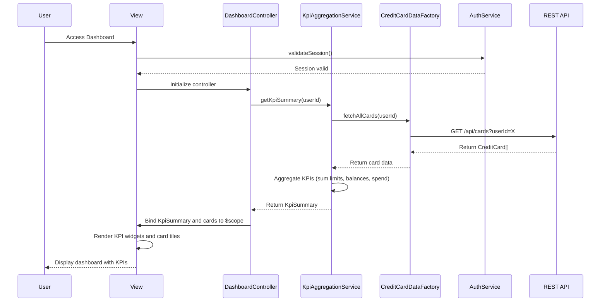

# Low-Level Design: QE-9703 - Credit Card Dashboard and KPI Overview

## a. Architecture Mapping

- **Dashboard UI Layer** → AngularJS Module (`app.dashboard`) + Controller (`DashboardController`) + View (`dashboard.html`)
- **KPI Aggregation Service** → AngularJS Service (`KpiAggregationService`) for calculating and caching KPI metrics
- **Credit Card Data Source** → AngularJS Factory (`CreditCardDataFactory`) for REST API calls to fetch card data
- **User Authentication Service** → AngularJS Service (`AuthService`) for session management and token handling
- **Responsive UI Components** → Bootstrap grid system + AngularJS Directives (`kpiCard`, `cardSummary`) for reusable KPI widgets

**Recommended Folder Structure:**
```
app/
├── modules/
│   └── dashboard/
│       ├── dashboard.module.js
│       ├── controllers/
│       │   └── dashboard.controller.js
│       ├── services/
│       │   ├── kpi-aggregation.service.js
│       │   └── auth.service.js
│       ├── factories/
│       │   └── credit-card-data.factory.js
│       ├── directives/
│       │   ├── kpi-card.directive.js
│       │   └── card-summary.directive.js
│       └── views/
│           └── dashboard.html
```

## b. Component Specifications

| Component Name | Artifact Type | Responsibility | Key Dependencies |
|---|---|---|---|
| DashboardController | Controller | Initializes dashboard view, fetches aggregated KPIs, manages card list state, handles user refresh actions | KpiAggregationService, CreditCardDataFactory, AuthService, $scope |
| KpiAggregationService | Service | Aggregates KPIs (monthly spend, total credit limit, available credit, outstanding amount) across all user cards, caches results | CreditCardDataFactory |
| CreditCardDataFactory | Factory | Fetches credit card data (balances, limits, transactions) from REST API, handles API errors and retries | $http, $q |
| AuthService | Service | Manages user authentication state, validates session tokens, provides user identity for API calls | $http, $window (for token storage) |
| kpiCard Directive | Directive | Renders individual KPI widget (e.g., Monthly Spend card) with icon, value, and label in a responsive layout | None |
| cardSummary Directive | Directive | Displays summary of a single credit card (card name, limit, balance) in a card tile format | None |

## c. Data Model

**CreditCard Model:**
```javascript
{
  cardId: String,
  cardNumber: String, // masked, e.g., "**** **** **** 1234"
  cardType: String, // Visa, MasterCard, Amex
  issuer: String,
  creditLimit: Number,
  currentBalance: Number,
  availableCredit: Number,
  outstandingAmount: Number,
  monthlySpend: Number
}
```

**KpiSummary Model:**
```javascript
{
  totalMonthlySpend: Number,
  totalCreditLimit: Number,
  totalAvailableCredit: Number,
  totalOutstandingAmount: Number,
  cardCount: Number
}
```

## d. Data Flow

User logs in and navigates to the dashboard; AuthService validates the session token. DashboardController is initialized and calls KpiAggregationService.getKpiSummary(userId). The service invokes CreditCardDataFactory.fetchAllCards(userId), which makes a REST API call to GET /api/cards. The factory returns a promise with an array of CreditCard objects. KpiAggregationService aggregates the data (summing monthly spend, credit limits, etc.) and returns a KpiSummary object. The controller binds the KpiSummary and card list to $scope, and the view renders KPI widgets via kpiCard directives and card tiles via cardSummary directives. The UI updates reactively when data changes.

## e. Primary Sequence Diagram



## f. Implementation Notes

- Use AngularJS $http service in CreditCardDataFactory with promise chaining; implement response caching with $cacheFactory to meet 2-second load time NFR.
- Inject KpiAggregationService and AuthService into DashboardController via AngularJS DI; use ES6 classes for service definitions for cleaner syntax.
- Leverage Bootstrap responsive grid (col-xs, col-sm, col-md, col-lg) in dashboard.html to ensure mobile, tablet, and desktop layouts adapt seamlessly.
- Implement kpiCard and cardSummary as isolated-scope directives with templateUrl and bindToController for reusability and encapsulation.
- Use $scope.$watch or controller-as syntax with one-way bindings to optimize digest cycles and maintain performance with up to 10 cards loaded.

## g. Error Handling

HTTP interceptor-based approach captures API failures and displays error messages via a centralized notification service; AuthService redirects to login on 401 Unauthorized.

## h. Security Notes

Requires token-based auth via existing SSO; all API requests include Authorization header with JWT token; card numbers are masked on client-side for PCI compliance.