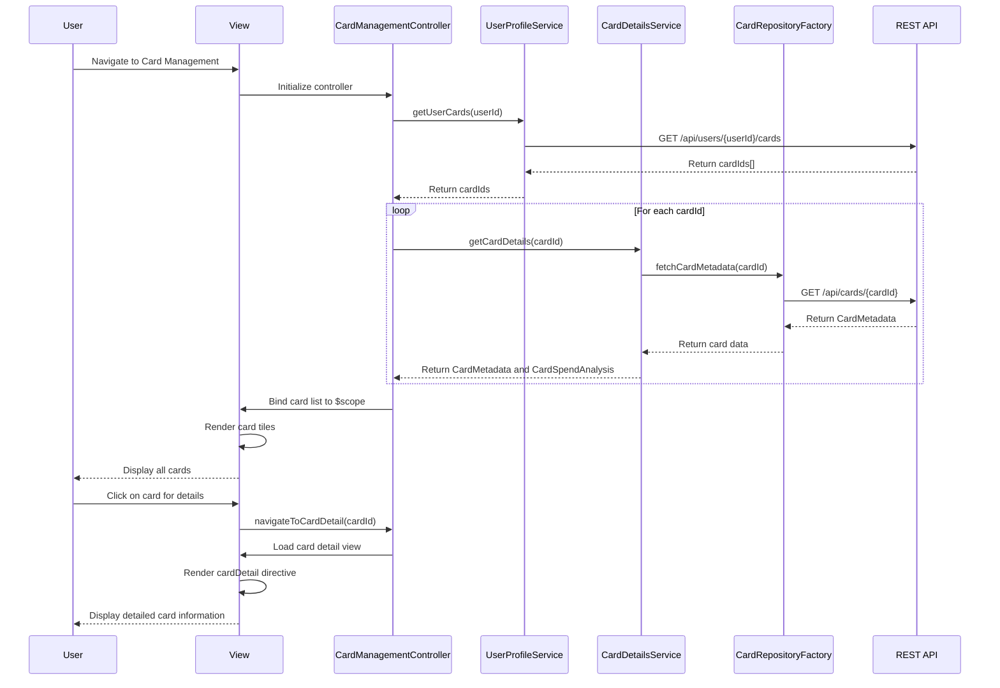

# Low-Level Design: QE-9704 - Multiple Credit Card Management

## a. Architecture Mapping

- **Card Management Module** → AngularJS Module (`app.cardManagement`) + Controller (`CardManagementController`)
- **Card Details Service** → AngularJS Service (`CardDetailsService`) for retrieving and managing individual card details
- **Credit Card Data Repository** → AngularJS Factory (`CardRepositoryFactory`) for REST API calls to fetch card metadata and transaction history
- **User Profile Service** → AngularJS Service (`UserProfileService`) for card ownership validation and user-card association
- **Card Comparison UI** → AngularJS Directive (`cardComparison`) for side-by-side card comparison view
- **Card Detail View** → AngularJS Directive (`cardDetail`) for drill-down card-specific information display

**Recommended Folder Structure:**
```
app/
├── modules/
│   └── card-management/
│       ├── card-management.module.js
│       ├── controllers/
│       │   └── card-management.controller.js
│       ├── services/
│       │   ├── card-details.service.js
│       │   └── user-profile.service.js
│       ├── factories/
│       │   └── card-repository.factory.js
│       ├── directives/
│       │   ├── card-comparison.directive.js
│       │   └── card-detail.directive.js
│       └── views/
│           ├── card-management.html
│           └── card-detail.html
```

## b. Component Specifications

| Component Name | Artifact Type | Responsibility | Key Dependencies |
|---|---|---|---|
| CardManagementController | Controller | Manages multiple card view state, handles card selection, initiates comparison mode, coordinates data fetching for all user cards | CardDetailsService, UserProfileService, $scope, $state |
| CardDetailsService | Service | Retrieves individual card details, card-wise spend analysis, caches card metadata for performance | CardRepositoryFactory |
| CardRepositoryFactory | Factory | Fetches card metadata (type, issuer, limits, balances) and transaction history from REST API, handles pagination and filtering | $http, $q |
| UserProfileService | Service | Validates card ownership for the logged-in user, retrieves user-card associations, enforces access control | $http |
| cardComparison Directive | Directive | Renders side-by-side comparison table for selected cards showing key metrics (limit, balance, spend, utilization) | None |
| cardDetail Directive | Directive | Displays detailed view of a single card including metadata, recent transactions, and spend analysis chart | Chart.js or similar |

## c. Data Model

**CardMetadata Model:**
```javascript
{
  cardId: String,
  cardNumber: String, // masked
  cardType: String, // Visa, MasterCard, Amex
  issuer: String,
  creditLimit: Number,
  currentBalance: Number,
  availableCredit: Number,
  outstandingAmount: Number,
  monthlySpend: Number,
  utilizationRate: Number, // percentage
  cardholderName: String,
  expiryDate: String // MM/YY format
}
```

**CardSpendAnalysis Model:**
```javascript
{
  cardId: String,
  monthlySpend: Number,
  categoryBreakdown: Array<{category: String, amount: Number}>,
  transactionCount: Number,
  averageTransactionAmount: Number
}
```

**UserCardAssociation Model:**
```javascript
{
  userId: String,
  cardIds: Array<String>
}
```

## d. Data Flow

User navigates to the card management view; CardManagementController initializes and calls UserProfileService.getUserCards(userId) to retrieve the list of card IDs associated with the user. The controller then invokes CardDetailsService.getCardDetails(cardId) for each card, which uses CardRepositoryFactory to make REST API calls (GET /api/cards/{cardId}) to fetch card metadata and spend analysis. The factory returns promises that resolve to CardMetadata and CardSpendAnalysis objects. The controller aggregates the data and binds it to $scope, rendering a list of cards. When the user selects a card, the controller navigates to the card detail view (using $state or ngRoute), passing the cardId. The cardDetail directive fetches additional transaction history and renders a detailed view. For comparison, the user selects multiple cards, triggering the cardComparison directive to display a side-by-side table.

## e. Primary Sequence Diagram



## f. Implementation Notes

- Use AngularJS $q.all() in CardManagementController to fetch multiple card details in parallel, ensuring the view loads within 3 seconds per NFR.
- Implement CardRepositoryFactory with $http and response caching ($cacheFactory) to avoid redundant API calls when navigating between card list and detail views.
- Leverage ES6 Promises and async/await patterns (if using Babel transpilation) for cleaner asynchronous code in services and factories.
- Use ui-router for state management; define states for card list view and card detail view with cardId as a URL parameter.
- Implement cardComparison directive with client-side logic to compute comparison metrics (e.g., utilization rate difference) for responsive interaction without additional API calls.

## g. Error Handling

HTTP interceptor captures API errors and displays user-friendly messages; UserProfileService handles 403 Forbidden errors for unauthorized card access with appropriate notifications.

## h. Security Notes

Requires token-based auth via existing SSO; UserProfileService enforces card ownership validation to prevent unauthorized access to other users' card data.