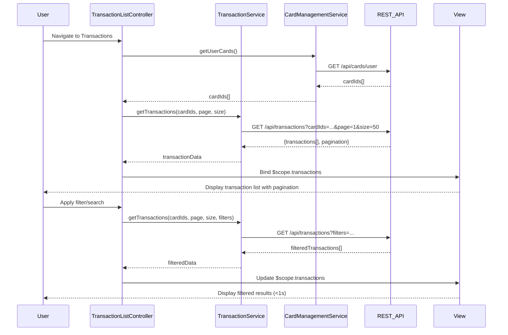

# Low-Level Design: Transaction Management and Viewing
**Epic ID:** QE-9729  
**Application Stack:** AngularJS 1.x, JavaScript ES6, HTML5, CSS3, Bootstrap, REST APIs, MVC Architecture

## a. Architecture Mapping

- **TransactionModule** (AngularJS Module) → Main module for transaction management features
- **TransactionListController** (Controller) → Manages transaction list view, pagination, and user interactions
- **TransactionDetailController** (Controller) → Handles individual transaction detail view
- **TransactionService** (Service) → Orchestrates transaction data retrieval and business logic
- **CardManagementService** (Service) → Retrieves user's card associations
- **SearchFilterService** (Service) → Handles search and filter operations
- **TransactionListDirective** (Directive) → Renders responsive transaction list with pagination controls

**Recommended Folder Structure:**
```
/app
  /modules
    /transaction
      /controllers
      /services
      /directives
      /views
      transaction.module.js
```

## b. Component Specifications

| Name | Artifact Type | Responsibility | Key Dependencies |
|------|---------------|----------------|------------------|
| TransactionModule | Module | Registers all transaction-related components and routes | ngRoute, ui.bootstrap |
| TransactionListController | Controller | Manages list state, pagination, search/filter UI | TransactionService, SearchFilterService, $scope |
| TransactionDetailController | Controller | Displays single transaction details | TransactionService, $routeParams, $scope |
| TransactionService | Service | Fetches transactions via REST API, handles pagination logic | $http, $q, CardManagementService |
| CardManagementService | Service | Retrieves user card associations from Card Management System | $http, $q |
| SearchFilterService | Service | Applies client-side and server-side filtering/search | $filter |
| TransactionListDirective | Directive | Renders transaction table with responsive design and pagination | TransactionService |

## c. Data Model

**Transaction Object:**
```javascript
{
  transactionId: String,
  cardId: String,
  cardName: String,
  merchantName: String,
  amount: Number,
  currency: String,
  transactionDate: Date,
  category: String,
  status: String, // 'posted', 'pending'
  description: String
}
```

**PaginationMetadata Object:**
```javascript
{
  currentPage: Number,
  pageSize: Number,
  totalRecords: Number,
  totalPages: Number
}
```

## d. Data Flow

User navigates to transaction view → TransactionListController initializes and calls TransactionService → TransactionService invokes CardManagementService to get user's card IDs → TransactionService fetches paginated transactions from REST API (`GET /api/transactions?cardIds=...&page=1&size=50`) → Data returned to controller and bound to $scope → View renders transaction list via TransactionListDirective with Bootstrap responsive table → User applies search/filter → SearchFilterService processes query and triggers API call with filter params → Updated results rendered in under 1 second → User clicks transaction row → TransactionDetailController loads and displays full transaction details.

## e. Primary Sequence Diagram



## f. Implementation Notes

- Use AngularJS DI to inject services into controllers; follow `$inject` annotation pattern for minification safety
- Implement pagination using ui-bootstrap's `<uib-pagination>` directive with server-side data fetching
- Use `$http` interceptors for adding auth tokens and handling common API errors
- Apply Bootstrap responsive grid classes (col-xs, col-sm, col-md) for mobile-first transaction table layout
- Leverage ES6 arrow functions and promises in services; wrap API calls in `$q` for Angular digest cycle integration

## g. Error Handling

HTTP interceptor captures API errors; display user-friendly messages via Bootstrap alerts; log errors to console for debugging.

## h. Security Notes

Requires token-based auth via existing SSO; all API calls include Authorization header with JWT token.