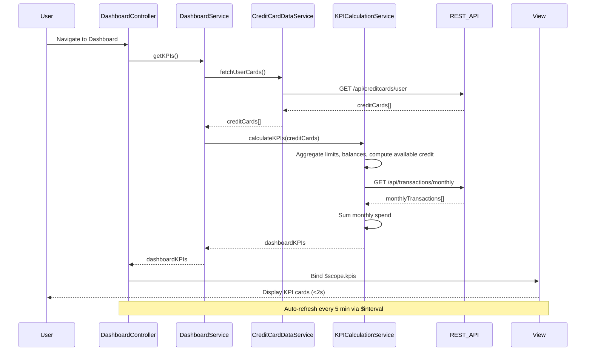

# Low-Level Design: Dashboard KPIs and Credit Card Overview
**Epic ID:** QE-9730  
**Application Stack:** AngularJS 1.x, JavaScript ES6, HTML5, CSS3, Bootstrap, REST APIs, MVC Architecture

## a. Architecture Mapping

- **DashboardModule** (AngularJS Module) → Main module for dashboard features
- **DashboardController** (Controller) → Manages dashboard state and KPI display
- **DashboardService** (Service) → Orchestrates KPI data retrieval and aggregation
- **KPICalculationService** (Service) → Computes KPIs from raw credit card data
- **CreditCardDataService** (Service) → Fetches credit card details, balances, and limits from API
- **KPICardDirective** (Directive) → Renders individual KPI card with responsive layout

**Recommended Folder Structure:**
```
/app
  /modules
    /dashboard
      /controllers
      /services
      /directives
      /views
      dashboard.module.js
```

## b. Component Specifications

| Name | Artifact Type | Responsibility | Key Dependencies |
|------|---------------|----------------|------------------|
| DashboardModule | Module | Registers dashboard components and routes | ngRoute, ui.bootstrap |
| DashboardController | Controller | Manages dashboard view state and KPI data binding | DashboardService, $scope, $interval |
| DashboardService | Service | Coordinates data aggregation and KPI calculation | CreditCardDataService, KPICalculationService, $q |
| CreditCardDataService | Service | Fetches card data from REST API | $http, $q |
| KPICalculationService | Service | Computes monthly spend, total limit, available credit, outstanding amounts | None |
| KPICardDirective | Directive | Renders responsive KPI card with icon, label, and value | None |

## c. Data Model

**CreditCard Object:**
```javascript
{
  cardId: String,
  cardName: String,
  cardNumber: String, // masked
  creditLimit: Number,
  currentBalance: Number,
  availableCredit: Number,
  lastUpdated: Date
}
```

**DashboardKPIs Object:**
```javascript
{
  monthlySpend: Number,
  totalCreditLimit: Number,
  totalAvailableCredit: Number,
  totalOutstanding: Number,
  cardCount: Number,
  lastRefreshTime: Date
}
```

## d. Data Flow

User navigates to dashboard → DashboardController initializes and calls DashboardService.getKPIs() → DashboardService invokes CreditCardDataService to fetch all user cards via REST API (`GET /api/creditcards/user`) → CreditCardDataService returns array of CreditCard objects → DashboardService passes data to KPICalculationService → KPICalculationService aggregates: sum all creditLimits for total limit, sum all currentBalances for total outstanding, compute availableCredit per card and sum for total available, fetch monthly transactions to compute monthly spend → Calculated KPIs returned to DashboardController → Controller binds to $scope → View renders KPI cards using KPICardDirective with Bootstrap grid for responsive layout → $interval triggers refresh every 5 minutes, updating last refresh timestamp.

## e. Primary Sequence Diagram



## f. Implementation Notes

- Use AngularJS DI with explicit `$inject` for all controllers and services
- Implement auto-refresh using `$interval` service; display "Last updated: X minutes ago" in UI
- Use Bootstrap grid (col-md-3 for desktop, col-xs-12 for mobile) for responsive KPI card layout
- Leverage ES6 `Promise.all()` wrapped in `$q.all()` for parallel API calls if fetching cards and transactions separately
- Cache KPI data in service for 5 minutes to reduce API load; use `$cacheFactory` or simple in-memory object

## g. Error Handling

HTTP interceptor handles API failures; display error banner with retry button; fallback to cached data if available.

## h. Security Notes

Requires token-based auth via existing SSO; all API endpoints validate JWT token and return user-specific data only.