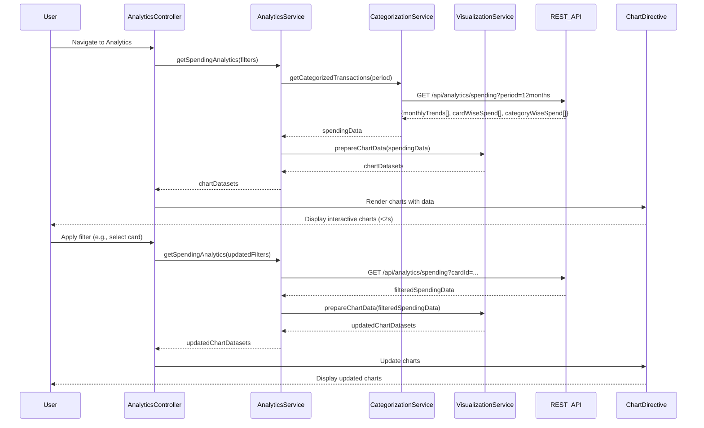

# Low-Level Design: Spending Analytics and Insights
**Epic ID:** QE-9731  
**Application Stack:** AngularJS 1.x, JavaScript ES6, HTML5, CSS3, Bootstrap, REST APIs, MVC Architecture

## a. Architecture Mapping

- **AnalyticsModule** (AngularJS Module) → Main module for analytics features
- **AnalyticsController** (Controller) → Manages analytics view state and user interactions
- **AnalyticsService** (Service) → Orchestrates analytics data retrieval and aggregation
- **CategorizationService** (Service) → Retrieves categorized transaction data
- **VisualizationService** (Service) → Prepares data for chart rendering
- **ChartDirective** (Directive) → Renders interactive charts using Chart.js or similar library

**Recommended Folder Structure:**
```
/app
  /modules
    /analytics
      /controllers
      /services
      /directives
      /views
      analytics.module.js
```

## b. Component Specifications

| Name | Artifact Type | Responsibility | Key Dependencies |
|------|---------------|----------------|------------------|
| AnalyticsModule | Module | Registers analytics components, routes, and chart library | ngRoute, chart.js, ui.bootstrap |
| AnalyticsController | Controller | Manages filter state, chart selection, and data binding | AnalyticsService, $scope, $filter |
| AnalyticsService | Service | Fetches and aggregates spending data by month, card, category | $http, $q, CategorizationService |
| CategorizationService | Service | Retrieves category-wise transaction data from API | $http, $q |
| VisualizationService | Service | Transforms raw data into chart-ready datasets (labels, values, colors) | None |
| ChartDirective | Directive | Renders responsive interactive charts with drill-down support | VisualizationService, Chart.js |

## c. Data Model

**SpendingAnalytics Object:**
```javascript
{
  monthlyTrends: [
    { month: String, totalSpend: Number }
  ],
  cardWiseSpend: [
    { cardId: String, cardName: String, totalSpend: Number }
  ],
  categoryWiseSpend: [
    { category: String, totalSpend: Number, transactionCount: Number }
  ]
}
```

**Category Enum:**
```javascript
['Food & Dining', 'Fuel', 'Shopping', 'Travel', 'Entertainment', 'Utilities', 'Healthcare', 'Education', 'Miscellaneous']
```

## d. Data Flow

User navigates to analytics view → AnalyticsController initializes and calls AnalyticsService.getSpendingAnalytics() → AnalyticsService fetches categorized transactions from CategorizationService via REST API (`GET /api/analytics/spending?period=12months`) → API returns aggregated data by month, card, and category → AnalyticsService passes data to VisualizationService → VisualizationService transforms data into chart-ready format (e.g., line chart dataset for monthly trends, pie chart dataset for category breakdown) → Data returned to AnalyticsController and bound to $scope → ChartDirective renders interactive charts (Chart.js) with responsive canvas → User applies filter (e.g., select specific card or date range) → AnalyticsController updates filter params and re-calls AnalyticsService → Updated chart data re-rendered in under 2 seconds.

## e. Primary Sequence Diagram



## f. Implementation Notes

- Use AngularJS DI with `$inject` annotation for minification-safe dependency injection
- Integrate Chart.js via angular-chart.js wrapper for seamless AngularJS binding and responsive charts
- Implement drill-down by binding click events on chart elements to trigger filtered data requests
- Use Bootstrap responsive utilities to stack charts vertically on mobile and display side-by-side on desktop
- Leverage ES6 array methods (map, reduce, filter) in VisualizationService for data transformation

## g. Error Handling

HTTP interceptor captures API errors; display error message in analytics view with retry option; log errors for debugging.

## h. Security Notes

Standard input validation and secure API calls assumed; token-based auth via existing SSO.