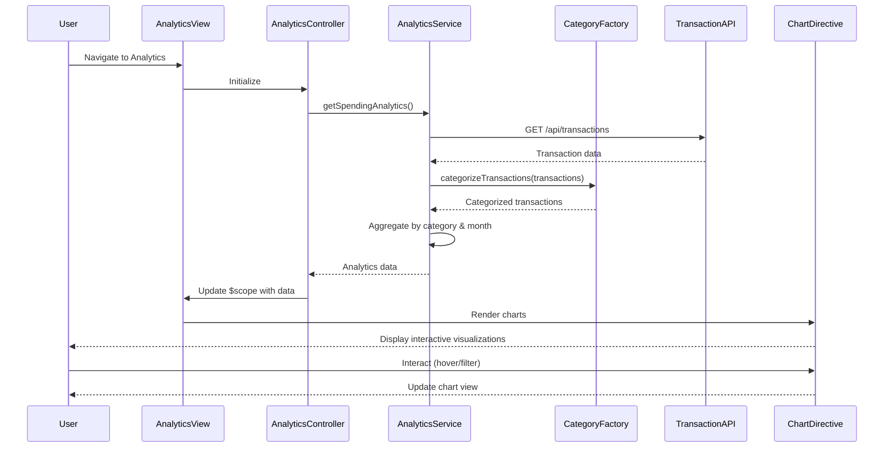

# Low-Level Design: QE-9750 - Spending Analytics and Insights

## a. Architecture Mapping

- **Analytics UI Component** → AngularJS Module + Controller (`analyticsModule`, `AnalyticsController`)
- **Visualization Engine** → AngularJS Directive (`spendingChart`, wraps charting library like Chart.js or D3.js)
- **Analytics Service** → AngularJS Service (`AnalyticsService`, handles data aggregation and calculations)
- **Categorization Service** → AngularJS Factory (`CategoryFactory`, provides transaction categorization logic)
- **Transaction Data** → REST API integration via `$http` or custom HTTP service

**Recommended Folder Structure:**
```
app/
├── modules/
│   └── analytics/
│       ├── analytics.module.js
│       ├── controllers/
│       │   └── analytics.controller.js
│       ├── services/
│       │   ├── analytics.service.js
│       │   └── category.factory.js
│       ├── directives/
│       │   └── spending-chart.directive.js
│       └── views/
│           └── analytics.html
└── assets/
    └── css/
        └── analytics.css
```

## b. Component Specifications

| Component Name | Artifact Type | Responsibility | Key Dependencies |
|----------------|---------------|----------------|------------------|
| analyticsModule | Module | Root module for analytics feature, registers all analytics components | angular, ui.router |
| AnalyticsController | Controller | Manages analytics view state, handles user interactions, coordinates data fetching | AnalyticsService, CategoryFactory, $scope |
| AnalyticsService | Service | Aggregates transaction data, calculates category-wise and monthly spend totals, provides analytics data to controller | $http, $q, CategoryFactory |
| CategoryFactory | Factory | Provides categorization logic, maps transactions to predefined categories (Food & Dining, Fuel, Shopping, Travel, Entertainment, Utilities, Healthcare, Education, Miscellaneous) | None |
| spendingChart | Directive | Renders interactive charts (pie/bar/line) for category-wise and monthly spend visualization using Chart.js | Chart.js library |
| TransactionApiService | Service | Handles REST API calls to fetch transaction data from backend | $http, API_CONFIG |

## c. Data Model

**Transaction Model:**
```javascript
{
  id: String,
  cardId: String,
  amount: Number,
  category: String, // One of: Food & Dining, Fuel, Shopping, Travel, Entertainment, Utilities, Healthcare, Education, Miscellaneous
  description: String,
  date: Date,
  merchant: String
}
```

**CategorySpending Model:**
```javascript
{
  category: String,
  totalAmount: Number,
  transactionCount: Number,
  percentage: Number
}
```

**MonthlyTrend Model:**
```javascript
{
  month: String, // YYYY-MM format
  totalSpend: Number,
  categoryBreakdown: Array<CategorySpending>
}
```

## d. Data Flow

User navigates to Analytics view → AnalyticsController initializes and calls AnalyticsService.getSpendingAnalytics() → AnalyticsService fetches transaction data via TransactionApiService → CategoryFactory categorizes each transaction into predefined categories → AnalyticsService aggregates data by category and month, calculates totals and percentages → Controller receives aggregated data and binds to $scope → spendingChart directive watches scope data and renders interactive visualizations (pie chart for category breakdown, line chart for monthly trends) → User interacts with charts (hover, filter) triggering directive event handlers that update view in real-time.

## e. Primary Sequence Diagram



## f. Implementation Notes

- Use AngularJS Dependency Injection to inject AnalyticsService and CategoryFactory into AnalyticsController for testability and modularity
- Implement CategoryFactory as a singleton factory returning categorization rules; use switch/case or object mapping for efficient category assignment
- Leverage Chart.js via custom directive with isolated scope; watch data changes using $scope.$watch to trigger chart updates
- Use $http interceptors for global error handling and loading states; cache analytics data using $cacheFactory for performance
- Apply ES6 arrow functions, const/let, and template literals in service/controller logic; use Bootstrap grid for responsive chart containers

## g. Error Handling

Use $http interceptor for global API error handling with user-friendly notifications via toast/modal; wrap service methods in try/catch blocks for client-side errors.

## h. Security Notes

Standard input validation and secure API calls assumed; ensure transaction data is fetched over HTTPS with token-based authentication.