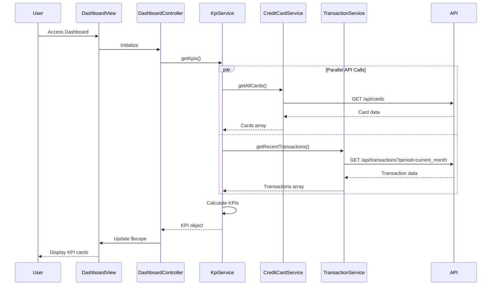

# Low-Level Design: QE-9751 - Credit Card Dashboard and KPI Management

## a. Architecture Mapping

- **Dashboard UI Layer** → AngularJS Module + Controller (`dashboardModule`, `DashboardController`)
- **KPI Aggregation Service** → AngularJS Service (`KpiService`, calculates and aggregates KPIs)
- **Credit Card Data Service** → AngularJS Service (`CreditCardService`, fetches card data via REST API)
- **Transaction Data Service** → AngularJS Service (`TransactionService`, fetches transaction data via REST API)
- **Data Repository** → Backend REST API endpoints consumed via $http

**Recommended Folder Structure:**
```
app/
├── modules/
│   └── dashboard/
│       ├── dashboard.module.js
│       ├── controllers/
│       │   └── dashboard.controller.js
│       ├── services/
│       │   ├── kpi.service.js
│       │   ├── credit-card.service.js
│       │   └── transaction.service.js
│       └── views/
│           └── dashboard.html
└── assets/
    └── css/
        └── dashboard.css
```

## b. Component Specifications

| Component Name | Artifact Type | Responsibility | Key Dependencies |
|----------------|---------------|----------------|------------------|
| dashboardModule | Module | Root module for dashboard feature, registers all dashboard components and routing | angular, ui.router |
| DashboardController | Controller | Manages dashboard state, coordinates KPI data fetching, handles user interactions | KpiService, CreditCardService, TransactionService, $scope |
| KpiService | Service | Aggregates data from multiple sources to calculate KPIs (monthly spend, total credit limit, available credit, outstanding amount) | CreditCardService, TransactionService, $q |
| CreditCardService | Service | Fetches credit card data from REST API, provides card details and credit limits | $http, API_CONFIG |
| TransactionService | Service | Fetches transaction data from REST API, provides spending and balance information | $http, API_CONFIG |
| kpiCard | Directive | Reusable component to display individual KPI metrics with icon, label, and value | None |

## c. Data Model

**CreditCard Model:**
```javascript
{
  id: String,
  cardNumber: String, // Masked (e.g., **** **** **** 1234)
  cardType: String, // Visa, MasterCard, etc.
  creditLimit: Number,
  availableCredit: Number,
  outstandingAmount: Number,
  expiryDate: String // MM/YY
}
```

**KPI Model:**
```javascript
{
  monthlySpend: Number,
  totalCreditLimit: Number,
  totalAvailableCredit: Number,
  totalOutstanding: Number
}
```

**Transaction Model:**
```javascript
{
  id: String,
  cardId: String,
  amount: Number,
  date: Date,
  description: String
}
```

## d. Data Flow

User accesses Dashboard view → DashboardController initializes and calls KpiService.getKpis() → KpiService concurrently fetches data via CreditCardService.getAllCards() and TransactionService.getRecentTransactions() using $q.all() → CreditCardService and TransactionService make REST API calls via $http → Services return data to KpiService → KpiService aggregates data to calculate monthly spend (sum of current month transactions), total credit limit (sum of all card limits), available credit (sum of all available credit), and outstanding amount (sum of all outstanding) → KpiService returns KPI object to DashboardController → Controller binds KPI data to $scope → View renders KPI cards using kpiCard directive with responsive Bootstrap grid → UI updates in real-time.

## e. Primary Sequence Diagram



## f. Implementation Notes

- Use AngularJS $q.all() in KpiService to fetch card and transaction data in parallel for optimized load time
- Implement CreditCardService and TransactionService as singletons with $http; use API_CONFIG constant for base URL configuration
- Create kpiCard as an isolated-scope directive with bindings for icon, label, and value; style with Bootstrap cards for responsive layout
- Apply ES6 features (arrow functions, const/let, template literals) in controllers and services; use Bootstrap grid (col-md-3) for 4-column KPI layout on desktop
- Cache KPI data using $cacheFactory with TTL to reduce redundant API calls; implement pull-to-refresh or auto-refresh mechanism

## g. Error Handling

Use $http interceptor for centralized API error handling with user notifications via toast messages; wrap KPI calculations in try/catch for graceful degradation.

## h. Security Notes

Requires token-based authentication via existing SSO; ensure all API calls include auth token in headers and card numbers are masked on client-side.