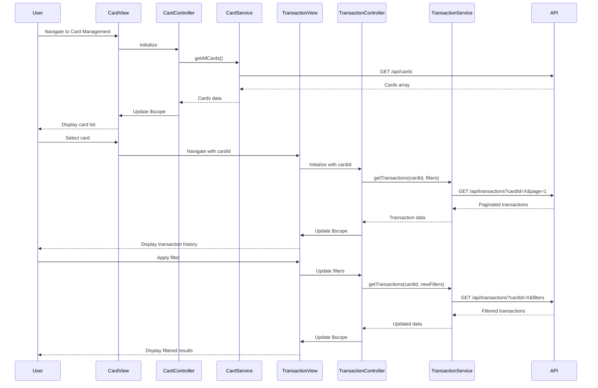

# Low-Level Design: QE-9752 - Credit Card and Transaction Management

## a. Architecture Mapping

- **User Interface** → AngularJS Module + Controller (`cardManagementModule`, `CardManagementController`)
- **Card Management Module** → AngularJS Controller + Service (`CardController`, `CardService`)
- **Transaction History Module** → AngularJS Controller + Service (`TransactionController`, `TransactionService`)
- **Credit Card Service** → AngularJS Service (`CardService`, handles card data operations via REST API)
- **Transaction Service** → AngularJS Service (`TransactionService`, handles transaction data operations via REST API)
- **Database** → Backend REST API endpoints consumed via $http

**Recommended Folder Structure:**
```
app/
├── modules/
│   └── card-management/
│       ├── card-management.module.js
│       ├── controllers/
│       │   ├── card-management.controller.js
│       │   └── transaction-history.controller.js
│       ├── services/
│       │   ├── card.service.js
│       │   └── transaction.service.js
│       ├── directives/
│       │   ├── card-list.directive.js
│       │   └── transaction-list.directive.js
│       └── views/
│           ├── card-management.html
│           └── transaction-history.html
└── assets/
    └── css/
        └── card-management.css
```

## b. Component Specifications

| Component Name | Artifact Type | Responsibility | Key Dependencies |
|----------------|---------------|----------------|------------------|
| cardManagementModule | Module | Root module for card and transaction management, registers components and routing | angular, ui.router |
| CardManagementController | Controller | Manages card list view, handles card selection, coordinates card data fetching | CardService, $scope, $state |
| TransactionController | Controller | Manages transaction history view, handles filtering and pagination, fetches transaction data for selected card | TransactionService, $scope, $stateParams |
| CardService | Service | Fetches all user credit cards, retrieves individual card details, provides card-specific data | $http, $q, API_CONFIG |
| TransactionService | Service | Fetches transaction history for a specific card with pagination and filtering support | $http, $q, API_CONFIG |
| cardList | Directive | Displays list of credit cards with summary info (card number, type, balance); handles card selection | CardService |
| transactionList | Directive | Displays paginated transaction history with filtering options (date range, amount); supports card-wise spend visualization | TransactionService |

## c. Data Model

**CreditCard Model:**
```javascript
{
  id: String,
  cardNumber: String, // Masked
  cardType: String,
  bankName: String,
  creditLimit: Number,
  availableCredit: Number,
  outstandingAmount: Number,
  expiryDate: String,
  status: String // Active, Blocked, Expired
}
```

**Transaction Model:**
```javascript
{
  id: String,
  cardId: String,
  amount: Number,
  transactionType: String, // Debit, Credit
  category: String,
  merchant: String,
  description: String,
  date: Date,
  status: String // Completed, Pending, Failed
}
```

**TransactionFilter Model:**
```javascript
{
  cardId: String,
  startDate: Date,
  endDate: Date,
  minAmount: Number,
  maxAmount: Number,
  category: String,
  page: Number,
  pageSize: Number
}
```

## d. Data Flow

User navigates to Card Management view → CardManagementController initializes and calls CardService.getAllCards() → CardService makes REST API call via $http → API returns array of credit cards → Controller binds card data to $scope → cardList directive renders card list with Bootstrap cards → User selects a card → Controller navigates to Transaction History view with cardId as route parameter → TransactionController initializes with $stateParams.cardId and calls TransactionService.getTransactions(cardId, filters) → TransactionService makes paginated REST API call with filters → API returns transaction data → Controller binds transactions to $scope → transactionList directive renders paginated transaction table with filtering UI → User applies filters or changes page → Controller updates filters and re-fetches data → View updates with new transaction list.

## e. Primary Sequence Diagram



## f. Implementation Notes

- Use ui.router for state management with nested views (card list → transaction detail); pass cardId via $stateParams for transaction filtering
- Implement pagination in TransactionService using query parameters (page, pageSize); use AngularJS ng-repeat with limitTo filter or custom pagination directive
- Create cardList and transactionList as reusable directives with isolated scope; bind card selection via callback function passed from controller
- Apply ES6 const/let, arrow functions, and template literals; use Bootstrap table-responsive for transaction list and card grid for card display
- Cache card list using $cacheFactory; implement lazy loading for transaction history to optimize performance with large datasets

## g. Error Handling

Use $http interceptor for global API error handling with user-friendly error messages; implement try/catch in controllers for client-side validation errors.

## h. Security Notes

Standard input validation and secure API calls assumed; ensure card numbers are masked and transaction data is fetched over HTTPS with token-based authentication.