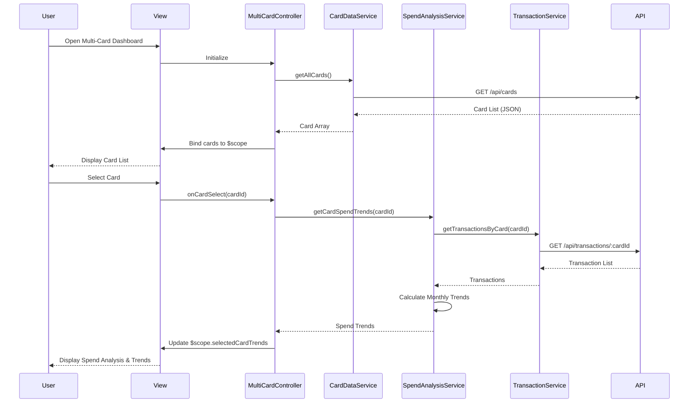

# Low-Level Design: Multi-Card Management and Monitoring
**Epic ID:** QE-9765  
**Application Stack:** AngularJS 1.x, JavaScript ES6, HTML5, CSS3, Bootstrap, REST APIs, MVC Architecture

---

## a. Architecture Mapping

| HLD Component | AngularJS Artifact | Description |
|---------------|-------------------|-------------|
| User Interface | Module: `creditCard.multiCard` | Root module for multi-card management feature |
| Multi-Card Management Module | Controller: `MultiCardController` | Orchestrates card display and user interactions |
| Card Selection and Filtering Component | Directive: `cardFilter` | Custom directive for card selection UI |
| Spend Analysis Engine | Service: `SpendAnalysisService` | Business logic for spend calculations and trends |
| Credit Card Data Repository | Service: `CardDataService` | REST API integration for card data |
| Transaction Processing Service | Service: `TransactionService` | Retrieves and processes transaction data |
| User Profile Service | Service: `UserProfileService` | Validates user-card associations |

**Recommended Folder Structure:**
```
app/
├── modules/
│   └── credit-card/
│       ├── multi-card/
│       │   ├── multi-card.module.js
│       │   ├── multi-card.controller.js
│       │   ├── multi-card.view.html
│       │   └── directives/
│       │       └── card-filter.directive.js
│       └── services/
│           ├── card-data.service.js
│           ├── transaction.service.js
│           ├── spend-analysis.service.js
│           └── user-profile.service.js
└── assets/
    └── css/
        └── multi-card.css
```

---

## b. Component Specifications

| Component Name | Artifact Type | Responsibility | Key Dependencies |
|----------------|---------------|----------------|------------------|
| `creditCard.multiCard` | Module | Root module registration and dependency injection | `ngRoute`, `ngResource`, `ui.bootstrap` |
| `MultiCardController` | Controller | Manages card list, selection, filtering, and view state | `CardDataService`, `SpendAnalysisService`, `$scope` |
| `cardFilter` | Directive | Renders card selection dropdown with filtering capabilities | `$filter`, isolated scope |
| `CardDataService` | Service | Fetches card details from REST API `/api/cards` | `$http`, `$q` |
| `TransactionService` | Service | Retrieves transactions via `/api/transactions/:cardId` | `$http`, `$q` |
| `SpendAnalysisService` | Service | Calculates card-wise spend, utilization, and monthly trends | `TransactionService`, ES6 Array methods |
| `UserProfileService` | Service | Validates card ownership via `/api/user/cards` | `$http`, `AuthService` |

---

## c. Data Model

**Card Object:**
```javascript
{
  cardId: String,
  cardNumber: String (masked),
  cardType: String,
  bankName: String,
  creditLimit: Number,
  availableCredit: Number,
  outstandingAmount: Number,
  utilizationPercent: Number,
  isActive: Boolean
}
```

**Transaction Object:**
```javascript
{
  transactionId: String,
  cardId: String,
  amount: Number,
  category: String,
  date: Date,
  merchant: String,
  description: String
}
```

**MonthlySpendTrend Object:**
```javascript
{
  month: String (YYYY-MM),
  totalSpend: Number,
  transactionCount: Number,
  cardId: String
}
```

---

## d. Data Flow

User opens the multi-card view → `MultiCardController` initializes and calls `CardDataService.getAllCards()` → Service makes GET request to `/api/cards` → Response returns array of card objects → Controller stores cards in `$scope.cards` → User selects a card via `cardFilter` directive → Controller invokes `SpendAnalysisService.getCardSpendTrends(cardId)` → Service calls `TransactionService.getTransactionsByCard(cardId)` → Transactions are aggregated by month → Spend trends and utilization metrics are calculated → Results are bound to view → UI updates card details panel and trend chart using Bootstrap grid and AngularJS data binding.

---

## e. Primary Sequence Diagram



---

## f. Implementation Notes

- Use AngularJS `$http` service with promise-based pattern for all REST API calls; leverage `$q.all()` for parallel card data retrieval.
- Implement ES6 `Array.reduce()` and `Array.filter()` in `SpendAnalysisService` for efficient transaction aggregation and trend calculation.
- Apply AngularJS Dependency Injection (DI) via function parameter annotation or `$inject` array to ensure minification safety.
- Use Bootstrap grid system (col-md-*, col-sm-*) for responsive card layout; integrate `ui.bootstrap` for dropdown and modal components.
- Implement one-way data binding where possible (`::` syntax) to optimize digest cycle performance for large card lists (up to 10 cards).

---

## g. Error Handling

HTTP interceptor-based error handling with user-friendly toast notifications for API failures; try/catch blocks in service methods with fallback to cached data.

---

## h. Security Notes

Requires token-based authentication via existing SSO; card numbers are masked on client-side; all API calls include Authorization header with JWT token.