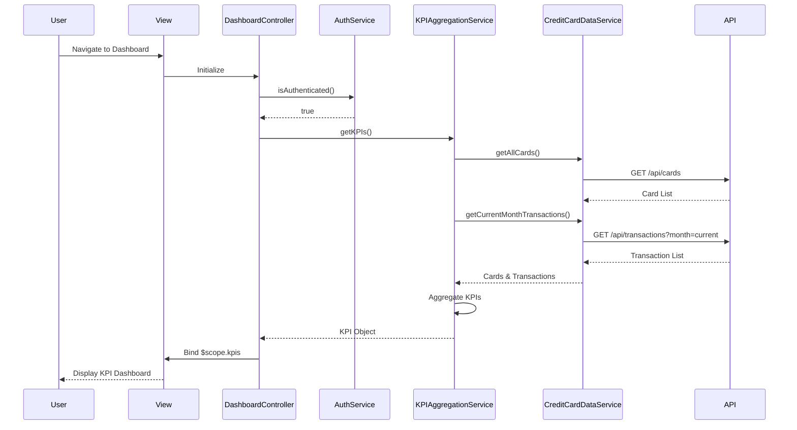

# Low-Level Design: Dashboard and KPI Management
**Epic ID:** QE-9766  
**Application Stack:** AngularJS 1.x, JavaScript ES6, HTML5, CSS3, Bootstrap, REST APIs, MVC Architecture

---

## a. Architecture Mapping

| HLD Component | AngularJS Artifact | Description |
|---------------|-------------------|-------------|
| User Browser | View: `dashboard.view.html` | Main dashboard HTML template with Bootstrap layout |
| Dashboard UI Component | Controller: `DashboardController` | Manages KPI data and view logic |
| KPI Aggregation Service | Service: `KPIAggregationService` | Aggregates and calculates KPI metrics |
| Credit Card Data Service | Service: `CreditCardDataService` | REST API integration for card and transaction data |
| User Authentication Service | Service: `AuthService` | Handles user authentication and session management |
| Data Store | REST API Endpoints | Backend endpoints: `/api/cards`, `/api/transactions` |

**Recommended Folder Structure:**
```
app/
├── modules/
│   └── dashboard/
│       ├── dashboard.module.js
│       ├── dashboard.controller.js
│       ├── dashboard.view.html
│       └── services/
│           ├── kpi-aggregation.service.js
│           ├── credit-card-data.service.js
│           └── auth.service.js
└── assets/
    └── css/
        └── dashboard.css
```

---

## b. Component Specifications

| Component Name | Artifact Type | Responsibility | Key Dependencies |
|----------------|---------------|----------------|------------------|
| `dashboard` | Module | Root module for dashboard feature | `ngRoute`, `ngResource`, `ui.bootstrap` |
| `DashboardController` | Controller | Orchestrates KPI display and data refresh | `KPIAggregationService`, `AuthService`, `$scope`, `$interval` |
| `KPIAggregationService` | Service | Calculates monthly spend, total credit limit, available credit, outstanding amount | `CreditCardDataService`, ES6 Array methods |
| `CreditCardDataService` | Service | Fetches card and transaction data from REST APIs | `$http`, `$q` |
| `AuthService` | Service | Validates user session and manages authentication tokens | `$http`, `$window` (localStorage) |
| `kpiCard` | Directive | Reusable KPI card component for displaying individual metrics | Isolated scope, `$filter` for number formatting |

---

## c. Data Model

**KPI Object:**
```javascript
{
  monthlySpend: Number,
  totalCreditLimit: Number,
  availableCredit: Number,
  outstandingAmount: Number,
  lastUpdated: Date
}
```

**Card Summary Object:**
```javascript
{
  cardId: String,
  creditLimit: Number,
  availableCredit: Number,
  currentBalance: Number
}
```

**Transaction Summary Object:**
```javascript
{
  currentMonthSpend: Number,
  transactionCount: Number,
  month: String (YYYY-MM)
}
```

---

## d. Data Flow

User navigates to dashboard → `DashboardController` initializes and checks authentication via `AuthService.isAuthenticated()` → If authenticated, controller calls `KPIAggregationService.getKPIs()` → Service invokes `CreditCardDataService.getAllCards()` and `CreditCardDataService.getCurrentMonthTransactions()` in parallel using `$q.all()` → API returns card summaries and transaction data → Service aggregates data: sums credit limits, calculates available credit (sum of availableCredit), computes outstanding amount (sum of currentBalance), and calculates monthly spend from transactions → Aggregated KPI object is returned to controller → Controller binds KPIs to `$scope.kpis` → View renders KPI cards using Bootstrap grid and AngularJS interpolation → `$interval` triggers auto-refresh every 30 seconds to update KPIs.

---

## e. Primary Sequence Diagram



---

## f. Implementation Notes

- Use AngularJS `$http` service with interceptors for adding authentication headers; implement `$q.all()` for parallel API calls to meet 2-second load time requirement.
- Leverage ES6 `Array.reduce()` in `KPIAggregationService` for efficient aggregation of credit limits and balances across multiple cards.
- Apply AngularJS DI with explicit `$inject` annotation to ensure minification compatibility.
- Use Bootstrap responsive grid (col-xs-12, col-md-6, col-lg-3) for KPI card layout; integrate CSS3 transitions for smooth KPI updates.
- Implement `$interval` service for auto-refresh with cleanup on `$scope.$on('$destroy')` to prevent memory leaks.

---

## g. Error Handling

HTTP interceptor captures API errors and displays user-friendly notifications via toast/alert; fallback to cached KPI data on network failure with visual indicator.

---

## h. Security Notes

Requires token-based auth via existing SSO; all API requests include JWT token in Authorization header; session timeout redirects to login page.