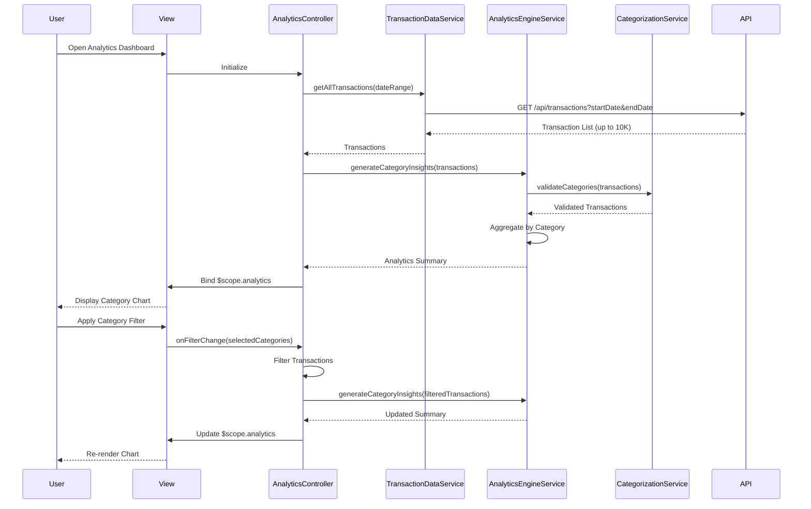

# Low-Level Design: Spending Analytics and Insights
**Epic ID:** QE-9767  
**Application Stack:** AngularJS 1.x, JavaScript ES6, HTML5, CSS3, Bootstrap, REST APIs, MVC Architecture

---

## a. Architecture Mapping

| HLD Component | AngularJS Artifact | Description |
|---------------|-------------------|-------------|
| User Interface | View: `analytics.view.html` | Main analytics page with chart containers |
| Analytics Visualization Module | Controller: `AnalyticsController` | Manages chart data and user interactions |
| Filtering and Drill-Down Component | Directive: `categoryFilter` | Custom directive for multi-category selection |
| Analytics Engine | Service: `AnalyticsEngineService` | Processes spending patterns and calculates insights |
| Transaction Data Service | Service: `TransactionDataService` | REST API integration for transaction retrieval |
| Categorization Service | Service: `CategorizationService` | Handles automatic transaction categorization logic |
| Transaction Database | REST API Endpoint | Backend endpoint: `/api/transactions` |

**Recommended Folder Structure:**
```
app/
├── modules/
│   └── analytics/
│       ├── analytics.module.js
│       ├── analytics.controller.js
│       ├── analytics.view.html
│       ├── directives/
│       │   └── category-filter.directive.js
│       └── services/
│           ├── analytics-engine.service.js
│           ├── transaction-data.service.js
│           └── categorization.service.js
└── assets/
    ├── css/
    │   └── analytics.css
    └── libs/
        └── chart.js (or D3.js)
```

---

## b. Component Specifications

| Component Name | Artifact Type | Responsibility | Key Dependencies |
|----------------|---------------|----------------|------------------|
| `analytics` | Module | Root module for analytics feature | `ngRoute`, `ngResource`, `chart.js` (or Angular-Chart) |
| `AnalyticsController` | Controller | Manages chart rendering, filtering, and drill-down logic | `AnalyticsEngineService`, `TransactionDataService`, `$scope` |
| `categoryFilter` | Directive | Renders multi-select dropdown for category filtering | `$filter`, isolated scope, two-way binding |
| `AnalyticsEngineService` | Service | Aggregates transactions by category, calculates percentages and totals | `CategorizationService`, ES6 Map/Set |
| `TransactionDataService` | Service | Fetches transactions via `/api/transactions` with pagination support | `$http`, `$q` |
| `CategorizationService` | Service | Validates and assigns categories to transactions | Predefined category rules (static config) |
| `spendingChart` | Directive | Wrapper directive for Chart.js pie/bar chart rendering | Chart.js library, `$timeout` |

---

## c. Data Model

**Transaction Object:**
```javascript
{
  transactionId: String,
  cardId: String,
  amount: Number,
  category: String,
  date: Date,
  merchant: String,
  description: String
}
```

**Category Spending Object:**
```javascript
{
  category: String,
  totalAmount: Number,
  percentage: Number,
  transactionCount: Number,
  color: String (hex code for chart)
}
```

**Analytics Summary Object:**
```javascript
{
  totalSpend: Number,
  categoryBreakdown: Array<CategorySpending>,
  dateRange: { start: Date, end: Date },
  topCategory: String
}
```

**Category Enum:**
```javascript
[
  'Food & Dining',
  'Fuel',
  'Shopping',
  'Travel',
  'Entertainment',
  'Utilities',
  'Healthcare',
  'Education',
  'Miscellaneous'
]
```

---

## d. Data Flow

User navigates to analytics page → `AnalyticsController` initializes and calls `TransactionDataService.getAllTransactions()` with date range filter → Service makes GET request to `/api/transactions?startDate=X&endDate=Y` → API returns up to 10,000 transactions → Controller passes transactions to `AnalyticsEngineService.generateCategoryInsights(transactions)` → Service uses `CategorizationService.validateCategories()` to ensure all transactions have valid categories → Service aggregates transactions by category using ES6 Map, calculates total spend per category and percentage of total → Service returns `AnalyticsSummary` object → Controller binds data to `$scope.analytics` → View renders pie chart via `spendingChart` directive using Chart.js → User selects category filter via `categoryFilter` directive → Controller filters transactions and re-invokes `AnalyticsEngineService` → Updated chart data is bound to view → Chart re-renders with sub-second response using `$timeout` for digest cycle optimization.

---

## e. Primary Sequence Diagram



---

## f. Implementation Notes

- Use AngularJS `$http` with response caching for transaction data to optimize repeated requests; implement pagination if dataset exceeds 10,000 records.
- Leverage ES6 `Map` for O(1) category lookup and `Array.reduce()` for efficient aggregation in `AnalyticsEngineService`.
- Integrate Chart.js via Angular-Chart directive wrapper for declarative chart rendering; use `$timeout` to defer chart updates outside digest cycle for sub-second performance.
- Apply AngularJS DI with explicit `$inject` for minification safety; use factory pattern for `CategorizationService` to maintain stateless category rules.
- Implement Bootstrap responsive grid for chart containers (col-md-8 for chart, col-md-4 for filters); use CSS3 transitions for smooth filter UI updates.

---

## g. Error Handling

HTTP interceptor-based error handling with user notifications; try/catch in aggregation logic with fallback to partial data display if categorization fails.

---

## h. Security Notes

Requires token-based auth via existing SSO; transaction data includes only user-owned records validated server-side; all API calls secured with JWT in Authorization header.