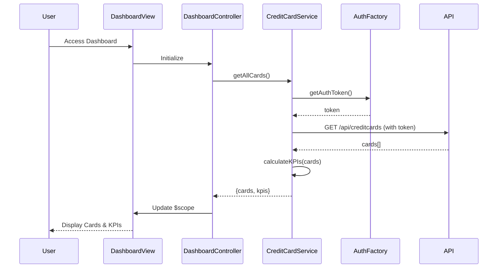

# Low-Level Design: QE-9768 - Credit Card Management and Dashboard KPIs

## a. Architecture Mapping

- **Dashboard UI Layer** → AngularJS Module (`creditCardDashboard`) with Controller (`DashboardController`)
- **Credit Card Management Service** → AngularJS Service (`CreditCardService`) for business logic and API orchestration
- **User Authentication Service** → AngularJS Factory (`AuthFactory`) for token management and session handling
- **Credit Card Data Service** → REST API integration via `$http` service
- **KPI Calculation Logic** → Service method within `CreditCardService`

**Recommended Folder Structure:**
```
app/
├── modules/
│   └── dashboard/
│       ├── dashboard.module.js
│       ├── dashboard.controller.js
│       ├── dashboard.html
│       └── dashboard.css
├── services/
│   ├── creditCard.service.js
│   └── auth.factory.js
└── models/
    └── creditCard.model.js
```

## b. Component Specifications

| Component Name | Artifact Type | Responsibility | Key Dependencies |
|---|---|---|---|
| `creditCardDashboard` | Module | Root module for dashboard feature | `ngRoute`, `ui.bootstrap` |
| `DashboardController` | Controller | Manages dashboard view state, fetches card data, calculates KPIs | `CreditCardService`, `$scope` |
| `CreditCardService` | Service | Retrieves card data from API, performs KPI calculations (available credit, utilization) | `$http`, `$q`, `AuthFactory` |
| `AuthFactory` | Factory | Manages authentication tokens and session state | `$window`, `$http` |
| `creditCardListDirective` | Directive | Renders individual credit card tiles with KPI display | `CreditCardService` |

## c. Data Model

```javascript
// CreditCard Model
const CreditCard = {
  cardId: String,
  cardNumber: String,        // Masked (e.g., "**** 1234")
  cardType: String,          // "Visa", "Mastercard", "Amex"
  cardHolderName: String,
  monthlySpend: Number,      // Current month spend
  totalCreditLimit: Number,
  availableCredit: Number,
  outstandingAmount: Number,
  lastUpdated: Date
};

// Dashboard KPI Model
const DashboardKPI = {
  totalMonthlySpend: Number,
  aggregatedCreditLimit: Number,
  aggregatedAvailableCredit: Number,
  totalOutstanding: Number,
  creditUtilization: Number  // Percentage
};
```

## d. Data Flow

User accesses the dashboard → `DashboardController` initializes and calls `CreditCardService.getAllCards()` → Service validates authentication via `AuthFactory` → Service makes REST API call (`GET /api/creditcards`) with auth token → API returns card data array → Service calculates aggregate KPIs (total spend, available credit, utilization) → Controller updates `$scope.cards` and `$scope.kpis` → View renders card tiles and KPI widgets using Bootstrap grid and `ng-repeat` → UI updates complete within 2 seconds per NFR.

## e. Primary Sequence Diagram



## f. Implementation Notes

- Use AngularJS 1.x module pattern with dependency injection for `CreditCardService` and `AuthFactory`
- Implement ES6 arrow functions and template literals for cleaner service methods
- Use `$http` interceptor to attach authentication token to all API requests automatically
- Apply Bootstrap responsive grid (`col-xs-12 col-md-6 col-lg-4`) for card tiles to support desktop/tablet/mobile
- Leverage `$q.all()` for parallel card data fetching if multiple API calls are needed to meet 2-second load NFR

## g. Error Handling

HTTP interceptor-based error handling with user-friendly notifications via Bootstrap alerts for API failures and session expiry.

## h. Security Notes

Requires token-based authentication via existing SSO; all API calls include Authorization header with JWT token.