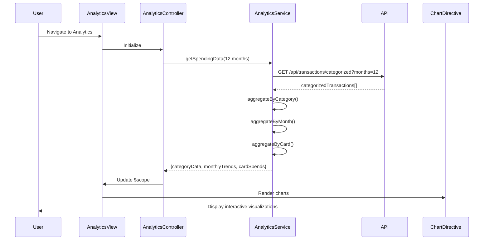

# Low-Level Design: QE-9769 - Spending Analytics and Insights

## a. Architecture Mapping

- **Analytics UI Component** → AngularJS Module (`spendingAnalytics`) with Controller (`AnalyticsController`)
- **Analytics Engine** → AngularJS Service (`AnalyticsService`) for data aggregation and trend calculation
- **Transaction Categorization Service** → REST API integration via `$http` for categorized transaction data
- **Chart Rendering Library** → Directive (`chartDirective`) wrapping Chart.js or D3.js for interactive visualizations
- **Category Filter Component** → AngularJS Directive (`categoryFilterDirective`) for user-driven category selection

**Recommended Folder Structure:**
```
app/
├── modules/
│   └── analytics/
│       ├── analytics.module.js
│       ├── analytics.controller.js
│       ├── analytics.html
│       └── analytics.css
├── services/
│   └── analytics.service.js
├── directives/
│   ├── chart.directive.js
│   └── categoryFilter.directive.js
└── models/
    └── spending.model.js
```

## b. Component Specifications

| Component Name | Artifact Type | Responsibility | Key Dependencies |
|---|---|---|---|
| `spendingAnalytics` | Module | Root module for analytics feature | `ngRoute`, `chart.js` |
| `AnalyticsController` | Controller | Manages analytics view, fetches spending data, handles user interactions | `AnalyticsService`, `$scope`, `$filter` |
| `AnalyticsService` | Service | Retrieves categorized transactions, aggregates spending by category/month/card | `$http`, `$q` |
| `chartDirective` | Directive | Renders interactive charts (pie, bar, line) using Chart.js library | `Chart.js`, `$timeout` |
| `categoryFilterDirective` | Directive | Provides multi-select filter for 9 spending categories | `$scope` |

## c. Data Model

```javascript
// Spending Category Model
const SpendingCategory = {
  categoryId: String,
  categoryName: String,  // "Food & Dining", "Fuel", "Shopping", etc.
  totalAmount: Number,
  transactionCount: Number,
  percentage: Number     // Of total spend
};

// Monthly Trend Model
const MonthlyTrend = {
  month: String,         // "2024-01", "2024-02", etc.
  totalSpend: Number,
  categoryBreakdown: Array  // Array of {category, amount}
};

// Card-wise Spend Model
const CardSpend = {
  cardId: String,
  cardName: String,      // Masked card number
  totalSpend: Number,
  topCategory: String,   // Most used category for this card
  spendByCategory: Array // Array of {category, amount}
};
```

## d. Data Flow

User navigates to Analytics page → `AnalyticsController` initializes and calls `AnalyticsService.getSpendingData(timeRange)` → Service makes REST API call (`GET /api/transactions/categorized?months=12`) → API returns categorized transaction data → Service aggregates data by category, month, and card using ES6 `reduce()` and `map()` → Controller updates `$scope.categoryData`, `$scope.monthlyTrends`, `$scope.cardSpends` → `chartDirective` watches scope changes and renders interactive charts (pie for categories, line for trends, bar for cards) using Chart.js → User interacts with filters → Controller re-aggregates data and updates charts within 2 seconds per NFR.

## e. Primary Sequence Diagram



## f. Implementation Notes

- Use AngularJS Service pattern for `AnalyticsService` with ES6 class syntax for cleaner aggregation methods
- Implement Chart.js via custom directive with two-way binding to support dynamic data updates
- Use `$filter` service for date formatting and currency display in chart tooltips
- Apply memoization or caching in `AnalyticsService` for pre-computed 12-month aggregations to meet 2-second render NFR
- Leverage `ng-if` and `ng-show` for conditional rendering of chart types based on user selection

## g. Error Handling

Try/catch blocks in service aggregation methods with fallback to empty datasets; HTTP interceptor displays user notification for API failures.

## h. Security Notes

Standard input validation and secure API calls assumed; authentication token required for transaction data access.