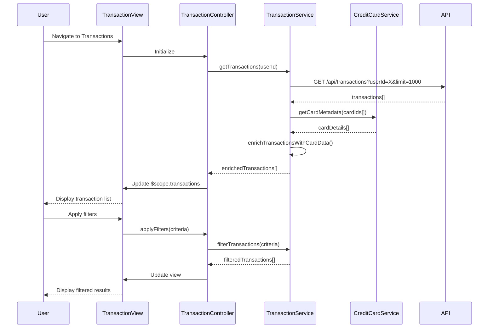

# Low-Level Design: QE-9770 - Transaction Management and Viewing

## a. Architecture Mapping

- **User Interface** → AngularJS Module (`transactionManagement`) with Controller (`TransactionController`)
- **Transaction Management Module** → AngularJS Service (`TransactionService`) for transaction retrieval and filtering logic
- **Transaction Data Service** → REST API integration via `$http` for transaction records
- **Credit Card Management Service** → AngularJS Service (`CreditCardService`) for card association
- **Transaction List View** → Directive (`transactionListDirective`) with sorting and filtering capabilities

**Recommended Folder Structure:**
```
app/
├── modules/
│   └── transactions/
│       ├── transactions.module.js
│       ├── transactions.controller.js
│       ├── transactions.html
│       └── transactions.css
├── services/
│   ├── transaction.service.js
│   └── creditCard.service.js
├── directives/
│   └── transactionList.directive.js
└── models/
    └── transaction.model.js
```

## b. Component Specifications

| Component Name | Artifact Type | Responsibility | Key Dependencies |
|---|---|---|---|
| `transactionManagement` | Module | Root module for transaction viewing feature | `ngRoute`, `ui.bootstrap`, `ngTable` |
| `TransactionController` | Controller | Manages transaction list state, handles filtering/sorting, pagination | `TransactionService`, `CreditCardService`, `$scope` |
| `TransactionService` | Service | Retrieves transactions from API, applies client-side filters, manages pagination | `$http`, `$q` |
| `CreditCardService` | Service | Provides card metadata for transaction-card association | `$http` |
| `transactionListDirective` | Directive | Renders transaction table with sortable columns and filter inputs | `TransactionService`, `$filter` |

## c. Data Model

```javascript
// Transaction Model
const Transaction = {
  transactionId: String,
  cardId: String,
  cardName: String,          // Masked card number
  transactionDate: Date,
  merchantName: String,
  category: String,          // "Food & Dining", "Fuel", etc.
  amount: Number,
  currency: String,          // "USD", "EUR", etc.
  status: String,            // "Posted", "Pending"
  description: String
};

// Transaction Filter Model
const TransactionFilter = {
  cardIds: Array,            // Selected card IDs
  dateFrom: Date,
  dateTo: Date,
  categories: Array,
  minAmount: Number,
  maxAmount: Number,
  searchText: String         // Merchant name search
};
```

## d. Data Flow

User navigates to Transactions page → `TransactionController` initializes and calls `TransactionService.getTransactions(userId)` → Service makes REST API call (`GET /api/transactions?userId=X&limit=1000`) with authentication token → API returns transaction array → Service associates each transaction with card metadata via `CreditCardService.getCardById()` → Controller updates `$scope.transactions` and initializes filter/sort state → View renders transaction table using `ng-repeat` with Bootstrap table styling → User applies filters (date range, card, category) → Controller calls `TransactionService.applyFilters(filterCriteria)` → Service filters transactions client-side using ES6 `filter()` and updates view → Transaction details displayed within 3 seconds per NFR.

## e. Primary Sequence Diagram



## f. Implementation Notes

- Use AngularJS Service pattern for `TransactionService` with dependency injection of `$http` and `CreditCardService`
- Implement client-side filtering and sorting using ES6 array methods (`filter`, `sort`) for responsive UX
- Use `ng-table` or custom directive with `orderBy` filter for sortable table columns
- Apply pagination with `limitTo` filter to display 50 transactions per page, improving performance for 1000+ records
- Leverage `$filter('date')` and `$filter('currency')` for consistent transaction display formatting

## g. Error Handling

HTTP interceptor-based error handling with user notifications; try/catch in filter logic with graceful degradation to unfiltered view.

## h. Security Notes

Requires token-based auth via existing SSO; transaction data access restricted to authenticated user's own transactions only.