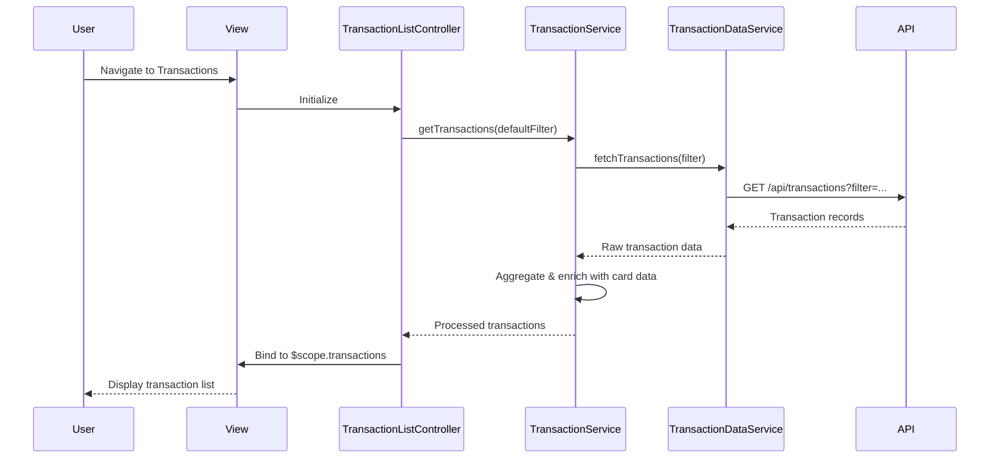

# Low-Level Design: Transaction Management and Viewing
**Epic ID:** QE-9771

## a. Architecture Mapping

- **User Interface** → AngularJS Module (`transactionModule`) + Controller (`TransactionListController`) + View templates
- **Transaction API Gateway** → Service (`TransactionService`) using `$http` for REST API calls
- **Credit Card Service** → Factory (`CreditCardFactory`) for card data retrieval and linking
- **Transaction Data Service** → Service (`TransactionDataService`) for transaction record operations
- **Transaction Data Store** → Backend REST API endpoints consumed by services

**Folder Structure:**
```
/app
  /modules
    /transactions
      /controllers
        transaction-list.controller.js
      /services
        transaction.service.js
        transaction-data.service.js
      /factories
        credit-card.factory.js
      /views
        transaction-list.html
      transactions.module.js
```

## b. Component Specifications

| Name | Artifact Type | Responsibility | Key Dependencies |
|------|---------------|----------------|------------------|
| transactionModule | Module | Root module for transaction management features | ngRoute, ui.bootstrap |
| TransactionListController | Controller | Manages transaction list view, filtering, and user interactions | TransactionService, CreditCardFactory, $scope |
| TransactionService | Service | Orchestrates transaction retrieval and aggregation across cards | $http, $q, TransactionDataService |
| TransactionDataService | Service | Handles REST API calls to retrieve transaction records | $http, API_CONFIG |
| CreditCardFactory | Factory | Provides credit card data and links transactions to cards | $http, $cacheFactory |
| transactionListView | View/Template | Displays transaction history with responsive layout | Bootstrap grid, ng-repeat |

## c. Data Model

**Transaction Object:**
```javascript
{
  transactionId: String,
  cardId: String,
  merchantName: String,
  amount: Number,
  transactionDate: Date,
  category: String,
  status: String,
  description: String
}
```

**TransactionFilter Object:**
```javascript
{
  cardIds: Array<String>,
  startDate: Date,
  endDate: Date,
  minAmount: Number,
  maxAmount: Number
}
```

## d. Data Flow

User navigates to transaction list view, triggering TransactionListController initialization. Controller invokes TransactionService.getTransactions() with default filter (last 90 days). TransactionService calls TransactionDataService to fetch transaction records via REST API, then uses CreditCardFactory to enrich transactions with card details. Aggregated transaction data is bound to $scope and rendered in the view using ng-repeat with Bootstrap responsive tables. User applies filters, triggering controller method that re-invokes service with updated filter parameters, and view updates reactively.

## e. Primary Sequence Diagram



## f. Implementation Notes

- Use AngularJS 1.x dependency injection for all controllers, services, and factories
- Implement pagination using ui.bootstrap pagination directive for large transaction volumes
- Use $http interceptor pattern for adding auth tokens and handling API errors globally
- Apply ES6 arrow functions and const/let for service implementations
- Leverage $cacheFactory in CreditCardFactory to minimize redundant card data API calls

## g. Error Handling

HTTP interceptor-based error handling with user-friendly notifications via toastr or Bootstrap alerts for API failures.

## h. Security Notes

Requires token-based auth via existing SSO; all API calls include Authorization header with JWT token.