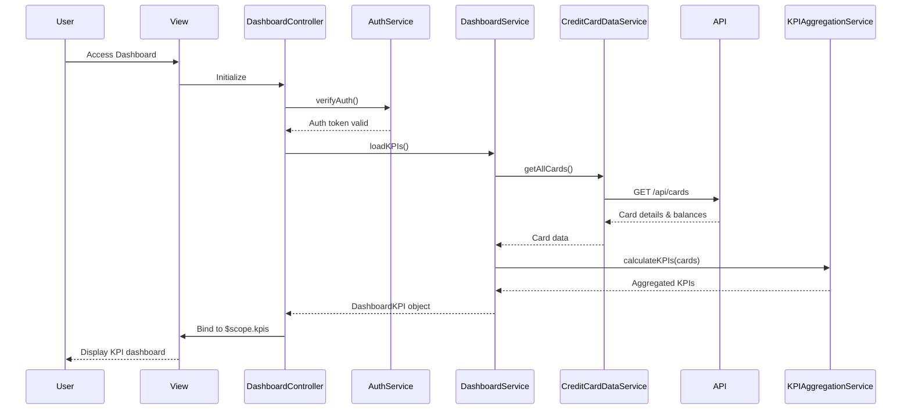

# Low-Level Design: Dashboard KPIs and Credit Card Overview
**Epic ID:** QE-9772

## a. Architecture Mapping

- **User Interface** → AngularJS Module (`dashboardModule`) + Controller (`DashboardController`) + View templates
- **Dashboard API Gateway** → Service (`DashboardService`) for orchestrating KPI data retrieval
- **User Authentication Service** → Service (`AuthService`) for authentication and session management
- **Credit Card Data Service** → Service (`CreditCardDataService`) for card details and balances
- **KPI Aggregation Module** → Service (`KPIAggregationService`) for calculating aggregated metrics
- **Credit Card Data Store** → Backend REST API endpoints consumed by services

**Folder Structure:**
```
/app
  /modules
    /dashboard
      /controllers
        dashboard.controller.js
      /services
        dashboard.service.js
        credit-card-data.service.js
        kpi-aggregation.service.js
      /views
        dashboard.html
      dashboard.module.js
  /shared
    /services
      auth.service.js
```

## b. Component Specifications

| Name | Artifact Type | Responsibility | Key Dependencies |
|------|---------------|----------------|------------------|
| dashboardModule | Module | Root module for dashboard features | ngRoute, ui.bootstrap, AuthService |
| DashboardController | Controller | Manages dashboard view and KPI display | DashboardService, $scope, $interval |
| DashboardService | Service | Orchestrates KPI data retrieval and refresh | CreditCardDataService, KPIAggregationService, $q |
| CreditCardDataService | Service | Fetches credit card details and balances from API | $http, API_CONFIG |
| KPIAggregationService | Service | Calculates aggregated KPIs (total limit, available credit, etc.) | None |
| AuthService | Service | Handles user authentication and token management | $http, $window, JWT_CONFIG |
| dashboardView | View/Template | Displays KPI cards with responsive Bootstrap layout | Bootstrap grid, ng-if |

## c. Data Model

**CreditCard Object:**
```javascript
{
  cardId: String,
  cardNumber: String,
  cardType: String,
  creditLimit: Number,
  outstandingAmount: Number,
  availableCredit: Number,
  monthlySpend: Number
}
```

**DashboardKPI Object:**
```javascript
{
  totalCreditLimit: Number,
  totalAvailableCredit: Number,
  totalOutstanding: Number,
  totalMonthlySpend: Number,
  cards: Array<CreditCard>
}
```

## d. Data Flow

User accesses dashboard view, triggering DashboardController initialization. Controller invokes AuthService to verify authentication. Upon successful auth, DashboardService.loadKPIs() is called, which uses CreditCardDataService to fetch all card details and balances via REST API. KPIAggregationService processes the card data to calculate totalCreditLimit, totalAvailableCredit, totalOutstanding, and totalMonthlySpend. Aggregated KPIs are bound to $scope and rendered in responsive KPI cards. $interval service enables periodic refresh (every 60 seconds) by re-invoking loadKPIs().

## e. Primary Sequence Diagram



## f. Implementation Notes

- Use AngularJS $interval service for periodic data refresh (every 60 seconds) with cleanup on $scope.$destroy
- Implement responsive KPI cards using Bootstrap col-* classes for desktop/tablet/mobile layouts
- Use ES6 promises ($q service) for chaining async operations in DashboardService
- Apply ng-if directives to conditionally display loading spinners during data fetch
- Store auth token in $window.sessionStorage and attach via $http interceptor

## g. Error Handling

$http interceptor captures API errors and displays user notifications; auth failures redirect to login via $state.go().

## h. Security Notes

Requires token-based auth via existing SSO; AuthService manages JWT token lifecycle and renewal.