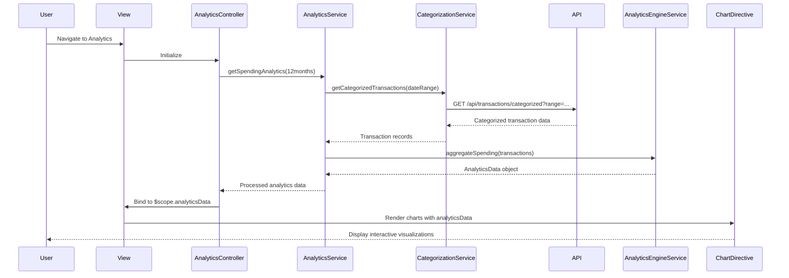

# Low-Level Design: Spending Analytics and Insights
**Epic ID:** QE-9773

## a. Architecture Mapping

- **User Interface** → AngularJS Module (`analyticsModule`) + Controller (`AnalyticsController`) + View templates
- **Analytics API Gateway** → Service (`AnalyticsService`) for orchestrating analytics data retrieval
- **Transaction Categorization Service** → Service (`CategorizationService`) for accessing categorized transactions
- **Analytics Engine** → Service (`AnalyticsEngineService`) for aggregating and processing spending data
- **Visualization Library** → Directive (`spendingChart`) wrapping Chart.js or D3.js for interactive charts
- **Transaction Data Store** → Backend REST API endpoints consumed by services

**Folder Structure:**
```
/app
  /modules
    /analytics
      /controllers
        analytics.controller.js
      /services
        analytics.service.js
        categorization.service.js
        analytics-engine.service.js
      /directives
        spending-chart.directive.js
      /views
        analytics.html
      analytics.module.js
```

## b. Component Specifications

| Name | Artifact Type | Responsibility | Key Dependencies |
|------|---------------|----------------|------------------|
| analyticsModule | Module | Root module for spending analytics features | ngRoute, chart.js, ui.bootstrap |
| AnalyticsController | Controller | Manages analytics view and user interactions with charts | AnalyticsService, $scope |
| AnalyticsService | Service | Orchestrates analytics data retrieval and processing | CategorizationService, AnalyticsEngineService, $q |
| CategorizationService | Service | Fetches categorized transaction data from API | $http, API_CONFIG |
| AnalyticsEngineService | Service | Aggregates spending by category, month, and card | None |
| spendingChart | Directive | Renders interactive charts using Chart.js | chart.js library |
| analyticsView | View/Template | Displays category-wise and monthly spend visualizations | Bootstrap grid, spending-chart directive |

## c. Data Model

**CategorySpend Object:**
```javascript
{
  category: String, // One of 9: Food & Dining, Fuel, Shopping, Travel, Entertainment, Utilities, Healthcare, Education, Miscellaneous
  totalSpend: Number,
  transactionCount: Number
}
```

**MonthlySpend Object:**
```javascript
{
  month: String, // Format: YYYY-MM
  totalSpend: Number,
  categoryBreakdown: Array<CategorySpend>
}
```

**AnalyticsData Object:**
```javascript
{
  categorySpends: Array<CategorySpend>,
  monthlyTrends: Array<MonthlySpend>,
  cardWiseSpends: Array<{cardId: String, totalSpend: Number}>
}
```

## d. Data Flow

User navigates to analytics view, triggering AnalyticsController initialization. Controller invokes AnalyticsService.getSpendingAnalytics() with a 12-month date range. AnalyticsService calls CategorizationService to fetch categorized transactions via REST API, then passes data to AnalyticsEngineService for aggregation by category, month, and card. Processed AnalyticsData object is bound to $scope. The spendingChart directive watches $scope.analyticsData and renders interactive Chart.js visualizations (pie chart for categories, line chart for monthly trends, bar chart for card-wise spend). User interactions with charts trigger $scope updates and re-rendering.

## e. Primary Sequence Diagram



## f. Implementation Notes

- Use Chart.js wrapped in AngularJS directive for declarative chart rendering with two-way data binding
- Implement $watch in spendingChart directive to reactively update charts when $scope.analyticsData changes
- Apply ES6 array methods (map, reduce, filter) in AnalyticsEngineService for efficient aggregation
- Use $q.all() to parallelize multiple API calls if category and monthly data come from separate endpoints
- Leverage ui.bootstrap tabs for switching between category-wise, monthly, and card-wise views

## g. Error Handling

$http interceptor-based error handling with fallback to cached data and user notification via toastr.

## h. Security Notes

Standard input validation and secure API calls assumed; auth token managed by global $http interceptor.