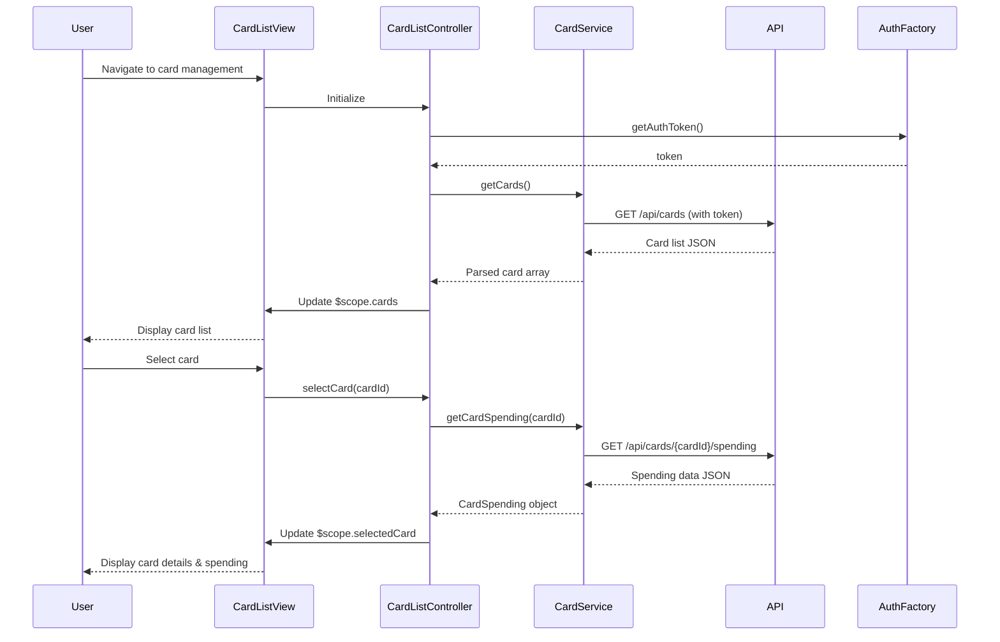

# Low-Level Design: Multiple Credit Card Management
**Epic ID:** QE-9774

## a. Architecture Mapping

- **Card Management Module** → AngularJS Module (`app.cardManagement`)
- **Card List View** → AngularJS Controller (`CardListController`) + HTML Template
- **Card Service** → AngularJS Service (`CardService`) for API communication
- **Card Filter/Selection** → AngularJS Directive (`cardFilter`) for reusable filter UI
- **Authentication** → AngularJS Factory (`AuthFactory`) for token management

**Folder Structure:**
```
/app
  /modules
    /card-management
      /controllers
      /services
      /directives
      /views
  /shared
    /factories
```

## b. Component Specifications

| Name | Artifact Type | Responsibility | Key Dependencies |
|------|--------------|----------------|------------------|
| CardListController | Controller | Manages card list display, filtering, and selection state | CardService, AuthFactory, $scope |
| CardService | Service | Fetches card data and spending details from REST API | $http, $q, API_CONFIG |
| cardFilter | Directive | Renders card filtering UI with search and status filters | CardService |
| CardDetailController | Controller | Displays individual card details and card-wise spend analysis | CardService, $routeParams |
| AuthFactory | Factory | Provides authentication tokens for API requests | $window, $http |

## c. Data Model

```javascript
// Card Model
Card {
  cardId: String,
  cardNumber: String (masked),
  cardType: String,
  bankName: String,
  creditLimit: Number,
  availableCredit: Number,
  outstandingAmount: Number,
  status: String,
  expiryDate: Date
}

// CardSpending Model
CardSpending {
  cardId: String,
  monthlySpend: Number,
  categoryBreakdown: Array<{category: String, amount: Number}>,
  lastTransactionDate: Date
}
```

## d. Data Flow

User navigates to card management view → CardListController initializes and calls CardService.getCards() → CardService makes authenticated GET request to `/api/cards` using AuthFactory token → API returns card list with metadata → Controller stores cards in $scope.cards → View renders card list with ng-repeat → User applies filter via cardFilter directive → Directive updates filter criteria and Controller filters displayed cards → User selects card → CardDetailController loads card-specific spending via CardService.getCardSpending(cardId) → View displays card details and spending analysis.

## e. Primary Sequence Diagram



## f. Implementation Notes

- Use AngularJS 1.x module pattern with dependency injection for CardService and AuthFactory
- Implement pagination in CardService using query params `?page=X&limit=10` for scalability beyond 10 cards
- Apply ES6 arrow functions and template literals in service methods for cleaner API calls
- Use $http interceptors for automatic token injection and error handling across all API requests
- Leverage Bootstrap grid system and card components for responsive multi-card layout

## g. Error Handling

HTTP interceptor captures API errors (401, 403, 500) and displays user-friendly notifications via Angular-toastr; client-side validation with try/catch in service layer.

## h. Security Notes

Requires token-based authentication via AuthFactory; all API calls include bearer token in Authorization header validated by backend.