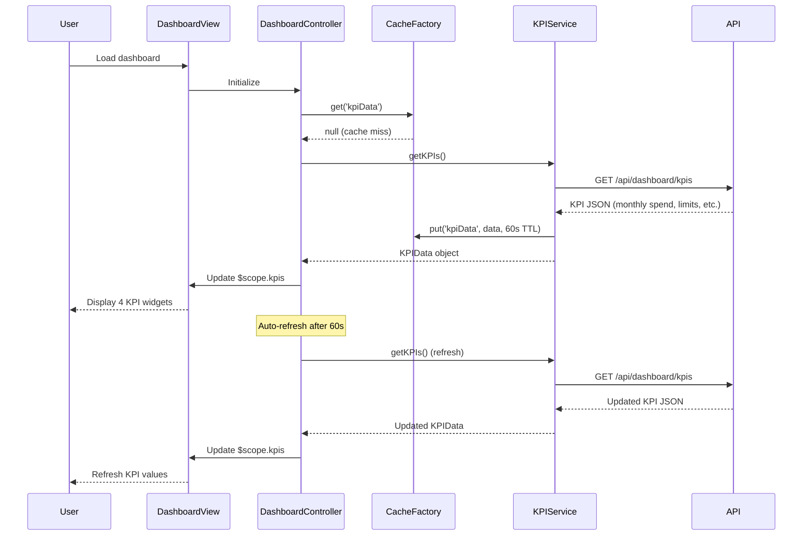

# Low-Level Design: Dashboard and KPI Management
**Epic ID:** QE-9775

## a. Architecture Mapping

- **Dashboard UI Component** → AngularJS Module (`app.dashboard`)
- **KPI Display** → AngularJS Controller (`DashboardController`) + HTML Template
- **KPI Aggregation Service** → AngularJS Service (`KPIService`) for API integration
- **KPI Widget** → AngularJS Directive (`kpiWidget`) for reusable KPI card display
- **Cache Management** → AngularJS Factory (`CacheFactory`) for client-side caching

**Folder Structure:**
```
/app
  /modules
    /dashboard
      /controllers
      /services
      /directives
      /views
  /shared
    /factories
```

## b. Component Specifications

| Name | Artifact Type | Responsibility | Key Dependencies |
|------|--------------|----------------|------------------|
| DashboardController | Controller | Orchestrates KPI data loading and dashboard state management | KPIService, CacheFactory, $scope, $interval |
| KPIService | Service | Fetches aggregated KPI data from backend API | $http, $q, API_CONFIG |
| kpiWidget | Directive | Renders individual KPI metric with icon, value, and label | None |
| CacheFactory | Factory | Manages client-side caching with TTL for KPI data | $cacheFactory |
| RefreshService | Service | Handles periodic auto-refresh of dashboard data | $interval, KPIService |

## c. Data Model

```javascript
// KPI Model
KPIData {
  monthlySpend: Number,
  totalCreditLimit: Number,
  availableCredit: Number,
  outstandingAmount: Number,
  utilizationPercentage: Number,
  lastUpdated: Date
}
```

## d. Data Flow

User accesses dashboard → DashboardController initializes and checks CacheFactory for cached KPI data → If cache miss or expired, DashboardController calls KPIService.getKPIs() → KPIService makes GET request to `/api/dashboard/kpis` → API Gateway authenticates, routes to KPI Aggregation Service → Backend aggregates data from Credit Card Data Source and Transaction Processing System → JSON response returned → KPIService caches response via CacheFactory (60s TTL) and returns to Controller → Controller updates $scope.kpis → View renders four kpiWidget directives with KPI values → RefreshService triggers auto-refresh every 60 seconds.

## e. Primary Sequence Diagram



## f. Implementation Notes

- Use AngularJS $cacheFactory with 60-second TTL to meet 2-second load time requirement on subsequent visits
- Implement $interval service for auto-refresh every 60 seconds to maintain real-time data visibility
- Apply Bootstrap 4 card components and grid system (col-md-3) for responsive 4-column KPI layout
- Use ES6 destructuring in KPIService to parse API response efficiently
- Leverage AngularJS $q promises for asynchronous KPI data loading with loading spinner

## g. Error Handling

$http interceptor catches API failures and displays error toast; retry logic with exponential backoff in KPIService for transient failures.

## h. Security Notes

Standard input validation and secure API calls assumed; authentication token passed via HTTP headers.