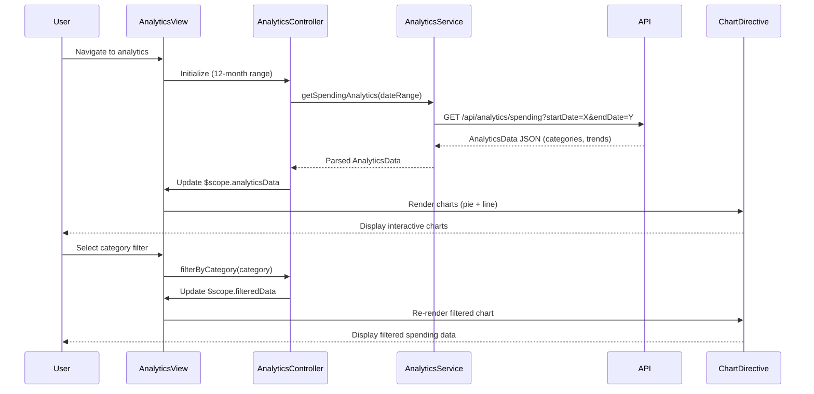

# Low-Level Design: Analytics and Spending Insights
**Epic ID:** QE-9776

## a. Architecture Mapping

- **Analytics Dashboard** → AngularJS Module (`app.analytics`)
- **Analytics View** → AngularJS Controller (`AnalyticsController`) + HTML Template
- **Analytics Service** → AngularJS Service (`AnalyticsService`) for API communication
- **Chart Rendering** → AngularJS Directive (`spendingChart`) wrapping Chart.js
- **Category Filter** → AngularJS Directive (`categoryFilter`) for category selection

**Folder Structure:**
```
/app
  /modules
    /analytics
      /controllers
      /services
      /directives
      /views
  /shared
    /libraries (Chart.js)
```

## b. Component Specifications

| Name | Artifact Type | Responsibility | Key Dependencies |
|------|--------------|----------------|------------------|
| AnalyticsController | Controller | Manages analytics data loading, date range selection, and chart state | AnalyticsService, $scope, $filter |
| AnalyticsService | Service | Fetches category-wise spending and trend data from API | $http, $q, API_CONFIG |
| spendingChart | Directive | Renders interactive Chart.js visualizations (bar, line, pie) | Chart.js library |
| categoryFilter | Directive | Provides UI for selecting spending categories to display | None |
| DateRangeService | Service | Manages date range selection (last 12 months) | $filter (date) |

## c. Data Model

```javascript
// CategorySpending Model
CategorySpending {
  category: String,
  amount: Number,
  percentage: Number,
  transactionCount: Number
}

// MonthlyTrend Model
MonthlyTrend {
  month: String (YYYY-MM),
  totalSpend: Number,
  categoryBreakdown: Array<{category: String, amount: Number}>
}

// AnalyticsData Model
AnalyticsData {
  categories: Array<CategorySpending>,
  monthlyTrends: Array<MonthlyTrend>,
  dateRange: {startDate: Date, endDate: Date}
}
```

## d. Data Flow

User navigates to analytics view → AnalyticsController initializes with default 12-month date range → Controller calls AnalyticsService.getSpendingAnalytics(dateRange) → AnalyticsService makes GET request to `/api/analytics/spending?startDate=X&endDate=Y` → API routes to Analytics Service → Backend queries Historical Transaction Database and Transaction Categorization Engine → Data Aggregation Service computes category totals and monthly trends → JSON response with categories and trends returned → AnalyticsService parses and returns AnalyticsData → Controller updates $scope.analyticsData → View renders spendingChart directive with category pie chart and monthly trend line chart → User selects specific category via categoryFilter → Controller filters data and updates charts.

## e. Primary Sequence Diagram



## f. Implementation Notes

- Use Chart.js 2.x wrapped in AngularJS directive for responsive interactive charts (pie for categories, line for trends)
- Implement AngularJS $filter service to format currency values and date ranges in views
- Apply ES6 array methods (map, reduce, filter) in AnalyticsService for efficient data transformation
- Use AngularJS two-way data binding for category filter checkboxes to dynamically update chart data
- Leverage Bootstrap responsive utilities to ensure charts scale properly on mobile/tablet viewports

## g. Error Handling

HTTP interceptor handles API errors with user-friendly messages; loading spinner displayed during data fetch with timeout fallback.

## h. Security Notes

Standard input validation and secure API calls assumed; date range inputs sanitized to prevent injection attacks.