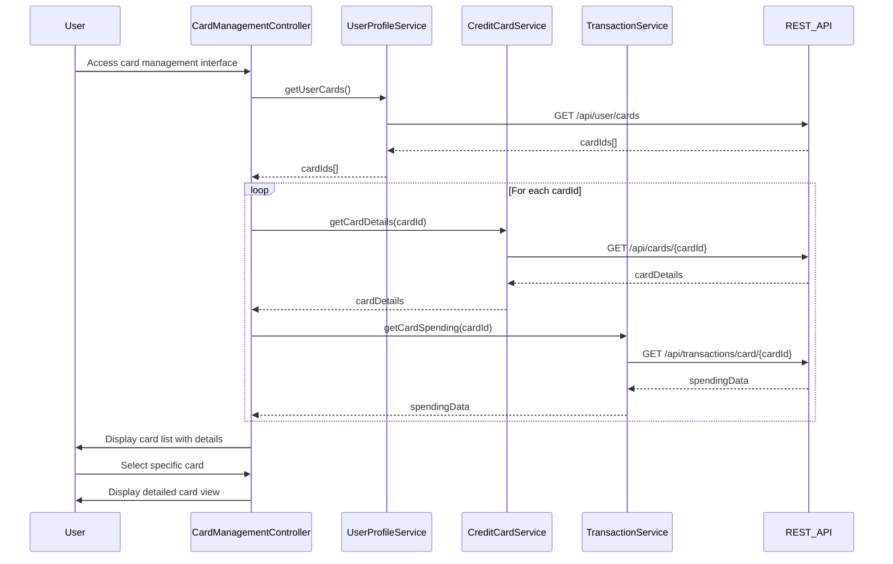

# Low-Level Design: Multi-Card Management and Monitoring
**Epic ID:** QE-9812

## a. Architecture Mapping

- **Card Management Module** → AngularJS Module (`app.cardManagement`)
- **Card Management Controller** → AngularJS Controller (`CardManagementController`)
- **Card List View Component** → AngularJS Directive (`cardListView`)
- **Card Details View Component** → AngularJS Directive (`cardDetailsView`)
- **Credit Card Data Repository** → AngularJS Service (`CreditCardService`)
- **User Profile Service** → AngularJS Service (`UserProfileService`)
- **Transaction Service** → AngularJS Service (`TransactionService`)

**Recommended Folder Structure:**
```
/app
  /modules
    /card-management
      /controllers
      /services
      /directives
      /views
```

## b. Component Specifications

| Name | Artifact Type | Responsibility | Key Dependencies |
|------|--------------|----------------|------------------|
| CardManagementController | Controller | Orchestrates card listing and detail views, manages user interactions | CreditCardService, UserProfileService, TransactionService, $scope |
| CreditCardService | Service | Fetches card information and balances from REST API | $http, $q |
| UserProfileService | Service | Retrieves user profile and card-user associations | $http, $q |
| TransactionService | Service | Provides card-specific spending data | $http, $q |
| cardListView | Directive | Renders consolidated list of all user credit cards | CardManagementController |
| cardDetailsView | Directive | Displays individual card details with spending patterns | CardManagementController |

## c. Data Model

**CreditCard Object:**
```javascript
{
  cardId: String,
  cardNumber: String,
  cardHolderName: String,
  bankName: String,
  cardType: String,
  creditLimit: Number,
  availableCredit: Number,
  outstandingAmount: Number,
  expiryDate: Date,
  status: String
}
```

**CardSpending Object:**
```javascript
{
  cardId: String,
  monthlySpend: Number,
  categoryBreakdown: Array<{category: String, amount: Number}>,
  transactionCount: Number
}
```

## d. Data Flow

User navigates to card management interface → CardManagementController initializes and calls UserProfileService to retrieve user's associated cards → Controller invokes CreditCardService to fetch detailed card information and balances, and TransactionService to get spending data for each card → Services make parallel REST API calls and return aggregated data → Controller processes and organizes data by card → cardListView directive renders the consolidated card listing with summary metrics → User selects a specific card → cardDetailsView directive displays detailed card information, spending patterns, and balance tracking → User can switch between cards seamlessly with 1-second data retrieval performance.

## e. Primary Sequence Diagram



## f. Implementation Notes

- Use AngularJS dependency injection to inject all services into CardManagementController for testability and modularity.
- Implement ES6 Promises via $q service for asynchronous REST API calls with proper error handling.
- Use Bootstrap responsive grid system (col-xs, col-sm, col-md) in card list and detail view templates for cross-device compatibility.
- Leverage AngularJS $http interceptor for adding authentication tokens to all API requests.
- Implement card data caching in services using simple object store to minimize redundant API calls within session.

## g. Error Handling

HTTP interceptor-based error handling with user-friendly toast notifications for API failures and network errors.

## h. Security Notes

Requires token-based authentication via existing SSO; card numbers displayed with masking (last 4 digits only).