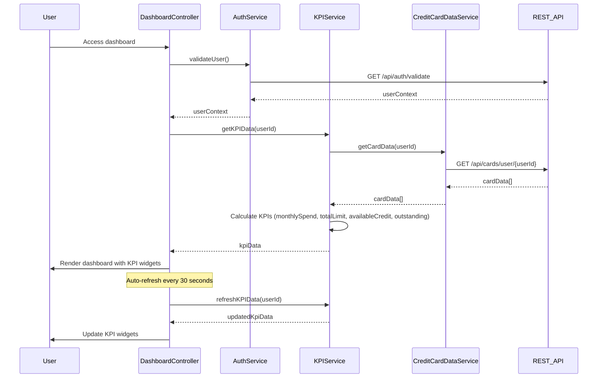

# Low-Level Design: Dashboard and KPI Management
**Epic ID:** QE-9813

## a. Architecture Mapping

- **Dashboard Module** → AngularJS Module (`app.dashboard`)
- **Dashboard Controller** → AngularJS Controller (`DashboardController`)
- **KPI Calculation Service** → AngularJS Service (`KPIService`)
- **Credit Card Data Service** → AngularJS Service (`CreditCardDataService`)
- **User Authentication Service** → AngularJS Service (`AuthService`)
- **Dashboard UI Components** → AngularJS Directives (`kpiWidget`, `dashboardLayout`)

**Recommended Folder Structure:**
```
/app
  /modules
    /dashboard
      /controllers
      /services
      /directives
      /views
```

## b. Component Specifications

| Name | Artifact Type | Responsibility | Key Dependencies |
|------|--------------|----------------|------------------|
| DashboardController | Controller | Manages dashboard state, fetches KPI data, handles refresh | KPIService, AuthService, $scope, $interval |
| KPIService | Service | Calculates and aggregates financial KPIs from card data | CreditCardDataService, $http, $q |
| CreditCardDataService | Service | Retrieves card balances and transaction data from REST API | $http, $q |
| AuthService | Service | Validates user authentication and provides user context | $http, $window |
| kpiWidget | Directive | Renders individual KPI metric with value and label | DashboardController |
| dashboardLayout | Directive | Provides responsive grid layout for KPI widgets | Bootstrap grid |

## c. Data Model

**KPIData Object:**
```javascript
{
  monthlySpend: Number,
  totalCreditLimit: Number,
  availableCredit: Number,
  outstandingAmount: Number,
  utilizationRate: Number,
  lastUpdated: Date
}
```

**CardData Object:**
```javascript
{
  userId: String,
  cards: Array<{
    cardId: String,
    creditLimit: Number,
    balance: Number,
    currentMonthSpend: Number
  }>
}
```

## d. Data Flow

User accesses dashboard → AuthService validates user session and provides user context → DashboardController requests KPI data from KPIService → KPIService calls CreditCardDataService to fetch all card balances and current month transactions via REST API → CreditCardDataService returns aggregated card data → KPIService calculates monthly spend (sum of current month transactions), total credit limit (sum of all card limits), available credit (total limit minus total outstanding), and outstanding amount (sum of all card balances) → Computed KPI metrics are returned to DashboardController → kpiWidget directives render each KPI in responsive Bootstrap grid layout → Dashboard displays with auto-refresh capability using $interval for real-time updates.

## e. Primary Sequence Diagram



## f. Implementation Notes

- Use AngularJS $interval service for automatic KPI refresh every 30 seconds to meet real-time data requirement.
- Implement KPI calculations in service layer using ES6 array methods (reduce, map) for clean aggregation logic.
- Use Bootstrap responsive utilities and CSS3 flexbox for 2-second load time optimization and mobile/desktop responsiveness.
- Leverage AngularJS one-way data binding for KPI widgets to improve rendering performance.
- Implement loading spinner directive during initial dashboard load and data refresh operations.

## g. Error Handling

Interceptor-based error handling with graceful degradation displaying cached KPI values and retry mechanism on API failure.

## h. Security Notes

Requires token-based auth via existing SSO; all API calls include JWT token in Authorization header.