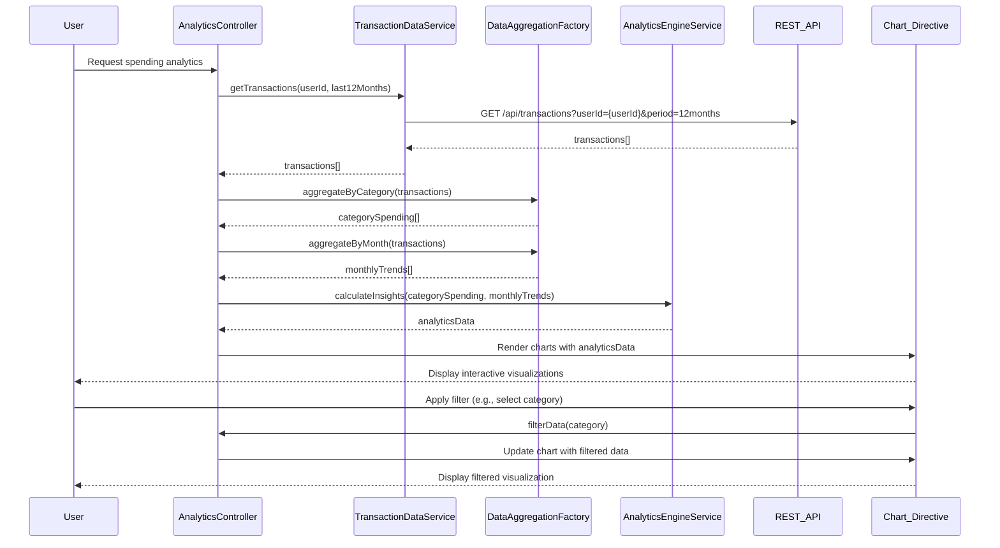

# Low-Level Design: Spending Analytics and Insights
**Epic ID:** QE-9814

## a. Architecture Mapping

- **Analytics Module** → AngularJS Module (`app.analytics`)
- **Analytics Controller** → AngularJS Controller (`AnalyticsController`)
- **Transaction Data Service** → AngularJS Service (`TransactionDataService`)
- **Analytics Engine** → AngularJS Service (`AnalyticsEngineService`)
- **Data Aggregation Module** → AngularJS Factory (`DataAggregationFactory`)
- **Visualization Library** → AngularJS Directive (`spendingChart`) using Chart.js integration

**Recommended Folder Structure:**
```
/app
  /modules
    /analytics
      /controllers
      /services
      /factories
      /directives
      /views
```

## b. Component Specifications

| Name | Artifact Type | Responsibility | Key Dependencies |
|------|--------------|----------------|------------------|
| AnalyticsController | Controller | Manages analytics view state, handles user interactions for filtering and drill-down | AnalyticsEngineService, TransactionDataService, $scope |
| TransactionDataService | Service | Fetches historical transaction data from REST API | $http, $q |
| AnalyticsEngineService | Service | Calculates spending patterns, trends, and insights | DataAggregationFactory, $q |
| DataAggregationFactory | Factory | Aggregates transactions by category and month | None |
| spendingChart | Directive | Renders interactive charts using Chart.js for category and trend visualization | Chart.js, AnalyticsController |

## c. Data Model

**Transaction Object:**
```javascript
{
  transactionId: String,
  cardId: String,
  amount: Number,
  category: String,
  transactionDate: Date,
  merchantName: String,
  description: String
}
```

**CategorySpending Object:**
```javascript
{
  category: String,
  totalAmount: Number,
  transactionCount: Number,
  percentage: Number
}
```

**MonthlyTrend Object:**
```javascript
{
  month: String,
  year: Number,
  totalSpend: Number,
  categoryBreakdown: Array<{category: String, amount: Number}>
}
```

## d. Data Flow

User navigates to spending analytics view → AnalyticsController initializes and calls TransactionDataService to fetch 12 months of historical transaction data via REST API → TransactionDataService returns transaction array → Controller passes data to DataAggregationFactory which groups transactions by category (Food & Dining, Fuel, Shopping, Travel, Entertainment, Utilities, Healthcare, Education, Miscellaneous) and by month → AnalyticsEngineService processes aggregated data to calculate spending patterns, category-wise totals, percentages, and monthly trends → Processed analytics data is returned to AnalyticsController → spendingChart directive renders interactive visualizations (pie chart for category breakdown, line chart for monthly trends) using Chart.js → User interacts with charts through filtering and drill-down capabilities → Controller updates view with filtered data and re-renders charts within 3-second performance target.

## e. Primary Sequence Diagram



## f. Implementation Notes

- Integrate Chart.js library via AngularJS directive wrapper for declarative chart rendering with two-way data binding.
- Use ES6 Map and reduce functions in DataAggregationFactory for efficient category and monthly grouping of large transaction datasets.
- Implement lazy loading for transaction data with pagination support if dataset exceeds performance threshold.
- Use AngularJS $filter service for date formatting and category filtering in views.
- Leverage CSS3 transitions and Bootstrap responsive utilities for smooth chart interactions and mobile responsiveness.

## g. Error Handling

Try/catch blocks in aggregation logic with interceptor-based API error handling and user notification via toast messages.

## h. Security Notes

Standard input validation and secure API calls assumed; transaction data filtered by authenticated user context.