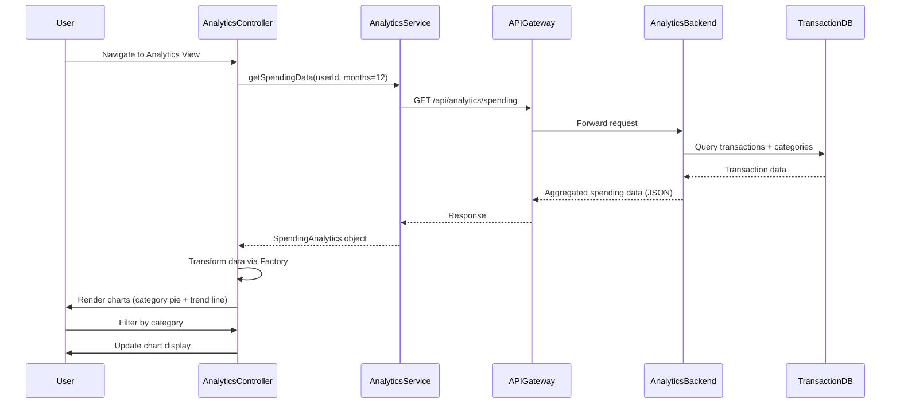

# Low-Level Design: QE-9822 - Spending Analytics and Insights

## a. Architecture Mapping

- **AngularJS Module**: `creditCard.analytics` - Main analytics feature module
- **Controller**: `AnalyticsController` - Manages analytics view state and user interactions
- **Service**: `AnalyticsService` - Fetches spending data and category breakdowns via REST API
- **Service**: `TransactionCategorizationService` - Handles transaction categorization logic
- **Directive**: `spendingChart` - Renders interactive charts (pie, bar, line) using D3.js or Chart.js
- **Factory**: `AnalyticsDataFactory` - Transforms raw transaction data into visualization-ready format

**Folder Structure:**
```
/app
  /modules
    /analytics
      analytics.module.js
      analytics.controller.js
      analytics.service.js
      analytics.html
      /directives
        spending-chart.directive.js
      /factories
        analytics-data.factory.js
```

## b. Component Specifications

| Name | Artifact Type | Responsibility | Key Dependencies |
|------|---------------|----------------|------------------|
| creditCard.analytics | Module | Analytics feature container | ngRoute, chart library module |
| AnalyticsController | Controller | Manages view state, handles user filter/drill-down actions | AnalyticsService, AnalyticsDataFactory, $scope |
| AnalyticsService | Service | Fetches transaction data and category aggregations from API Gateway | $http, $q |
| TransactionCategorizationService | Service | Applies categorization rules to transactions | None |
| spendingChart | Directive | Renders interactive charts with category/trend data | D3.js or Chart.js, $window |
| AnalyticsDataFactory | Factory | Transforms API responses into chart-compatible data structures | None |

## c. Data Model

**SpendingAnalytics** (JavaScript Object):
```javascript
{
  userId: String,
  monthYear: String,  // "YYYY-MM"
  categoryBreakdown: Array<CategorySpend>,
  monthlyTrends: Array<MonthlySpend>,
  totalSpend: Number
}
```

**CategorySpend**:
```javascript
{
  category: String,  // "Food & Dining", "Fuel", etc.
  amount: Number,
  transactionCount: Number,
  percentage: Number
}
```

**MonthlySpend**:
```javascript
{
  monthYear: String,  // "YYYY-MM"
  totalAmount: Number,
  categories: Array<CategorySpend>
}
```

## d. Data Flow

User navigates to analytics view → AnalyticsController initializes and calls AnalyticsService.getSpendingData() → Service sends GET request to `/api/analytics/spending?userId={id}&months=12` via API Gateway → Backend Analytics Service aggregates transaction data by category and month, applies categorization engine → JSON response with category breakdowns and monthly trends returned → AnalyticsDataFactory transforms data into chart formats → Controller updates $scope with visualization data → spendingChart directive renders interactive pie chart (category breakdown) and line chart (monthly trends) → User interacts (filter by category, select month) → Controller updates filters and re-renders charts.

## e. Primary Sequence Diagram



## f. Implementation Notes

- Use AngularJS Dependency Injection for all services and factories; register via module.service() and module.factory()
- Implement AnalyticsService using $http with promise-based API calls; cache results using $cacheFactory for 5 minutes
- Use Chart.js or D3.js wrapped in custom directive for responsive, interactive visualizations with two-way data binding
- Apply ES6 arrow functions and const/let in controllers and services; use template literals for API URL construction
- Implement client-side filtering and sorting in AnalyticsDataFactory to minimize API calls during user interactions

## g. Error Handling

HTTP interceptor captures API errors (4xx/5xx); displays user-friendly toast notifications via angular-toastr; logs errors to console in dev mode.

## h. Security Notes

Requires token-based auth via existing SSO; userId validated server-side; all API calls include Authorization header with JWT token.