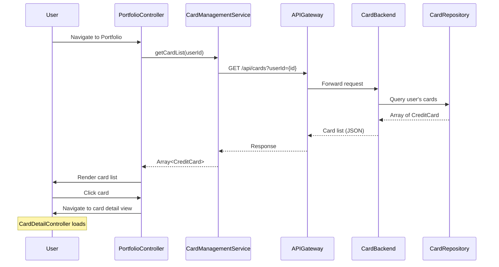

# Low-Level Design: QE-9823 - Multi-Card Portfolio Management

## a. Architecture Mapping

- **AngularJS Module**: `creditCard.portfolio` - Multi-card portfolio feature module
- **Controller**: `PortfolioController` - Manages card list view and navigation
- **Controller**: `CardDetailController` - Manages individual card detail view
- **Service**: `CardManagementService` - Fetches card list and card-specific data via REST API
- **Service**: `CardMetricsService` - Retrieves card-level KPIs (spend, outstanding, available credit)
- **Directive**: `cardListItem` - Renders individual card summary in list view
- **Factory**: `CardDataFactory` - Caches and manages card data state

**Folder Structure:**
```
/app
  /modules
    /portfolio
      portfolio.module.js
      portfolio.controller.js
      card-detail.controller.js
      card-management.service.js
      card-metrics.service.js
      portfolio.html
      card-detail.html
      /directives
        card-list-item.directive.js
      /factories
        card-data.factory.js
```

## b. Component Specifications

| Name | Artifact Type | Responsibility | Key Dependencies |
|------|---------------|----------------|------------------|
| creditCard.portfolio | Module | Portfolio feature container | ngRoute |
| PortfolioController | Controller | Manages card list display and card selection | CardManagementService, CardDataFactory, $scope, $location |
| CardDetailController | Controller | Manages individual card detail view and spend analysis | CardManagementService, CardMetricsService, $routeParams, $scope |
| CardManagementService | Service | Fetches card list and individual card details from API | $http, $q |
| CardMetricsService | Service | Retrieves card-specific KPIs and spending patterns | $http, $q |
| cardListItem | Directive | Renders card summary with limit, available credit, outstanding | None |
| CardDataFactory | Factory | Caches card list and selected card data; manages state | $cacheFactory |

## c. Data Model

**CreditCard** (JavaScript Object):
```javascript
{
  cardId: String,
  userId: String,
  cardNumber: String,  // masked, e.g., "****1234"
  cardName: String,
  cardType: String,  // "Visa", "Mastercard", etc.
  creditLimit: Number,
  availableCredit: Number,
  outstandingBalance: Number,
  lastUpdated: String  // ISO 8601 timestamp
}
```

**CardMetrics**:
```javascript
{
  cardId: String,
  monthlySpend: Number,
  categoryBreakdown: Array<CategorySpend>,
  recentTransactions: Array<Transaction>
}
```

**Transaction**:
```javascript
{
  transactionId: String,
  amount: Number,
  category: String,
  date: String,  // ISO 8601
  merchant: String
}
```

## d. Data Flow

User navigates to portfolio view → PortfolioController calls CardManagementService.getCardList(userId) → Service sends GET to `/api/cards?userId={id}` → Backend Card Management Service queries Credit Card Repository → Array of CreditCard objects returned → CardDataFactory caches list → Controller updates $scope.cards → cardListItem directive renders each card summary → User clicks card → $location redirects to `/card-detail/:cardId` → CardDetailController initializes with $routeParams.cardId → Calls CardManagementService.getCardDetails(cardId) and CardMetricsService.getCardMetrics(cardId) in parallel → Backend services fetch from Repository, Transaction Service, Dashboard KPI Service → Aggregated card data and metrics returned → Controller updates $scope with card details, spend analysis, and recent transactions → UI renders card detail view.

## e. Primary Sequence Diagram



## f. Implementation Notes

- Use AngularJS $routeProvider to define routes: `/portfolio` and `/card-detail/:cardId` with respective controllers and templates
- Implement CardManagementService and CardMetricsService with $http; use $q.all() to parallelize API calls in CardDetailController
- Cache card list in CardDataFactory using $cacheFactory with 10-minute TTL; invalidate on user-triggered refresh
- Use ng-repeat with track by cardId in portfolio.html for optimized list rendering; apply Bootstrap grid for responsive card layout
- Apply ES6 classes for services and factories; use const/let and arrow functions throughout

## g. Error Handling

HTTP interceptor with try/catch in controllers; display error messages via angular-toastr; retry failed requests once with exponential backoff.

## h. Security Notes

Requires token-based auth via existing SSO; cardId and userId validated server-side; sensitive card data (full number) never exposed to client.