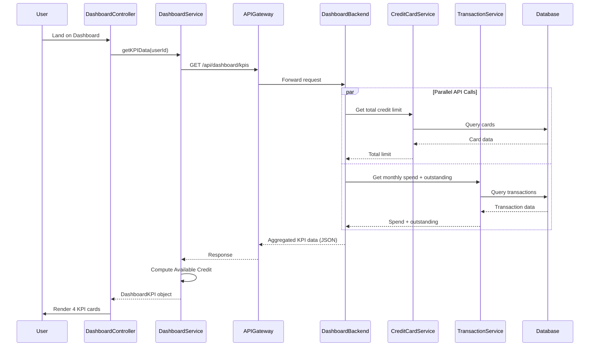

# Low-Level Design: QE-9824 - Dashboard and KPI Management

## a. Architecture Mapping

- **AngularJS Module**: `creditCard.dashboard` - Main dashboard feature module
- **Controller**: `DashboardController` - Manages dashboard view state and KPI display
- **Service**: `DashboardService` - Fetches aggregated KPI data via REST API
- **Service**: `KPICalculationService` - Computes derived KPIs (Available Credit) client-side
- **Directive**: `kpiCard` - Renders individual KPI metric card with value and label
- **Factory**: `DashboardDataFactory` - Manages dashboard data state and refresh logic

**Folder Structure:**
```
/app
  /modules
    /dashboard
      dashboard.module.js
      dashboard.controller.js
      dashboard.service.js
      kpi-calculation.service.js
      dashboard.html
      /directives
        kpi-card.directive.js
      /factories
        dashboard-data.factory.js
```

## b. Component Specifications

| Name | Artifact Type | Responsibility | Key Dependencies |
|------|---------------|----------------|------------------|
| creditCard.dashboard | Module | Dashboard feature container | ngRoute |
| DashboardController | Controller | Manages dashboard view, triggers KPI refresh | DashboardService, KPICalculationService, DashboardDataFactory, $scope, $interval |
| DashboardService | Service | Fetches KPI data from API Gateway | $http, $q |
| KPICalculationService | Service | Computes Available Credit = Total Limit - Outstanding | None |
| kpiCard | Directive | Renders KPI card with formatted value, label, and icon | $filter |
| DashboardDataFactory | Factory | Caches KPI data; manages auto-refresh state | $cacheFactory, $timeout |

## c. Data Model

**DashboardKPI** (JavaScript Object):
```javascript
{
  userId: String,
  monthlySpend: Number,
  totalCreditLimit: Number,
  availableCredit: Number,
  outstandingAmount: Number,
  lastUpdated: String  // ISO 8601 timestamp
}
```

## d. Data Flow

User authenticates and lands on dashboard → DashboardController initializes and calls DashboardService.getKPIData(userId) → Service sends GET to `/api/dashboard/kpis?userId={id}` → API Gateway routes to Dashboard Service backend → Backend orchestrates parallel calls to Credit Card Data Service (for total limit) and Transaction Service (for monthly spend and outstanding) → Services query Database → Backend aggregates results into partial KPI object → Response returned to DashboardService → KPICalculationService computes availableCredit = totalCreditLimit - outstandingAmount → DashboardDataFactory caches result → Controller updates $scope.kpis → kpiCard directive renders four KPI cards (Monthly Spend, Total Credit Limit, Available Credit, Outstanding Amount) with Bootstrap responsive grid → $interval triggers auto-refresh every 10 seconds → Process repeats.

## e. Primary Sequence Diagram



## f. Implementation Notes

- Use AngularJS $routeProvider to set dashboard as default route ('/'); bind DashboardController and dashboard.html template
- Implement DashboardService with $http GET; use $q for promise chaining; apply $cacheFactory with 5-second TTL for KPI data
- Use $interval in DashboardController to auto-refresh KPI data every 10 seconds; cancel interval on $scope.$destroy to prevent memory leaks
- Implement kpiCard directive with isolated scope {value: '=', label: '@', icon: '@'}; use $filter('currency') for monetary values
- Apply Bootstrap grid (col-xs-12 col-sm-6 col-md-3) for responsive 4-column KPI layout; use CSS3 transitions for value updates

## g. Error Handling

HTTP interceptor captures API errors; displays error banner via angular-toastr; retries failed requests once after 2-second delay.

## h. Security Notes

Requires token-based auth via existing SSO; userId extracted from JWT token; all API calls include Authorization header with Bearer token.