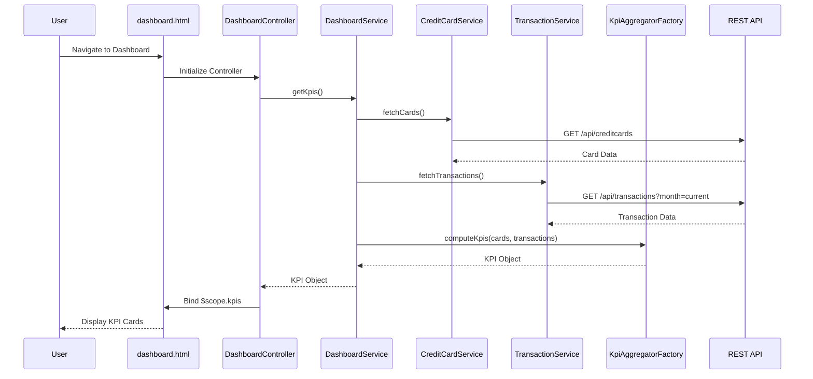

# Low-Level Design: Credit Card Dashboard and KPI Management
**Epic ID:** QE-9825  
**Branch:** PERFTEST20261110205152

---

## a. Architecture Mapping

**Component to AngularJS Artifact Mapping:**
- User Interface → AngularJS Module (`ccDashboard`) + Controller (`DashboardController`) + HTML5 View (`dashboard.html`)
- Dashboard Service → AngularJS Service (`DashboardService`) for orchestrating KPI data retrieval
- Data Aggregation Engine → AngularJS Factory (`KpiAggregatorFactory`) for computing KPIs from raw data
- Credit Card Data Service → AngularJS Service (`CreditCardService`) for REST API calls to fetch card details
- Transaction Processing Service → AngularJS Service (`TransactionService`) for REST API calls to fetch transaction data

**Recommended Folder Structure:**
```
app/
├── modules/
│   └── dashboard/
│       ├── dashboard.module.js
│       ├── controllers/
│       │   └── dashboard.controller.js
│       ├── services/
│       │   ├── dashboard.service.js
│       │   ├── creditcard.service.js
│       │   └── transaction.service.js
│       ├── factories/
│       │   └── kpi-aggregator.factory.js
│       └── views/
│           └── dashboard.html
├── shared/
│   ├── interceptors/
│   └── constants/
└── assets/
    ├── css/
    └── js/
```

---

## b. Component Specifications

| Component Name | Artifact Type | Responsibility | Key Dependencies |
|----------------|---------------|----------------|------------------|
| `ccDashboard` | Module | Root module for dashboard feature, configures routes and dependencies | `ngRoute`, `ui.bootstrap` |
| `DashboardController` | Controller | Manages dashboard view state, fetches KPIs via DashboardService, binds data to view | `DashboardService`, `$scope`, `$q` |
| `DashboardService` | Service | Orchestrates data retrieval from CreditCardService and TransactionService, delegates aggregation to KpiAggregatorFactory | `CreditCardService`, `TransactionService`, `KpiAggregatorFactory`, `$q` |
| `CreditCardService` | Service | Makes REST API calls to fetch credit card details (card list, limits, balances) | `$http`, `API_ENDPOINTS` constant |
| `TransactionService` | Service | Makes REST API calls to fetch transaction data for monthly spend and outstanding calculations | `$http`, `API_ENDPOINTS` constant |
| `KpiAggregatorFactory` | Factory | Computes KPIs (monthly spend, total credit limit, available credit, outstanding amount) from raw card and transaction data | None (pure computation) |
| `dashboard.html` | View | Displays KPI cards using Bootstrap grid, responsive layout for desktop/tablet/mobile | `DashboardController`, Bootstrap CSS |

---

## c. Data Model

**CreditCard Model:**
```javascript
{
  cardId: String,
  cardNumber: String,
  cardType: String,
  creditLimit: Number,
  currentBalance: Number,
  availableCredit: Number
}
```

**Transaction Model:**
```javascript
{
  transactionId: String,
  cardId: String,
  amount: Number,
  date: Date,
  category: String,
  description: String
}
```

**KPI Model:**
```javascript
{
  monthlySpend: Number,
  totalCreditLimit: Number,
  availableCredit: Number,
  outstandingAmount: Number
}
```

---

## d. Data Flow

User navigates to the dashboard view, triggering `DashboardController` initialization. The controller invokes `DashboardService.getKpis()`, which concurrently calls `CreditCardService.fetchCards()` and `TransactionService.fetchTransactions()` to retrieve card and transaction data via REST APIs. Upon promise resolution, `DashboardService` passes the raw data to `KpiAggregatorFactory.computeKpis()`, which calculates monthly spend (sum of current month transactions), total credit limit (sum of all card limits), available credit (sum of available credit per card), and outstanding amount (sum of current balances). The aggregated KPI object is returned to the controller, which binds it to `$scope.kpis`, triggering Angular's digest cycle to update the view with Bootstrap-styled KPI cards displayed responsively.

---

## e. Primary Sequence Diagram



---

## f. Implementation Notes

- Use AngularJS 1.x module pattern with dependency injection for all services, factories, and controllers.
- Leverage `$q.all()` to parallelize API calls to CreditCardService and TransactionService for optimal performance.
- Implement client-side caching in services using `$cacheFactory` to meet 2-second load time requirement for up to 10 cards.
- Use Bootstrap grid system (`col-md-3`, `col-sm-6`, `col-xs-12`) for responsive KPI card layout across devices.
- Apply ES6 arrow functions and template literals in service/factory logic for cleaner code.

---

## g. Error Handling

HTTP interceptor-based error handling with user-friendly notifications via Bootstrap alerts and promise rejection propagation.

---

## h. Security Notes

Requires token-based authentication via existing SSO; all API calls include auth token in headers via HTTP interceptor.