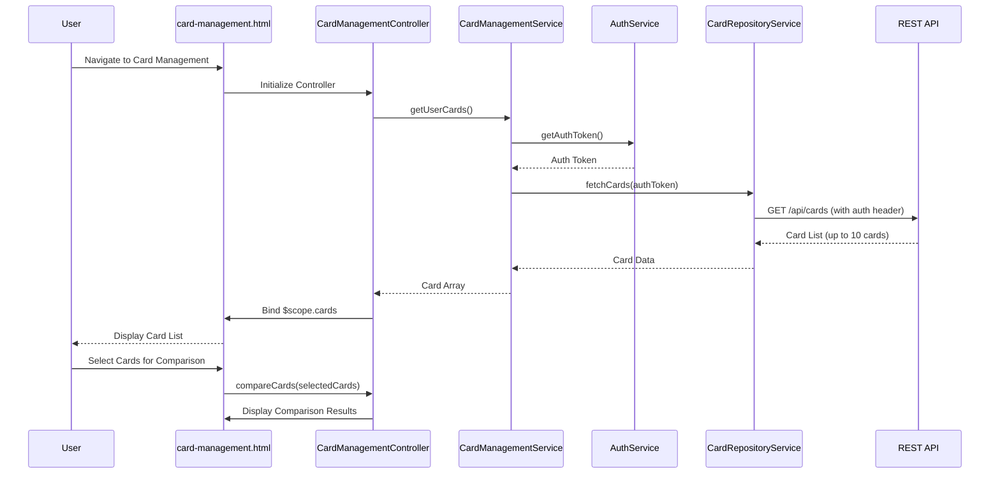

# Low-Level Design: Multiple Credit Card Management and Viewing
**Epic ID:** QE-9826  
**Branch:** PERFTEST20261110205152

---

## a. Architecture Mapping

**Component to AngularJS Artifact Mapping:**
- User Interface → AngularJS Module (`ccCardManagement`) + Controller (`CardManagementController`) + HTML5 View (`card-management.html`)
- Card Management Service → AngularJS Service (`CardManagementService`) for orchestrating card operations
- User Authentication Service → AngularJS Service (`AuthService`) for token management and user context
- Credit Card Repository → AngularJS Service (`CardRepositoryService`) for REST API calls to card data backend
- Card Comparison Engine → AngularJS Factory (`CardComparisonFactory`) for client-side card comparison logic

**Recommended Folder Structure:**
```
app/
├── modules/
│   └── card-management/
│       ├── card-management.module.js
│       ├── controllers/
│       │   └── card-management.controller.js
│       ├── services/
│       │   ├── card-management.service.js
│       │   ├── card-repository.service.js
│       │   └── auth.service.js
│       ├── factories/
│       │   └── card-comparison.factory.js
│       ├── directives/
│       │   └── card-item.directive.js
│       └── views/
│           ├── card-management.html
│           └── card-detail.html
├── shared/
└── assets/
```

---

## b. Component Specifications

| Component Name | Artifact Type | Responsibility | Key Dependencies |
|----------------|---------------|----------------|------------------|
| `ccCardManagement` | Module | Root module for card management feature, configures routes and dependencies | `ngRoute`, `ui.bootstrap` |
| `CardManagementController` | Controller | Manages card list view state, handles card selection/switching, invokes comparison logic | `CardManagementService`, `CardComparisonFactory`, `$scope` |
| `CardManagementService` | Service | Orchestrates card retrieval via CardRepositoryService, manages card state and user context via AuthService | `CardRepositoryService`, `AuthService`, `$q` |
| `CardRepositoryService` | Service | Makes REST API calls to fetch, register, and retrieve card information from backend | `$http`, `API_ENDPOINTS` constant |
| `AuthService` | Service | Manages user authentication state, provides auth tokens for secure API calls | `$http`, `$window` (for token storage) |
| `CardComparisonFactory` | Factory | Compares multiple cards based on credit limit, balance, spend, and returns comparison metrics | None (pure computation) |
| `cardItem` | Directive | Reusable component to display individual card details with click-to-expand functionality | `CardManagementController` |
| `card-management.html` | View | Displays list of all user cards in Bootstrap grid, supports card switching and comparison UI | `CardManagementController`, Bootstrap CSS |

---

## c. Data Model

**CreditCard Model:**
```javascript
{
  cardId: String,
  cardNumber: String,
  cardType: String,
  bankName: String,
  creditLimit: Number,
  currentBalance: Number,
  availableCredit: Number,
  expiryDate: Date,
  isActive: Boolean
}
```

**CardComparison Model:**
```javascript
{
  cardId: String,
  cardType: String,
  creditLimit: Number,
  utilizationRate: Number,
  availableCredit: Number,
  rank: Number
}
```

**User Model:**
```javascript
{
  userId: String,
  username: String,
  authToken: String
}
```

---

## d. Data Flow

User navigates to the card management view, triggering `CardManagementController` initialization. The controller calls `CardManagementService.getUserCards()`, which first validates user authentication via `AuthService.getAuthToken()`. Upon successful authentication, `CardManagementService` invokes `CardRepositoryService.fetchCards()` to retrieve all registered cards via REST API. The card data is returned to the controller and bound to `$scope.cards`, rendering the card list using the `cardItem` directive in a Bootstrap grid. When the user selects the comparison option, the controller passes selected cards to `CardComparisonFactory.compareCards()`, which computes utilization rates and ranks, returning comparison results displayed in a modal or side panel.

---

## e. Primary Sequence Diagram



---

## f. Implementation Notes

- Use AngularJS 1.x dependency injection for all services, factories, controllers, and directives.
- Implement `cardItem` directive with isolated scope for reusability and encapsulation of card display logic.
- Cache fetched card data in `CardManagementService` using in-memory array to avoid redundant API calls during session.
- Use Bootstrap cards (`card`, `card-body`) and grid (`row`, `col-md-4`) for responsive multi-card display.
- Apply ES6 array methods (`.map()`, `.filter()`, `.reduce()`) in `CardComparisonFactory` for efficient comparison logic.

---

## g. Error Handling

HTTP interceptor captures API errors; controller displays user-friendly error messages via Bootstrap alerts and logs errors to console.

---

## h. Security Notes

Requires token-based auth via existing SSO; AuthService validates token expiry and refreshes as needed; all card API calls secured with auth headers.