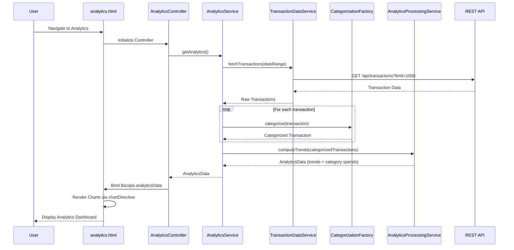

# Low-Level Design: Spending Analytics and Transaction Insights
**Epic ID:** QE-9827  
**Branch:** PERFTEST20261110205152

---

## a. Architecture Mapping

**Component to AngularJS Artifact Mapping:**
- User Interface → AngularJS Module (`ccAnalytics`) + Controller (`AnalyticsController`) + HTML5 View (`analytics.html`)
- Analytics Dashboard Service → AngularJS Service (`AnalyticsService`) for orchestrating analytics data retrieval
- Transaction Data Service → AngularJS Service (`TransactionDataService`) for REST API calls to fetch transaction records
- Transaction Categorization Engine → AngularJS Factory (`CategorizationFactory`) for client-side transaction categorization logic
- Data Analytics Processing Service → AngularJS Service (`AnalyticsProcessingService`) for trend calculations and aggregations
- Visualization Renderer → AngularJS Directive (`chartDirective`) wrapping Chart.js or D3.js for interactive charts

**Recommended Folder Structure:**
```
app/
├── modules/
│   └── analytics/
│       ├── analytics.module.js
│       ├── controllers/
│       │   └── analytics.controller.js
│       ├── services/
│       │   ├── analytics.service.js
│       │   ├── transaction-data.service.js
│       │   └── analytics-processing.service.js
│       ├── factories/
│       │   └── categorization.factory.js
│       ├── directives/
│       │   └── chart.directive.js
│       └── views/
│           └── analytics.html
├── shared/
└── assets/
    └── js/
        └── chart.min.js
```

---

## b. Component Specifications

| Component Name | Artifact Type | Responsibility | Key Dependencies |
|----------------|---------------|----------------|------------------|
| `ccAnalytics` | Module | Root module for analytics feature, configures routes and chart library dependencies | `ngRoute`, `ui.bootstrap`, `chart.js` |
| `AnalyticsController` | Controller | Manages analytics view state, fetches transaction insights via AnalyticsService, binds chart data to view | `AnalyticsService`, `$scope`, `$filter` |
| `AnalyticsService` | Service | Orchestrates transaction data retrieval, categorization, and analytics processing | `TransactionDataService`, `CategorizationFactory`, `AnalyticsProcessingService`, `$q` |
| `TransactionDataService` | Service | Makes REST API calls to fetch transaction records for specified date ranges | `$http`, `API_ENDPOINTS` constant |
| `CategorizationFactory` | Factory | Categorizes transactions into predefined categories (Food, Fuel, Shopping, Travel, Entertainment, Utilities, Healthcare, Education, Miscellaneous) | None (rule-based logic) |
| `AnalyticsProcessingService` | Service | Computes monthly spend trends, category-wise aggregations, and spending pattern metrics | `$filter` (for date filtering) |
| `chartDirective` | Directive | Renders interactive charts (pie, bar, line) using Chart.js, binds to controller data | Chart.js library |
| `analytics.html` | View | Displays category-wise spending charts, monthly trends, and transaction history table using Bootstrap layout | `AnalyticsController`, Bootstrap CSS, Chart.js |

---

## c. Data Model

**Transaction Model:**
```javascript
{
  transactionId: String,
  cardId: String,
  amount: Number,
  date: Date,
  merchantName: String,
  category: String,
  description: String
}
```

**CategorySpend Model:**
```javascript
{
  category: String,
  totalSpend: Number,
  transactionCount: Number,
  percentage: Number
}
```

**MonthlyTrend Model:**
```javascript
{
  month: String,
  totalSpend: Number,
  categoryBreakdown: Array<CategorySpend>
}
```

**AnalyticsData Model:**
```javascript
{
  categorySpends: Array<CategorySpend>,
  monthlyTrends: Array<MonthlyTrend>,
  transactions: Array<Transaction>
}
```

---

## d. Data Flow

User navigates to the analytics view, triggering `AnalyticsController` initialization. The controller invokes `AnalyticsService.getAnalytics()`, which calls `TransactionDataService.fetchTransactions()` to retrieve up to 1000 transactions via REST API. Upon receiving transaction data, `AnalyticsService` passes each transaction to `CategorizationFactory.categorize()` to assign predefined categories based on merchant name or description patterns. The categorized transactions are then sent to `AnalyticsProcessingService.computeTrends()`, which aggregates spending by category and month, calculating totals, percentages, and trend metrics. The resulting `AnalyticsData` object is returned to the controller and bound to `$scope.analyticsData`. The view uses the `chartDirective` to render interactive pie charts (category-wise spend) and line charts (monthly trends), while displaying transaction history in a Bootstrap table with filtering capabilities.

---

## e. Primary Sequence Diagram



---

## f. Implementation Notes

- Use AngularJS 1.x dependency injection for all services, factories, controllers, and directives.
- Integrate Chart.js via `chartDirective` with isolated scope for reusable chart components (pie, bar, line).
- Implement `CategorizationFactory` with keyword-based rules (e.g., "restaurant" → Food & Dining, "gas station" → Fuel) for real-time categorization.
- Use `AnalyticsProcessingService` with ES6 `.reduce()` and `.groupBy()` patterns for efficient aggregation of up to 1000 transactions.
- Apply Bootstrap responsive tables and grid layout for transaction history and chart display across devices.

---

## g. Error Handling

HTTP interceptor-based error handling with try/catch blocks in processing logic; user notified via Bootstrap alerts on API or computation failures.

---

## h. Security Notes

Requires token-based auth via existing SSO; all transaction API calls include auth token; standard input validation applied to date range filters.