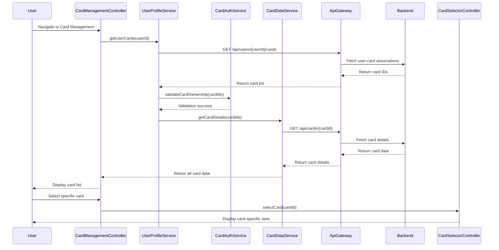

# Low-Level Design: QE-9828 - Multiple Credit Card Management

## a. Architecture Mapping

- **User Interface Card Management** → AngularJS Module: `creditCard.management` + Controller: `CardManagementController`
- **API Gateway** → Service: `ApiGatewayService` (handles all REST API calls)
- **User Profile Service** → Service: `UserProfileService` (fetches user-card associations)
- **Card Authentication System** → Service: `CardAuthService` (validates card ownership)
- **Credit Card Data Repository** → Backend REST API endpoints consumed by `CardDataService`
- **Card Selection Controller** → Controller: `CardSelectorController` (manages card switching state)
- **Card-Specific Analytics** → Service: `CardAnalyticsService` (fetches per-card metrics)

**Recommended Folder Structure:**
```
/app
  /modules
    /creditCard
      /management
        - cardManagement.module.js
        - CardManagementController.js
        - CardSelectorController.js
      /services
        - CardDataService.js
        - CardAuthService.js
        - CardAnalyticsService.js
        - UserProfileService.js
        - ApiGatewayService.js
      /directives
        - cardListDirective.js
        - cardDetailDirective.js
      /views
        - cardManagement.html
        - cardDetail.html
  /common
    /services
      - httpInterceptor.js
```

## b. Component Specifications

| Name | Artifact Type | Responsibility | Key Dependencies |
|------|---------------|----------------|------------------|
| creditCard.management | Module | Root module for card management feature | ngRoute, ngResource |
| CardManagementController | Controller | Orchestrates card list display and user interactions | UserProfileService, CardAuthService, $scope |
| CardSelectorController | Controller | Manages selected card state and switching logic | CardDataService, CardAnalyticsService, $rootScope |
| UserProfileService | Service (Factory) | Retrieves user-card associations from backend | ApiGatewayService, $q |
| CardAuthService | Service (Factory) | Validates card ownership and permissions | ApiGatewayService, $http |
| CardDataService | Service (Factory) | Fetches card details from repository | ApiGatewayService, $http, $cacheFactory |
| CardAnalyticsService | Service (Factory) | Retrieves card-specific spending metrics | ApiGatewayService, $http |
| ApiGatewayService | Service (Factory) | Centralized REST API communication layer | $http, $q, httpInterceptor |
| cardListDirective | Directive | Renders responsive card list UI | CardSelectorController |
| cardDetailDirective | Directive | Displays individual card details and analytics | CardAnalyticsService |

## c. Data Model

**CreditCard Object:**
```javascript
{
  cardId: String,           // Unique card identifier
  userId: String,           // Owner user ID
  cardNumber: String,       // Masked card number (e.g., "**** **** **** 1234")
  cardType: String,         // e.g., "Visa", "MasterCard"
  creditLimit: Number,      // Total credit limit
  availableCredit: Number,  // Available credit
  outstandingBalance: Number, // Current balance
  monthlySpend: Number,     // Current month spend
  cardHolderName: String,   // Name on card
  expiryDate: String,       // MM/YY format
  isActive: Boolean         // Card status
}
```

**CardAnalytics Object:**
```javascript
{
  cardId: String,
  monthlyTrends: Array,     // [{month: String, spend: Number}]
  categoryBreakdown: Object, // {category: amount}
  lastTransactionDate: String,
  averageMonthlySpend: Number
}
```

**UserProfile Object:**
```javascript
{
  userId: String,
  associatedCards: Array    // Array of cardId strings
}
```

## d. Data Flow

User logs in and navigates to card management view → CardManagementController initializes and calls UserProfileService.getUserCards() → UserProfileService invokes ApiGatewayService to fetch user-card associations → CardAuthService validates card ownership → CardDataService retrieves detailed card information for each associated card → Card list rendered via cardListDirective → User selects a card → CardSelectorController updates $rootScope.selectedCard and broadcasts 'cardSelected' event → CardAnalyticsService fetches card-specific metrics → cardDetailDirective displays individual card limits, balances, spending details, and monthly trends → User switches cards by clicking another card, triggering instant UI update via client-side state change with data isolation enforced.

## e. Primary Sequence Diagram



## f. Implementation Notes

- Use AngularJS Dependency Injection for all services and controllers to ensure testability and modularity
- Implement client-side card switching with $rootScope event broadcasting ('cardSelected') for instant UI updates without server round-trips
- Leverage $cacheFactory in CardDataService to cache card details and reduce API calls during repeated card switches
- Use ES6 classes for services and arrow functions for callbacks to maintain lexical scope and cleaner code
- Implement data isolation by filtering card data based on userId at service layer before rendering

## g. Error Handling

HTTP interceptor captures API errors (401, 403, 500) and broadcasts error events; controllers display user-friendly notifications via toast/modal service.

## h. Security Notes

Requires token-based auth via existing SSO; card data filtered by userId server-side to enforce data isolation.