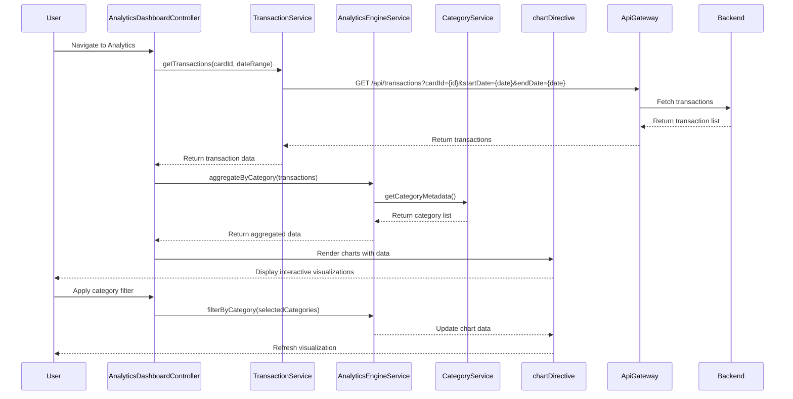

# Low-Level Design: QE-9829 - Transaction Analytics and Category-wise Spending

## a. Architecture Mapping

- **User Interface Analytics Dashboard** → AngularJS Module: `creditCard.analytics` + Controller: `AnalyticsDashboardController`
- **API Gateway** → Service: `ApiGatewayService` (centralized REST API communication)
- **Transaction Processing System** → Backend REST API consumed by `TransactionService`
- **Category Classification Engine** → Backend service; client uses `CategoryService` for category metadata
- **Transaction Data Service** → Service: `TransactionService` (fetches transaction records)
- **Data Visualization Library** → Directive: `chartDirective` (wraps Chart.js or D3.js for rendering)
- **Analytics Engine** → Service: `AnalyticsEngineService` (aggregates and processes transaction data client-side for filtering)

**Recommended Folder Structure:**
```
/app
  /modules
    /creditCard
      /analytics
        - analytics.module.js
        - AnalyticsDashboardController.js
      /services
        - TransactionService.js
        - AnalyticsEngineService.js
        - CategoryService.js
        - ApiGatewayService.js
      /directives
        - chartDirective.js
        - categoryFilterDirective.js
      /views
        - analyticsDashboard.html
```

## b. Component Specifications

| Name | Artifact Type | Responsibility | Key Dependencies |
|------|---------------|----------------|------------------|
| creditCard.analytics | Module | Root module for analytics feature | ngRoute, chart.js |
| AnalyticsDashboardController | Controller | Orchestrates analytics view, filters, and drill-down | TransactionService, AnalyticsEngineService, $scope |
| TransactionService | Service (Factory) | Fetches transaction records from backend | ApiGatewayService, $http, $q |
| AnalyticsEngineService | Service (Factory) | Aggregates transactions by category and time period | CategoryService |
| CategoryService | Service (Factory) | Provides category metadata and mappings | $http |
| chartDirective | Directive | Renders interactive charts (pie, bar, line) using Chart.js | AnalyticsEngineService |
| categoryFilterDirective | Directive | Provides UI controls for filtering by category and date range | AnalyticsDashboardController |
| ApiGatewayService | Service (Factory) | Centralized REST API layer | $http, $q, httpInterceptor |

## c. Data Model

**Transaction Object:**
```javascript
{
  transactionId: String,
  cardId: String,
  amount: Number,
  category: String,         // e.g., "Food & Dining", "Fuel"
  merchantName: String,
  transactionDate: String,  // ISO 8601 format
  description: String
}
```

**CategorySummary Object:**
```javascript
{
  category: String,
  totalSpend: Number,
  transactionCount: Number,
  percentageOfTotal: Number
}
```

**AnalyticsFilter Object:**
```javascript
{
  cardId: String,
  startDate: String,
  endDate: String,
  categories: Array         // Array of category strings
}
```

## d. Data Flow

User navigates to analytics dashboard → AnalyticsDashboardController initializes and calls TransactionService.getTransactions(cardId, dateRange) → TransactionService invokes ApiGatewayService to fetch transaction records from backend → Transactions returned and passed to AnalyticsEngineService.aggregateByCategory() → AnalyticsEngineService groups transactions by predefined categories (Food & Dining, Fuel, Shopping, etc.) and calculates totals → CategoryService provides category metadata for display → Aggregated data passed to chartDirective → chartDirective renders interactive pie chart for category breakdown and line chart for monthly trends → User applies filters via categoryFilterDirective → AnalyticsEngineService re-aggregates filtered data → Charts update dynamically without backend call.

## e. Primary Sequence Diagram



## f. Implementation Notes

- Use Chart.js wrapped in AngularJS directive for responsive, interactive charts; bind chart data to controller scope for automatic updates on filter changes
- Implement client-side aggregation in AnalyticsEngineService using ES6 Array.reduce() for efficient category grouping and sum calculations
- Leverage $http caching for TransactionService to avoid redundant API calls when switching between views
- Use AngularJS $watch on filter model to trigger automatic re-aggregation and chart re-rendering
- Implement lazy loading for transaction history view to handle 1000+ transactions efficiently using virtual scrolling or pagination

## g. Error Handling

HTTP interceptor handles API failures; display error toast if transaction fetch fails; fallback to cached data if available.

## h. Security Notes

Standard input validation and secure API calls assumed; transaction data filtered by authenticated userId server-side.