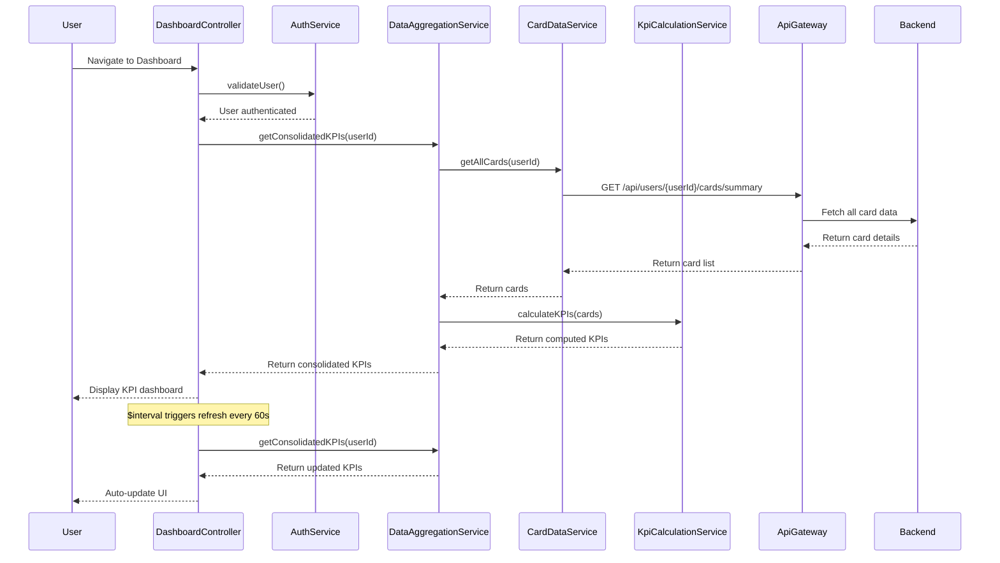

# Low-Level Design: QE-9830 - Dashboard KPIs and Financial Overview

## a. Architecture Mapping

- **User Interface Dashboard** → AngularJS Module: `creditCard.dashboard` + Controller: `DashboardController`
- **API Gateway** → Service: `ApiGatewayService` (centralized REST API layer)
- **Data Aggregation Service** → Service: `DataAggregationService` (consolidates multi-card metrics)
- **User Authentication Service** → Service: `AuthService` (validates user identity)
- **Credit Card Data Source** → Backend REST API consumed by `CardDataService`
- **KPI Calculation Engine** → Service: `KpiCalculationService` (computes monthly spend, limits, available credit, outstanding amounts)

**Recommended Folder Structure:**
```
/app
  /modules
    /creditCard
      /dashboard
        - dashboard.module.js
        - DashboardController.js
      /services
        - DataAggregationService.js
        - KpiCalculationService.js
        - CardDataService.js
        - AuthService.js
        - ApiGatewayService.js
      /directives
        - kpiCardDirective.js
        - creditUtilizationDirective.js
      /views
        - dashboard.html
```

## b. Component Specifications

| Name | Artifact Type | Responsibility | Key Dependencies |
|------|---------------|----------------|------------------|
| creditCard.dashboard | Module | Root module for dashboard feature | ngRoute, ngAnimate |
| DashboardController | Controller | Orchestrates dashboard KPI display and real-time updates | DataAggregationService, AuthService, $scope, $interval |
| DataAggregationService | Service (Factory) | Consolidates metrics across all user credit cards | CardDataService, KpiCalculationService, $q |
| KpiCalculationService | Service (Factory) | Computes monthly spend, total limit, available credit, outstanding amounts | None |
| CardDataService | Service (Factory) | Fetches raw card data from backend | ApiGatewayService, $http |
| AuthService | Service (Factory) | Validates user identity and manages auth tokens | $http, $window |
| kpiCardDirective | Directive | Renders individual KPI metric cards (e.g., Monthly Spend, Credit Limit) | DashboardController |
| creditUtilizationDirective | Directive | Displays credit utilization gauge/progress bar | KpiCalculationService |
| ApiGatewayService | Service (Factory) | Centralized REST API communication | $http, $q, httpInterceptor |

## c. Data Model

**DashboardKPI Object:**
```javascript
{
  userId: String,
  monthlySpend: Number,
  totalCreditLimit: Number,
  availableCredit: Number,
  outstandingAmount: Number,
  creditUtilization: Number,  // Percentage
  lastUpdated: String         // ISO 8601 timestamp
}
```

**CreditCard Object:**
```javascript
{
  cardId: String,
  cardNumber: String,
  creditLimit: Number,
  availableCredit: Number,
  outstandingBalance: Number,
  monthlySpend: Number
}
```

## d. Data Flow

User authenticates and navigates to dashboard → DashboardController initializes and calls AuthService.validateUser() → AuthService confirms authentication → DashboardController invokes DataAggregationService.getConsolidatedKPIs(userId) → DataAggregationService calls CardDataService.getAllCards(userId) → CardDataService fetches all user cards via ApiGatewayService from backend → DataAggregationService passes card data to KpiCalculationService.calculateKPIs(cards) → KpiCalculationService computes total monthly spend (sum of all card monthly spends), total credit limit (sum of all limits), available credit (sum of available across cards), and outstanding amount (sum of balances) → Aggregated KPIs returned to DashboardController → kpiCardDirective renders each KPI metric → $interval triggers periodic refresh every 60 seconds for real-time updates → UI updates automatically via two-way data binding.

## e. Primary Sequence Diagram



## f. Implementation Notes

- Use AngularJS $interval service to poll DataAggregationService every 60 seconds for real-time KPI updates without full page reload
- Implement KpiCalculationService as pure functions using ES6 for testability and reusability across modules
- Leverage AngularJS two-way data binding to automatically update UI when KPI model changes
- Use Bootstrap grid system for responsive dashboard layout; kpiCardDirective uses col-md-3 col-sm-6 for desktop/mobile adaptation
- Implement loading indicators during initial data fetch and refresh cycles to meet 2-second load time NFR

## g. Error Handling

HTTP interceptor captures API errors; DashboardController displays error notification and retries failed requests up to 3 times with exponential backoff.

## h. Security Notes

Requires token-based auth via existing SSO; all API calls include Authorization header with JWT token validated server-side.