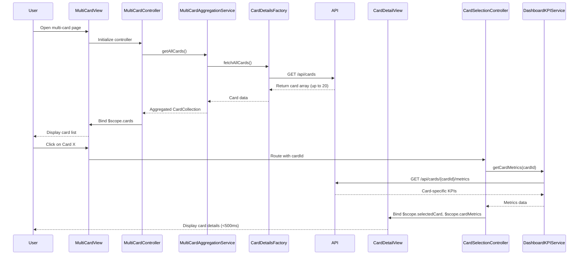

# Low-Level Design: QE-9837 - Multi-Card Management and Visualization

## a. Architecture Mapping

**Component to Artifact Mapping:**
- User Interface → AngularJS Module `creditCardApp.multiCard` with Controller `MultiCardController`
- Card Selection Controller → AngularJS Controller `CardSelectionController` with two-way data binding
- Multi-Card Aggregation Service → AngularJS Service `MultiCardAggregationService` (singleton)
- Card Details Service → AngularJS Factory `CardDetailsFactory` for REST API calls
- Dashboard KPI System → Shared AngularJS Service `DashboardKPIService` (dependency injection)
- Credit Card Data Repository → Backend REST API endpoints consumed via `$http` service

**Recommended Folder Structure:**
```
app/
├── modules/
│   └── multi-card/
│       ├── controllers/
│       │   ├── multi-card.controller.js
│       │   └── card-selection.controller.js
│       ├── services/
│       │   ├── multi-card-aggregation.service.js
│       │   └── card-details.factory.js
│       ├── views/
│       │   ├── multi-card-list.html
│       │   └── card-detail-view.html
│       └── multi-card.module.js
├── shared/
│   └── services/
│       └── dashboard-kpi.service.js
└── assets/
    └── css/
        └── multi-card.css
```

---

## b. Component Specifications

| Component Name | Artifact Type | Responsibility | Key Dependencies |
|----------------|---------------|----------------|------------------|
| `creditCardApp.multiCard` | Module | Root module for multi-card management feature | `ngRoute`, `creditCardApp.shared` |
| `MultiCardController` | Controller | Manages multi-card list view, card selection state, and UI interactions | `MultiCardAggregationService`, `$scope` |
| `CardSelectionController` | Controller | Handles individual card selection, switching logic, and card detail display | `CardDetailsFactory`, `DashboardKPIService`, `$routeParams` |
| `MultiCardAggregationService` | Service | Aggregates and caches data from up to 20 cards, maintains sync state | `CardDetailsFactory`, `$q` for promises |
| `CardDetailsFactory` | Factory | Executes REST API calls to fetch individual card details and metrics | `$http`, `API_CONFIG` constant |
| `DashboardKPIService` | Service (Shared) | Provides card-specific KPI metrics for comparison and analysis | `$http`, `$cacheFactory` |
| `multiCardListView` | HTML Template | Displays all user cards in a responsive grid/list layout | Bootstrap grid, `ng-repeat` |
| `cardDetailView` | HTML Template | Shows detailed information for a selected card with comparison metrics | Bootstrap components, `ng-show`/`ng-hide` |

---

## c. Data Model

**CreditCard (JavaScript Object):**
```javascript
{
  cardId: String,
  cardNumber: String (masked, last 4 digits),
  cardType: String (Visa/MasterCard/Amex),
  cardHolderName: String,
  totalLimit: Number,
  availableCredit: Number,
  outstandingAmount: Number,
  utilizationRate: Number (percentage),
  monthlySpend: Number,
  isActive: Boolean,
  expiryDate: String (MM/YY),
  lastUpdated: Date
}
```

**CardCollection (JavaScript Object):**
```javascript
{
  userId: String,
  cards: Array<CreditCard>,
  totalCards: Number,
  selectedCardId: String,
  lastSyncTimestamp: Date
}
```

---

## d. Data Flow

User opens the multi-card view → `MultiCardController` initializes and calls `MultiCardAggregationService.getAllCards()` → Service checks cache; if stale, invokes `CardDetailsFactory.fetchAllCards()` → Factory executes REST API GET `/api/cards` → API returns card array → Service aggregates, caches, and returns data to Controller → Controller binds `CardCollection` to `$scope.cards` → View renders card list via `ng-repeat` → User clicks a card → `CardSelectionController` is invoked with `cardId` → Controller calls `DashboardKPIService.getCardMetrics(cardId)` → Service fetches card-specific KPIs → Controller updates `$scope.selectedCard` and `$scope.cardMetrics` → View displays detailed card information and comparison metrics with sub-500ms response time.

---

## e. Primary Sequence Diagram



---

## f. Implementation Notes

- Use AngularJS 1.x dependency injection for all services and controllers; register via `.module().service()` and `.controller()` patterns.
- Implement `$cacheFactory` in `MultiCardAggregationService` with TTL of 5 minutes to achieve sub-500ms card switching; cache key: `user_{userId}_cards`.
- Use ES6 arrow functions and `const`/`let` for all new JavaScript code; avoid `var` declarations.
- Integrate REST API calls via `$http` service with interceptors for error handling and authentication token injection.
- Apply Bootstrap responsive grid (`col-xs-*`, `col-md-*`) for card list layout to ensure consistent display across devices.

---

## g. Error Handling

Client-side errors handled via HTTP interceptor (`$httpProvider.interceptors`) with try/catch blocks in controllers; user notifications displayed using Bootstrap alerts or toast service.

---

## h. Security Notes

Requires token-based authentication via existing SSO; all API calls include Authorization header with JWT token; card numbers are masked (last 4 digits only).