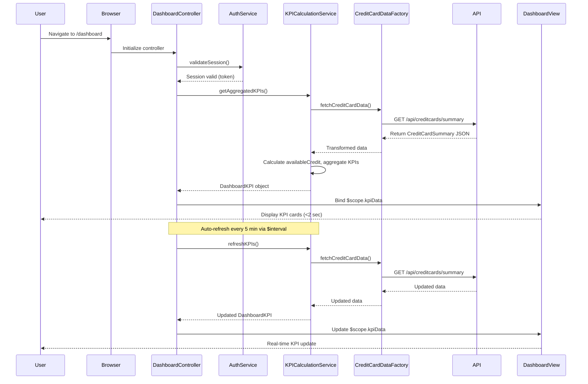

# Low-Level Design: QE-9838 - Credit Card Dashboard and KPI Management

## a. Architecture Mapping

**Component to Artifact Mapping:**
- User Browser → AngularJS SPA entry point via `index.html` and `app.js`
- Dashboard UI Layer → AngularJS Module `creditCardApp.dashboard` with Controller `DashboardController`
- KPI Calculation Service → AngularJS Service `KPICalculationService` (singleton, business logic)
- Credit Card Data Service → AngularJS Factory `CreditCardDataFactory` for REST API integration
- User Authentication Service → AngularJS Service `AuthService` (shared, handles SSO token management)
- Data Store → Backend REST API endpoints consumed via `$http` service

**Recommended Folder Structure:**
```
app/
├── modules/
│   └── dashboard/
│       ├── controllers/
│       │   └── dashboard.controller.js
│       ├── services/
│       │   ├── kpi-calculation.service.js
│       │   └── credit-card-data.factory.js
│       ├── views/
│       │   └── dashboard.html
│       └── dashboard.module.js
├── shared/
│   └── services/
│       └── auth.service.js
└── assets/
    └── css/
        └── dashboard.css
```

---

## b. Component Specifications

| Component Name | Artifact Type | Responsibility | Key Dependencies |
|----------------|---------------|----------------|------------------|
| `creditCardApp.dashboard` | Module | Root module for dashboard feature, handles routing and initialization | `ngRoute`, `creditCardApp.shared` |
| `DashboardController` | Controller | Manages dashboard view state, KPI display, and user interactions | `KPICalculationService`, `AuthService`, `$scope`, `$interval` |
| `KPICalculationService` | Service | Calculates and aggregates KPIs (monthly spend, total limit, available credit, outstanding) | `CreditCardDataFactory`, `$q` for promise handling |
| `CreditCardDataFactory` | Factory | Fetches credit card data from REST API, handles data transformation | `$http`, `API_CONFIG` constant |
| `AuthService` | Service (Shared) | Manages user authentication, SSO token validation, and secure API access | `$http`, `$window` for session storage |
| `dashboardView` | HTML Template | Responsive dashboard layout displaying KPI cards and real-time data | Bootstrap grid system, AngularJS directives |

---

## c. Data Model

**DashboardKPI (JavaScript Object):**
```javascript
{
  monthlySpend: Number,
  totalCreditLimit: Number,
  availableCredit: Number,
  outstandingAmount: Number,
  lastUpdated: Date
}
```

**CreditCardSummary (JavaScript Object):**
```javascript
{
  userId: String,
  totalCards: Number,
  aggregatedKPI: DashboardKPI,
  cardDetails: Array<{
    cardId: String,
    cardType: String,
    limit: Number,
    balance: Number,
    monthlySpend: Number
  }>
}
```

---

## d. Data Flow

User navigates to dashboard URL → AngularJS router loads `DashboardController` → Controller invokes `AuthService.validateSession()` to ensure user is authenticated → Upon success, Controller calls `KPICalculationService.getAggregatedKPIs()` → Service requests data via `CreditCardDataFactory.fetchCreditCardData()` → Factory executes REST API GET `/api/creditcards/summary` → API returns `CreditCardSummary` JSON → Factory transforms and returns data → Service calculates `availableCredit = totalCreditLimit - outstandingAmount` and other KPIs → Service returns `DashboardKPI` object to Controller → Controller binds KPI data to `$scope.kpiData` → View renders KPI cards using Bootstrap responsive layout → `$interval` service polls `KPICalculationService.refreshKPIs()` every 5 minutes for real-time updates → Updated KPIs are bound to view, triggering automatic UI refresh.

---

## e. Primary Sequence Diagram



---

## f. Implementation Notes

- Use AngularJS 1.x module pattern with strict dependency injection (`'ngInject'` annotation or explicit array notation) to avoid minification issues.
- Implement `$interval` service in `DashboardController` to poll `KPICalculationService.refreshKPIs()` every 5 minutes for real-time data refresh; cancel interval on `$scope.$on('$destroy')`.
- Use ES6 template literals for dynamic API endpoint construction; apply `const` for immutable references and `let` for block-scoped variables.
- Integrate Bootstrap 3.x responsive grid (`container-fluid`, `row`, `col-md-3`) for KPI card layout to ensure <2-second load time and mobile responsiveness.
- Apply AngularJS `$http` service with promise-based error handling; chain `.then()` and `.catch()` for asynchronous API calls.

---

## g. Error Handling

HTTP interceptor registered via `$httpProvider.interceptors` for global error handling; Controller-level try/catch with user-friendly error messages displayed via Bootstrap alert components.

---

## h. Security Notes

Requires token-based auth via existing SSO; `AuthService` injects JWT token in Authorization header for all API calls; session timeout handled with automatic redirect to login.