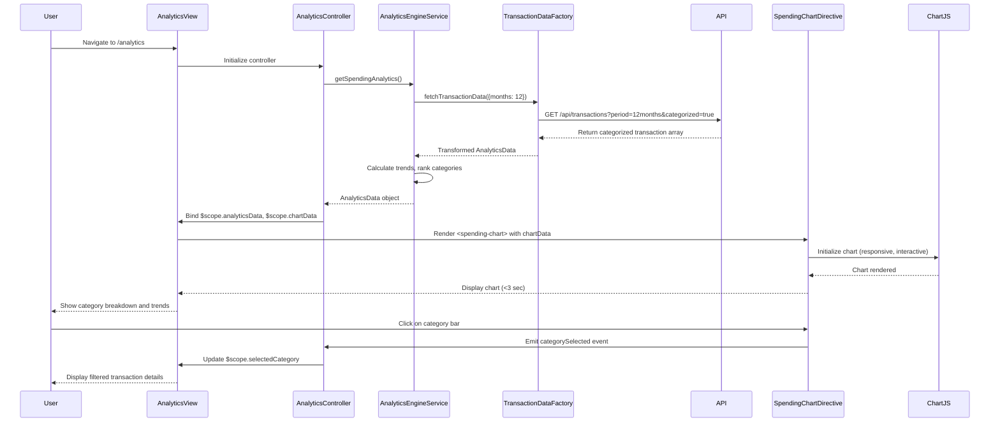

# Low-Level Design: QE-9839 - Spending Analytics and Category Insights

## a. Architecture Mapping

**Component to Artifact Mapping:**
- User Interface → AngularJS Module `creditCardApp.analytics` with Controller `AnalyticsController`
- Visualization Layer → AngularJS Directive `spendingChart` (wraps Chart.js or D3.js for interactive charts)
- Data Analytics Engine → AngularJS Service `AnalyticsEngineService` (performs trend calculations and pattern analysis)
- Transaction Data Service → AngularJS Factory `TransactionDataFactory` for REST API calls
- Dashboard KPI Module → Shared AngularJS Service `DashboardKPIService` (dependency injection)
- Transaction Data Store → Backend REST API endpoints consumed via `$http` service

**Recommended Folder Structure:**
```
app/
├── modules/
│   └── analytics/
│       ├── controllers/
│       │   └── analytics.controller.js
│       ├── services/
│       │   ├── analytics-engine.service.js
│       │   └── transaction-data.factory.js
│       ├── directives/
│       │   └── spending-chart.directive.js
│       ├── views/
│       │   └── analytics.html
│       └── analytics.module.js
├── shared/
│   └── services/
│       └── dashboard-kpi.service.js
└── assets/
    ├── css/
    │   └── analytics.css
    └── libs/
        └── chart.min.js
```

---

## b. Component Specifications

| Component Name | Artifact Type | Responsibility | Key Dependencies |
|----------------|---------------|----------------|------------------|
| `creditCardApp.analytics` | Module | Root module for spending analytics feature | `ngRoute`, `creditCardApp.shared`, `chart.js` |
| `AnalyticsController` | Controller | Manages analytics view state, user interactions, and chart data binding | `AnalyticsEngineService`, `TransactionDataFactory`, `$scope`, `$filter` |
| `AnalyticsEngineService` | Service | Performs trend calculations, pattern identification, and time-based comparisons for 12-month data | `TransactionDataFactory`, `$q` for promises |
| `TransactionDataFactory` | Factory | Fetches categorized transaction data from REST API, handles data transformation | `$http`, `API_CONFIG` constant |
| `DashboardKPIService` | Service (Shared) | Provides consolidated KPI metrics for integration with analytics | `$http`, `$cacheFactory` |
| `spendingChart` | Directive | Renders interactive, responsive charts (category-wise and trend) using Chart.js | `$window` for resize events, Chart.js library |
| `analyticsView` | HTML Template | Displays category breakdown, monthly trends, and interactive charts | Bootstrap grid, custom directive `<spending-chart>` |

---

## c. Data Model

**SpendingCategory (JavaScript Object):**
```javascript
{
  categoryName: String, // Food & Dining, Fuel, Shopping, Travel, Entertainment, Utilities, Healthcare, Education, Miscellaneous
  totalSpend: Number,
  transactionCount: Number,
  percentage: Number // of total monthly spend
}
```

**MonthlyTrend (JavaScript Object):**
```javascript
{
  month: String, // YYYY-MM format
  totalSpend: Number,
  categoryBreakdown: Array<SpendingCategory>
}
```

**AnalyticsData (JavaScript Object):**
```javascript
{
  userId: String,
  currentMonth: MonthlyTrend,
  historicalTrends: Array<MonthlyTrend>, // 12 months
  topCategories: Array<SpendingCategory>, // sorted by totalSpend descending
  lastUpdated: Date
}
```

---

## d. Data Flow

User navigates to analytics page → `AnalyticsController` initializes and calls `AnalyticsEngineService.getSpendingAnalytics()` → Service invokes `TransactionDataFactory.fetchTransactionData({ months: 12 })` → Factory executes REST API GET `/api/transactions?period=12months&categorized=true` → API returns categorized transaction array → Factory transforms data into `AnalyticsData` structure → Service performs trend calculations (month-over-month growth, category ranking) and pattern identification → Service returns `AnalyticsData` to Controller → Controller binds data to `$scope.analyticsData` and prepares chart datasets → View renders category breakdown table and invokes `<spending-chart>` directive with chart data → Directive initializes Chart.js with responsive configuration → User interacts with chart (hover, click) → Directive emits events back to Controller → Controller updates `$scope.selectedCategory` → View displays filtered transaction details for selected category, all within 3-second render time.

---

## e. Primary Sequence Diagram



---

## f. Implementation Notes

- Use AngularJS 1.x custom directive pattern for `spendingChart`; implement `link` function to integrate Chart.js with AngularJS data binding and `$watch` for reactive updates.
- Apply Chart.js responsive configuration (`maintainAspectRatio: true`, `responsive: true`) to ensure charts render correctly on desktop, tablet, and mobile devices.
- Implement `AnalyticsEngineService` with memoization pattern to cache trend calculations for 12-month data; cache key: `user_{userId}_analytics_{month}`.
- Use ES6 array methods (`map`, `filter`, `reduce`) for category aggregation and trend calculations; avoid imperative loops where possible.
- Integrate REST API calls via `$http` service with query parameters for date range filtering; use `$q.all()` for parallel API calls if multiple endpoints are required.

---

## g. Error Handling

Client-side errors handled via HTTP interceptor with try/catch in controllers; chart rendering errors caught in directive's link function with fallback to error message display.

---

## h. Security Notes

Standard input validation and secure API calls assumed; transaction data access controlled via user-scoped API endpoints with JWT token authentication.