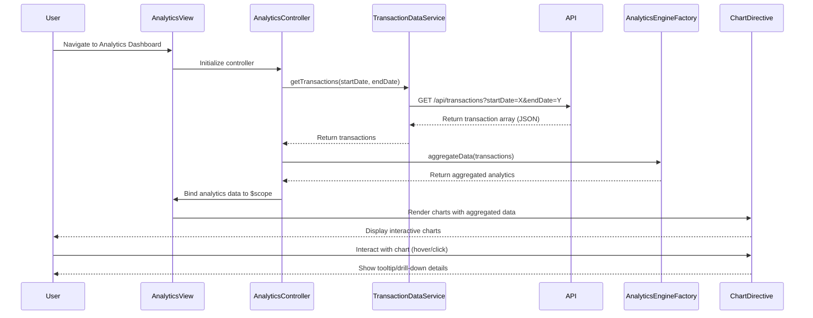

# Low-Level Design: QE-9840 - Spending Analytics and Insights

## a. Architecture Mapping

**HLD Component → AngularJS Artifact Mapping:**

- User Dashboard → AngularJS Module: `analytics.dashboard`
- Analytics UI Component → Controller: `AnalyticsController` + Directive: `spendingChart`
- API Gateway → Service: `ApiGatewayService` (HTTP interceptor)
- Analytics Engine → Factory: `AnalyticsEngineFactory` (data aggregation logic)
- Transaction Data Service → Service: `TransactionDataService` (REST API calls)
- Visualization Library → Directive: `chartDirective` (wraps charting library like Chart.js or D3.js)

**Recommended Folder Structure:**
```
app/
├── modules/
│   └── analytics/
│       ├── controllers/
│       │   └── analytics.controller.js
│       ├── services/
│       │   ├── transaction-data.service.js
│       │   └── api-gateway.service.js
│       ├── factories/
│       │   └── analytics-engine.factory.js
│       ├── directives/
│       │   ├── spending-chart.directive.js
│       │   └── chart.directive.js
│       ├── views/
│       │   └── analytics-dashboard.html
│       └── analytics.module.js
├── shared/
│   └── interceptors/
│       └── http-interceptor.js
└── app.js
```

---

## b. Component Specifications

| Component Name | Artifact Type | Responsibility | Key Dependencies |
|---|---|---|---|
| `analytics.module` | Module | Root module for analytics feature; declares all controllers, services, directives | `ngRoute`, `ngResource`, `chart.js` |
| `AnalyticsController` | Controller | Manages analytics dashboard state, fetches aggregated data, handles user interactions | `TransactionDataService`, `AnalyticsEngineFactory`, `$scope` |
| `TransactionDataService` | Service | Fetches transaction data from REST API; supports 12+ months history retrieval | `$http`, `ApiGatewayService` |
| `AnalyticsEngineFactory` | Factory | Aggregates transactions by month, card, and category; calculates trends and totals | None (pure logic) |
| `spendingChart` | Directive | Renders interactive spending charts (monthly trends, card-wise, category-wise) | `chartDirective`, `AnalyticsEngineFactory` |
| `chartDirective` | Directive | Generic chart wrapper for Chart.js/D3.js; handles responsive rendering | Chart.js library |
| `ApiGatewayService` | Service | Centralized API configuration and token injection | `$http` |
| `httpInterceptor` | Interceptor | Adds auth tokens, handles API errors globally | `$q`, `$injector` |

---

## c. Data Model

**Transaction Model:**
```javascript
{
  transactionId: String,
  cardId: String,
  amount: Number,
  date: Date,
  merchant: String,
  category: String, // One of: 'Food & Dining', 'Fuel', 'Shopping', 'Travel', 'Entertainment', 'Utilities', 'Healthcare', 'Education', 'Miscellaneous'
  description: String
}
```

**Analytics Aggregation Model:**
```javascript
{
  monthlySpend: [
    { month: String, totalSpend: Number } // e.g., { month: '2024-01', totalSpend: 5000 }
  ],
  cardWiseSpend: [
    { cardId: String, cardName: String, totalSpend: Number }
  ],
  categoryWiseSpend: [
    { category: String, totalSpend: Number, percentage: Number }
  ]
}
```

---

## d. Data Flow

User navigates to the Analytics Dashboard → `AnalyticsController` initializes and calls `TransactionDataService.getTransactions()` with date range (12 months) → Service sends GET request to `/api/transactions?startDate=X&endDate=Y` via `ApiGatewayService` → API returns transaction array → `AnalyticsEngineFactory` aggregates data into monthly trends, card-wise totals, and category-wise breakdowns → Aggregated data is bound to `$scope` → `spendingChart` directive watches scope changes and renders interactive charts via `chartDirective` → User interacts with charts (hover, click) triggering directive event handlers that update UI with detailed tooltips or drill-down views.

---

## e. Primary Sequence Diagram



---

## f. Implementation Notes

- Use AngularJS Dependency Injection to inject services and factories into controllers; follow strict DI annotation (`$inject` or array syntax) for minification safety.
- Implement `TransactionDataService` using `$http` with promise-based API; cache responses using `$cacheFactory` for 12-month data to optimize performance.
- `AnalyticsEngineFactory` should use ES6 array methods (`map`, `reduce`, `filter`) for efficient client-side aggregation of up to 1000 transactions/month.
- Wrap Chart.js in a reusable directive (`chartDirective`) with isolated scope and two-way binding for chart config and data; ensure responsive rendering using Chart.js responsive options.
- Use `$httpInterceptor` to inject auth tokens and handle global error responses (401, 500) with user-friendly notifications.

---

## g. Error Handling

HTTP interceptor-based error handling with try/catch blocks in service methods; user notifications via toast/modal for API failures or data aggregation errors.

---

## h. Security Notes

Requires token-based authentication via existing SSO; all API calls include Authorization header with JWT token injected by `ApiGatewayService`.