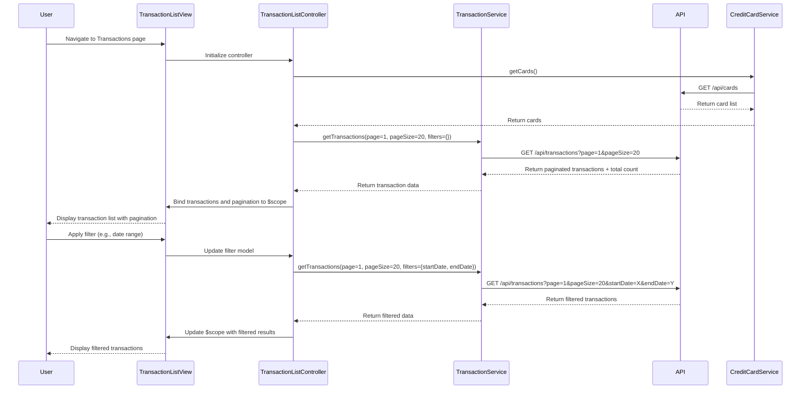

# Low-Level Design: QE-9841 - Transaction Management and Viewing

## a. Architecture Mapping

**HLD Component → AngularJS Artifact Mapping:**

- User Interface → AngularJS Module: `transaction.management`
- Authentication Service → Service: `AuthService` (token management and validation)
- API Gateway → Service: `ApiGatewayService` (centralized API calls)
- Transaction Service → Service: `TransactionService` (transaction CRUD operations)
- Credit Card Service → Service: `CreditCardService` (card metadata retrieval)
- Transaction Database → External REST API endpoints

**Recommended Folder Structure:**
```
app/
├── modules/
│   └── transactions/
│       ├── controllers/
│       │   ├── transaction-list.controller.js
│       │   └── transaction-detail.controller.js
│       ├── services/
│       │   ├── transaction.service.js
│       │   ├── credit-card.service.js
│       │   ├── auth.service.js
│       │   └── api-gateway.service.js
│       ├── directives/
│       │   ├── transaction-filter.directive.js
│       │   └── transaction-search.directive.js
│       ├── views/
│       │   ├── transaction-list.html
│       │   └── transaction-detail.html
│       └── transactions.module.js
├── shared/
│   └── components/
│       └── pagination.component.js
└── app.js
```

---

## b. Component Specifications

| Component Name | Artifact Type | Responsibility | Key Dependencies |
|---|---|---|---|
| `transaction.management` | Module | Root module for transaction features; declares controllers, services, directives | `ngRoute`, `ngResource`, `ui.bootstrap` |
| `TransactionListController` | Controller | Manages transaction list view, pagination, search/filter state, and multi-card aggregation | `TransactionService`, `CreditCardService`, `$scope`, `$routeParams` |
| `TransactionDetailController` | Controller | Displays detailed view of a single transaction with full metadata | `TransactionService`, `$scope`, `$routeParams` |
| `TransactionService` | Service | Fetches, searches, and filters transactions via REST API; handles pagination logic | `$http`, `ApiGatewayService` |
| `CreditCardService` | Service | Retrieves credit card metadata to link transactions to specific cards | `$http`, `ApiGatewayService` |
| `AuthService` | Service | Manages user authentication tokens and session validation | `$http`, `$window` (localStorage) |
| `ApiGatewayService` | Service | Centralized API endpoint configuration and request/response handling | `$http` |
| `transactionFilter` | Directive | Provides UI controls for filtering transactions by date, amount, category, card | None (isolated scope) |
| `transactionSearch` | Directive | Provides search input with debounce for merchant/description search | `$timeout` |
| `paginationComponent` | Component | Reusable pagination control for transaction list | None (bindings for page, pageSize, totalItems) |

---

## c. Data Model

**Transaction Model:**
```javascript
{
  transactionId: String,
  cardId: String,
  cardName: String,
  amount: Number,
  date: Date,
  merchant: String,
  category: String,
  description: String,
  status: String // e.g., 'Posted', 'Pending'
}
```

**Pagination Model:**
```javascript
{
  currentPage: Number,
  pageSize: Number, // Default: 20
  totalItems: Number,
  totalPages: Number
}
```

**Filter Model:**
```javascript
{
  startDate: Date,
  endDate: Date,
  minAmount: Number,
  maxAmount: Number,
  category: String,
  cardId: String,
  searchTerm: String
}
```

---

## d. Data Flow

User navigates to Transaction List view → `TransactionListController` initializes and calls `TransactionService.getTransactions()` with pagination params (page=1, pageSize=20) and optional filters → Service sends GET request to `/api/transactions?page=1&pageSize=20&filters=...` via `ApiGatewayService` → API returns paginated transaction array with total count → Controller binds data to `$scope.transactions` and pagination metadata → View renders transaction list with `ng-repeat` and pagination controls → User applies filters or search via directives → Directives emit events or update controller scope → Controller re-calls `TransactionService.getTransactions()` with updated params → Updated results are rendered → User clicks transaction row → Controller navigates to detail view via `$location.path('/transactions/:id')` → `TransactionDetailController` fetches single transaction via `TransactionService.getTransactionById(id)` and displays full details.

---

## e. Primary Sequence Diagram



---

## f. Implementation Notes

- Use AngularJS `$http` service with promise chaining for all API calls; implement pagination server-side with query params (page, pageSize) to handle large datasets efficiently.
- Implement debounce (300ms) on search input using `$timeout` to minimize API calls during typing; cancel pending requests using `$http` cancellation tokens.
- Store filter and pagination state in controller scope and sync with URL query params using `$location.search()` for bookmarkable/shareable URLs.
- Use `ng-repeat` with `track by transactionId` for optimal rendering performance; implement virtual scrolling or lazy loading if transaction count exceeds 100 per page.
- Inject `AuthService` token into all API requests via `ApiGatewayService` interceptor; handle 401 responses by redirecting to login.

---

## g. Error Handling

Interceptor-based error handling with try/catch in service methods; display user-friendly error messages via toast notifications for API failures or network errors.

---

## h. Security Notes

Requires token-based auth via existing SSO; all API calls include Authorization header with JWT token managed by `AuthService`.