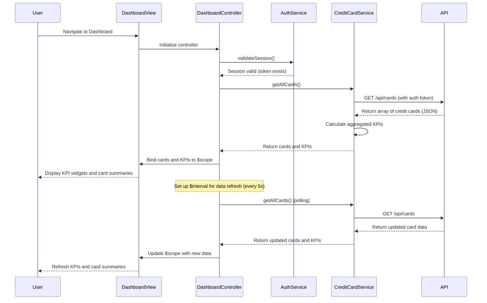

# Low-Level Design: QE-9842 - Credit Card Management and Dashboard KPIs

## a. Architecture Mapping

**HLD Component → AngularJS Artifact Mapping:**

- User Web/Mobile Client → AngularJS Module: `dashboard.creditcard`
- Dashboard UI Component → Controller: `DashboardController` + View: `dashboard.html`
- Authentication Service → Service: `AuthService` (session and token management)
- API Gateway → Service: `ApiGatewayService` (centralized REST API calls)
- Credit Card Data Service → Service: `CreditCardService` (card data retrieval and KPI calculation)
- Database → External REST API endpoints

**Recommended Folder Structure:**
```
app/
├── modules/
│   └── dashboard/
│       ├── controllers/
│       │   └── dashboard.controller.js
│       ├── services/
│       │   ├── credit-card.service.js
│       │   ├── auth.service.js
│       │   └── api-gateway.service.js
│       ├── directives/
│       │   ├── card-summary.directive.js
│       │   └── kpi-widget.directive.js
│       ├── views/
│       │   └── dashboard.html
│       └── dashboard.module.js
├── shared/
│   └── interceptors/
│       └── http-interceptor.js
└── app.js
```

---

## b. Component Specifications

| Component Name | Artifact Type | Responsibility | Key Dependencies |
|---|---|---|---|
| `dashboard.creditcard` | Module | Root module for dashboard feature; declares controllers, services, directives | `ngRoute`, `ngResource` |
| `DashboardController` | Controller | Manages dashboard state, fetches credit card data, calculates KPIs, handles data refresh | `CreditCardService`, `AuthService`, `$scope`, `$interval` |
| `CreditCardService` | Service | Fetches credit card details, balances, limits, and spend data from REST API | `$http`, `ApiGatewayService` |
| `AuthService` | Service | Manages user authentication, token storage, and session validation | `$http`, `$window` (localStorage) |
| `ApiGatewayService` | Service | Centralized API configuration, request/response handling, and error interception | `$http` |
| `cardSummary` | Directive | Renders individual credit card summary tile with card name, limit, balance, and available credit | None (isolated scope with card data binding) |
| `kpiWidget` | Directive | Displays KPI metric (monthly spend, total limit, available credit, outstanding) with icon and value | None (isolated scope with KPI data binding) |
| `httpInterceptor` | Interceptor | Injects auth tokens into requests and handles global API errors | `$q`, `$injector` |

---

## c. Data Model

**Credit Card Model:**
```javascript
{
  cardId: String,
  cardName: String,
  cardNumber: String, // Masked, e.g., '**** **** **** 1234'
  cardType: String, // e.g., 'Visa', 'MasterCard'
  creditLimit: Number,
  availableCredit: Number,
  outstandingAmount: Number,
  monthlySpend: Number,
  dueDate: Date,
  status: String // e.g., 'Active', 'Blocked'
}
```

**Dashboard KPI Model:**
```javascript
{
  totalMonthlySpend: Number,
  totalCreditLimit: Number,
  totalAvailableCredit: Number,
  totalOutstanding: Number
}
```

---

## d. Data Flow

User navigates to Dashboard → `DashboardController` initializes and calls `AuthService.validateSession()` → If valid, controller calls `CreditCardService.getAllCards()` → Service sends GET request to `/api/cards` via `ApiGatewayService` → API returns array of credit card objects (up to 10 cards) → Service calculates aggregated KPIs (sum of monthly spend, total limit, available credit, outstanding) → Controller binds card array and KPI object to `$scope` → View renders KPI widgets using `kpiWidget` directive and card list using `ng-repeat` with `cardSummary` directive → Controller sets up `$interval` (every 5 seconds) to poll `CreditCardService.getAllCards()` for near real-time data refresh → On data update, `$scope` is updated and view re-renders automatically via AngularJS digest cycle.

---

## e. Primary Sequence Diagram



---

## f. Implementation Notes

- Use AngularJS Dependency Injection with strict annotation (`$inject` or array syntax) for all controllers and services to ensure minification safety.
- Implement `CreditCardService.getAllCards()` using `$http.get()` with promise-based response handling; cache responses using `$cacheFactory` with TTL of 5 seconds to optimize polling.
- Use `$interval` service (not `setInterval`) for data refresh to integrate with AngularJS digest cycle; cancel interval on controller destroy using `$scope.$on('$destroy', ...)` to prevent memory leaks.
- Implement `cardSummary` and `kpiWidget` as isolated-scope directives with one-way bindings (`<` or `@`) for card/KPI data; use Bootstrap grid for responsive layout (col-md-3 for KPIs, col-md-4 for cards).
- Use `$httpInterceptor` to inject Authorization header with JWT token from `AuthService.getToken()` and handle 401/403 responses by redirecting to login.

---

## g. Error Handling

HTTP interceptor-based error handling with try/catch in service methods; display user-friendly error messages via toast notifications for API failures or session expiration.

---

## h. Security Notes

Requires token-based authentication via existing SSO; all API calls include Authorization header with JWT token managed by `AuthService` and stored securely in localStorage.