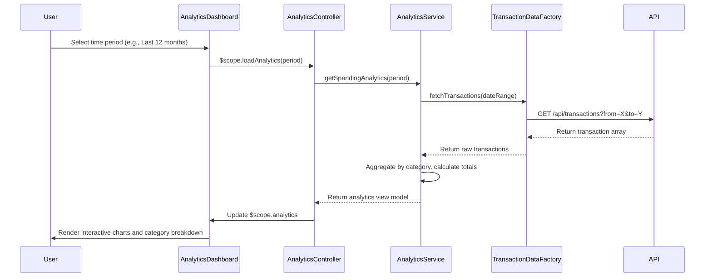

# Low-Level Design: QE-9885 - Spending Analytics and Category Insights

## a. Architecture Mapping

**Component to Artifact Mapping:**
- Analytics Dashboard UI → AngularJS Module (`app.analytics`) + Controller (`AnalyticsController`)
- Visualization Engine → Directive (`spendingChart`) wrapping charting library (e.g., Chart.js/D3.js)
- Analytics Service → AngularJS Service (`AnalyticsService`) for data aggregation and transformation
- Transaction Data Service → AngularJS Factory (`TransactionDataFactory`) for API communication
- Categorized Transaction Database → REST API endpoint integration

**Recommended Folder Structure:**
```
app/
├── modules/
│   └── analytics/
│       ├── analytics.module.js
│       ├── controllers/
│       │   └── analytics.controller.js
│       ├── services/
│       │   └── analytics.service.js
│       ├── directives/
│       │   └── spending-chart.directive.js
│       ├── factories/
│       │   └── transaction-data.factory.js
│       └── views/
│           └── analytics-dashboard.html
├── models/
│   └── transaction.model.js
└── assets/
    ├── css/
    └── js/
```

## b. Component Specifications

| Component Name | Artifact Type | Responsibility | Key Dependencies |
|----------------|---------------|----------------|------------------|
| AnalyticsModule | Module | Register analytics feature module and dependencies | angular, app.core, chart.js |
| AnalyticsController | Controller | Manage analytics dashboard state, user interactions, and view model | $scope, AnalyticsService, $filter |
| AnalyticsService | Service | Aggregate transaction data, calculate category totals, format for visualization | TransactionDataFactory, $q |
| TransactionDataFactory | Factory | Fetch categorized transaction history from REST API | $http, API_CONFIG |
| SpendingChartDirective | Directive | Render interactive category-wise spending charts | Chart.js/D3.js library |
| TransactionModel | Model | Define transaction data structure with category mapping | None |

## c. Data Model

**Transaction Model:**
```javascript
{
  id: String,
  cardId: String,
  amount: Number,
  category: String, // One of: 'Food & Dining', 'Fuel', 'Shopping', 'Travel', 'Entertainment', 'Utilities', 'Healthcare', 'Education', 'Miscellaneous'
  date: Date,
  description: String,
  merchant: String
}
```

**Category Summary Model:**
```javascript
{
  category: String,
  totalSpend: Number,
  transactionCount: Number,
  percentage: Number
}
```

**Analytics View Model:**
```javascript
{
  monthlyTrends: Array<{month: String, totalSpend: Number}>,
  categoryBreakdown: Array<CategorySummary>,
  selectedPeriod: String, // 'last30days', 'last3months', 'last12months'
  totalSpend: Number
}
```

## d. Data Flow

User selects analytics period on Analytics Dashboard UI → AnalyticsController captures selection and invokes AnalyticsService.getSpendingAnalytics(period) → AnalyticsService calls TransactionDataFactory.fetchTransactions(dateRange) → Factory executes HTTP GET to /api/transactions?from=X&to=Y → API returns categorized transaction array → Service aggregates by category, calculates totals and percentages → Service returns formatted analytics data → Controller updates $scope.analytics → SpendingChartDirective watches data change and re-renders interactive chart → User views updated visualization with category breakdown and monthly trends.

## e. Primary Sequence Diagram



## f. Implementation Notes

- Use AngularJS Dependency Injection to inject AnalyticsService and TransactionDataFactory into AnalyticsController for testability and modularity.
- Implement custom directive `spendingChart` with isolated scope binding chart data via `scope: { data: '=' }` to encapsulate Chart.js rendering logic.
- Use ES6 classes for Service and Factory with `$inject` annotation for minification safety: `AnalyticsService.$inject = ['TransactionDataFactory', '$q'];`
- Leverage AngularJS `$http` interceptor for adding authentication tokens and global error handling on API calls.
- Use `$filter('date')` and `$filter('currency')` for consistent date and currency formatting across analytics views.

## g. Error Handling

HTTP interceptor captures API errors; TransactionDataFactory rejects promise with error message; AnalyticsController displays user-friendly notification via toast/alert service.

## h. Security Notes

Requires token-based auth via existing SSO; transaction API endpoints validate user session and return only user-owned transaction data.